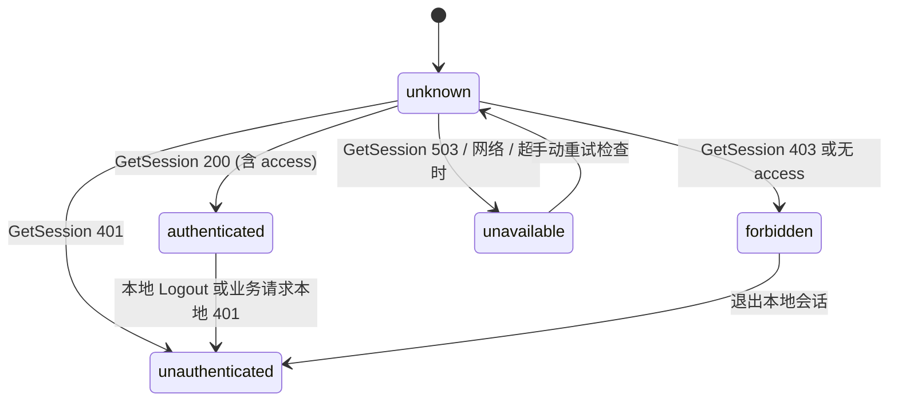

# Admin Web 技术设计

需求：[本任务 PRD](prd.md) · [父任务 PRD](../10-04-admin-v1/prd.md) · [Admin 后端设计](../archive/2026-11/10-18-admin-v1-backend/design.md) · [IAM 归档设计](../archive/2026-11/10-18-admin-v1-iam/design.md)。

---

## 1. 工程定位、端口代理与目录结构

`app/admin/web` 是面向平台唯一管理员的浏览器工作台，基于 Vben 5 Ant Design Vue（`apps/web-antd`）构建，仅通过同源 `/v1/admin/*` HTTP JSON 与 OIDC 浏览器跳转入口消费 `app/admin/service`。

- **端口与同源代理**：
  - 本地开发（`just web::admin::dev`）与生产预览（`vite preview`）固定使用 `10012` 端口（`strictPort: true`）。
  - `apps/web-antd/vite.config.ts` 移除模板 `/api -> localhost:5320` Mock 代理与 `rewrite`，仅将 `/v1` 原样代理至 `${VITE_ADMIN_BACKEND_ORIGIN || 'http://127.0.0.1:10010'}`（`changeOrigin: true`），并配置 `resolve.dedupe: ['@servora/proto-utils']`。
  - 浏览器请求始终发往当前站点同源 `/v1/admin/...`，`Origin` 与 `Sec-Fetch-Site: same-origin` 满足后端 `security/session.NewFilter`（`PublicOrigin: http://localhost:10012`、`JSONPrefixes: ["/v1/admin/"]`）的同源防护与 SCS Cookie 装载要求。
- **瘦身后目录结构**：
  ```text
  app/admin/web/
  ├── apps/web-antd/                     # 唯一保留应用 (@vben/web-antd)
  │   ├── .env / .env.development / .env.production
  │   ├── vite.config.ts
  │   └── src/
  │       ├── adapter/                   # Vben Form (Zod) + VxeTable 适配器
  │       ├── api/
  │       │   ├── client.ts              # createHttpClient({ service: 'admin', retry: 0 }) + createTransport
  │       │   ├── errors.ts              # ApiError / KratosError 分类与受控中文映射
  │       │   └── index.ts
  │       ├── layouts/{auth,basic}.vue   # 精简登录壳层与主工作台壳层
  │       ├── router/
  │       │   ├── {access,guard,index}.ts
  │       │   └── routes/
  │       │       ├── core.ts            # '/' -> '/overview', '/auth/login', fallback
  │       │       └── modules/{overview,users}.ts
  │       ├── store/auth.ts              # 内存会话状态机、权限集合与独立本地退出
  │       └── views/
  │           ├── _core/authentication/login.vue
  │           ├── _core/fallback/{forbidden,not-found,service-unavailable}.vue
  │           ├── overview/index.vue
  │           └── users/
  │               ├── index.vue          # 单路由双视图（正常用户 / 回收站）+ 游标分页栏
  │               ├── schemas.ts         # 列、查询栏、资料/创建/设密表单 Schema 与纯函数构造器
  │               └── components/
  │                   ├── create-user-modal.vue
  │                   ├── expunge-user-modal.vue
  │                   ├── set-password-modal.vue
  │                   └── user-detail-drawer.vue
  ├── internal/                          # Vben 构建/tsconfig/lint 配置（移除 nitro-mock）
  ├── packages/                          # @core/*、constants、effects/{access,common-ui,hooks,layouts,plugins}、icons、locales、preferences、stores、styles(antd+global)、types、utils
  ├── scripts/                           # clean、turbo-run、vsh、deploy
  ├── justfile
  ├── package.json
  └── pnpm-workspace.yaml
  ```

---

## 2. 跨仓传输契约统一与 `@plateau/client` 迭代设计（E1、E2）

### 2.1 `@servora/proto-utils/transport` 单一事实源（`../servora`）

消除 `protoc-gen-typescript-http` 在每个生成 `index.ts` 内联 38 行传输模板以及 `@plateau/client` 手写同构类型：

1. **新增 `servora/web/packages/proto-utils/src/transport.ts`**（删除空置 `src/client/.gitkeep`）：
   - 导出 `TransportMeta`、`ClientTransport`、`ServerStream<T>`、`DuplexStream<TIn, TOut>` 类型及 `encodePathSegment`、`encodeMultiSegmentPath` 纯函数（保持 RFC 3986 `[!'()*]` 大写百分号编码不变）；
   - `servora/web/packages/proto-utils/package.json` 的 `exports` 增加 `"./transport": { "types": "./dist/transport.d.ts", "import": "./dist/transport.js" }`，补充路径编码单测。
2. **改造 `servora/cmd/protoc-gen-typescript-http`（`transportgen.go` / `packagegen.go`）**：
   - 移除内联接口与编码函数生成逻辑；
   - 按生成文件实际内容按需导入：无 `service` 的消息/枚举文件零导入；含 `service` 时导入 `type ClientTransport`（含流式方法时追加 `type ServerStream` / `type DuplexStream`），仅含路径模板变量的方法才导入 `encodePathSegment` / `encodeMultiSegmentPath`；
   - 重装本地插件并刷新 `servora`（`just gen-ts`）与 `plateau`（`just api-ts`）生成产物。

### 2.2 `@plateau/client` 演进与无请求体写方法 `Content-Type` 对齐

源码核查发现：`security/session/filter.go`（`jsonWriteGuard`）要求 `/v1/admin/` 下所有非安全方法（`POST`、`PATCH`、`PUT`、`DELETE`）必须携带 `Content-Type: application/json`，否则在装载会话前返回 `415 UNSUPPORTED_MEDIA_TYPE`；而 `UserService/DeleteUser`（`DELETE /v1/admin/{name=users/*}`）无请求体（`body = null`），当前 `createTransport` 仅在 `body !== null` 时设置 `content-type`，且 `http-client.ts` 在 `overrides.body === null` 时主动删除 `content-type`，会导致浏览器软删除请求触发 `415`。

在不放松后端跨站简单请求防护（无 body 的 `POST` 同样需非简单头触发预检）的前提下，统一在 `@plateau/client` 对齐：
1. `web/packages/client/src/types.ts` 直接重导出 `@servora/proto-utils/transport` 的传输契约类型，仅保留 `StreamClient`；`createTransport` 显式实现 `ClientTransport`。
2. `web/packages/client/src/index.ts`（`createTransport`）：unary 调用当 `body !== null` **或**方法非 `GET`/`HEAD`/`OPTIONS` 时，统一设置 `headers.set('content-type', 'application/json')`。
3. `web/packages/client/src/http-client.ts`：仅在安全方法且 `overrides.body === null`、调用方未显式传入 `content-type` 时移除继承的 `content-type`；向底层 `ofetch` 传参时将 `body: null` 转为 `undefined`，并在 `test/http.test.ts` 覆盖无体 `DELETE` / `GET` 请求头契约。

### 2.3 `apps/web-antd` API 组合根与工作区链接拓扑

1. **跨工作区链接**：
   - 父级 `../pnpm-workspace.yaml` 补入 `- "!plateau/app/admin/web"`，与 `plateau/pnpm-workspace.yaml` 保持一致；
   - `apps/web-antd/package.json` 通过 `link:` 挂载 `@plateau/api`（`link:../../../../api/gen`）、`@plateau/client`（`link:../../../../web/packages/client`）及本地联调期的 `@servora/proto-utils`（需先构建 `dist/`），并在 `internal/lint-configs/eslint-config/src/configs/pnpm.ts` 对跨仓 `link:` 放行；
   - `apps/web-antd/tsconfig.json` 开启 `"allowImportingTsExtensions": true`，兼容 `link:` 源码包内 `.ts` 后缀导入。
2. **集中式客户端装配（`src/api/client.ts`）**：
   - `adminHttpClient = createHttpClient({ service: 'admin', baseURL: '/', credentials: 'same-origin', retry: 0, timeout: 10_000 })`（显式 `retry: 0` 禁绝读写自动重试）；
   - `createAdminApi(signal?: AbortSignal)` 组装 `createAuthServiceClient` 与 `createUserServiceClient`；
   - `buildOidcLoginUrl(returnTo?: string)` 校验单 `/` 开头且非 `//`、非 `/auth/` 的站内相对路径（默认 `/overview`），拼装 `/v1/admin/auth/login?return_to=...`。

---

## 3. Vben 工程瘦身与 `package.json` 最小化（E3、E4）

- **工程与插件瘦身**：
  - 删除 `apps/{web-ele,web-naive,web-tdesign,web-antdv-next,backend-mock}`、`docs`、`playground`、`.changeset`、`packages/effects/request`；
  - 删除 `packages/effects/plugins/src/{echarts,tiptap}`，`@vben/plugins` 仅保留 `./vxe-table` 与 `./motion`；
  - 删除 `packages/styles/src/{ele,naive,antdv-next}`，`@vben/styles` 仅保留 `.`、`./antd`、`./global`；
  - 删除 `internal/vite-config/src/plugins/nitro-mock.ts` 及 `nitropack` 依赖；
  - 清理 `app/admin/web/pnpm-workspace.yaml` 全部未使用 `catalog:` 项（如 `element-plus`、`naive-ui`、`tdesign-vue-next`、`antdv-next`、`axios*`、`echarts`、`@tiptap/*`、`nitropack`、`h3`、`@faker-js/faker`、`vitepress*`、`@changesets/*`），确保 `eslint-plugin-pnpm` 与 `vsh check-dep`（`knip`）零报错。
- **`package.json` 最小化**：
  - 公开包 `@servora/proto-utils` 完整保留 npm 发布字段；
  - `plateau` 与 `app/admin/web` 内所有私有包统一保留最小运行字段（`name`、`private: true`、`type`、有效 `exports`/`imports`/`sideEffects`、在用 `scripts` 与依赖项），剔除 `author`、`homepage`、`bugs`、`repository`、`keywords`、`publishConfig` 及失效脚本；`app/admin/web/justfile` 收敛 `dev`/`build` 至 `@vben/web-antd` 并补齐 `check`。

---

## 4. 认证握手、会话状态机、路由守卫与壳层裁剪（W1、W2）

### 4.1 内存会话状态机（`src/store/auth.ts`）

移除模板持久化 `accessToken`，在内存中维护 `sessionStatus`、`currentUser: iamuserv1_User | null`、`permissions: ReadonlySet<string>`：



- **单飞探针 `ensureSession()`**：并发守卫共享同一 `GetSession` 请求；`200` 且含 `'access'` 时同步填充 `userStore`（显示名、只读邮箱、`picture` 头像）与 `accessStore.accessCodes`；`401` 置 `unauthenticated`；`403` 置 `forbidden`；`503`/网络/超时置 `unavailable` 且不动本地 Cookie。
- **独立退出 `logout()`**：调用 `POST /v1/admin/auth/logout` 销毁本地 SCS 会话、执行 `resetAllStores()` 并 `router.replace('/auth/login')`；不触碰 IAM 会话端点，且前端不轮询 IAM 状态，IAM 单独退出不清除仍有效的 Admin 会话（`AC-W1`）。

### 4.2 登录页、路由守卫与壳层裁剪

- **登录页 `/auth/login`**：移除账密表单、验证码/扫码/注册/忘记密码及演示下拉；仅展示「使用 Plateau IAM 登录」主按钮，并解析后端回调查询参数 `?error=`：
  - `access_denied` → 警告提示“当前 IAM 账号未获授平台管理员访问权限，请切换 IAM 登录身份后再试”；
  - `service_unavailable` → 错误提示“认证服务或权限引擎暂时不可用，请稍后重试”；
  - `login_failed` → 提示“登录握手已过期或未完成，请重新发起登录”。
- **路由守卫（`router/guard.ts`）**：访问 `/auth/login?error=...` 直接渲染提示避免死循环；访问受保护路由按 `sessionStatus` 分流：`unauthenticated` 跳 `/auth/login?redirect=...`，`forbidden` 渲染无权限页（附退出/回登录页入口），`unavailable` 渲染服务不可用页（附重试按钮，不跳登录页）。
- **菜单与壳层清理**：`accessMode: 'frontend'`，`defaultHomePath: '/overview'`，仅保留 **「总览」（`/overview`）** 与 **「用户管理」（`/users`）** 两个一级菜单；移除 `basic.vue` 假通知、本地锁屏、个人中心、外链菜单项，移除 `preferences.ts` 的 `preferencesExtension`（含 `tenantMode`），右上角下拉仅展示当前管理员真实信息与「退出登录」。

---

## 5. 页面设计与全生命周期操作合同（W2、W3、W4、W5）

### 5.1 轻量总览页（`/overview`）

展示当前管理员真实身份卡片（显示名、`email`、`userId`、状态徽标与实时持有的 `access` / `manage_users` / `expunge_users` 权限标签）及直达「用户管理」、「创建新用户」（`?action=create`）、「已删除用户（回收站）」（`?view=deleted`）的快捷入口卡片，无任何虚构图表或统计指标。

### 5.2 `/users` 单路由双视图、筛选排序与游标分页

1. **双视图切换**：顶部 `Segmented` 切换 **「正常用户」**（`showDeleted: false`）与 **「已删除用户（回收站）」**（`showDeleted: true` + 固定过滤 `{ field: 'delete_time', operator: '!=', value: null }`，顶部常驻提示“已软删除账号无限期保留且继续占用原邮箱，无自动清理倒计时”）。
2. **类型安全查询构造**：基于 `@servora/proto-utils/crud` 的 `buildFilter` / `buildOrderBy` 与 `@plateau/api/iam/user/v1.crud` 的 `UserFields`：
   - 正常视图：`email`（`filterContains`）、`status`（`rawFilterValue`：`PENDING_EMAIL_VERIFICATION` / `ACTIVE` / `DISABLED`）、`user_id`（精确匹配）、排序（`create_time desc/asc`、`update_time desc/asc`）；
   - 回收站视图：`email`（`filterContains`）、`user_id`（精确匹配）、排序（默认 `delete_time desc`，可选 `delete_time asc`、`create_time desc`）。
3. **游标分页栏**：禁用 `VxeGrid` 页码直跳分页器，底部自定义游标工具栏维护 `cursorStack: string[]`、`currentPageIndex`、`nextPageToken`、`pageSize`（`10/20/50`）与 `totalSize`（`includeTotal: true`）；支持「首页 / 上一页 / 下一页」，变更筛选或视图时重置栈并取消在途请求；删除/恢复导致当前尾页为空且 `currentPageIndex > 0` 时自动回退上一页游标。

### 5.3 行操作权限与自我保护规则

- **正常用户行操作**：详情/编辑抽屉；`manage_users` 下开放：补发验证信（仅 `PENDING_EMAIL_VERIFICATION`）、设置密码、强制登出 IAM、封禁（非 `DISABLED` 且非本人）/ 解禁（仅 `DISABLED`）、软删除（非本人）。
- **回收站行操作**：查看只读详情抽屉；`manage_users` 下开放：恢复账号；`expunge_users` 下开放：永久删除（非本人；无 `expunge_users` 时按钮禁用并说明所需权限）。
- **自我保护**：当 `row.userId === authStore.currentUser?.userId` 时，封禁、软删除、永久删除按钮前端置灰禁用并带 Tooltip 说明；同级管理员保护由后端 `TARGET_IS_ADMIN` 拦截并清晰提示。

### 5.4 抽屉与弹窗交互规则

1. **详情与 7 字段编辑抽屉（`user-detail-drawer.vue`）**：
   - 打开时调 `GetUser` 获取最新记录与 `etag`；只读区展示 `name`、`userId`、`email`（只读）、`status`、`emailVerified`/`emailVerifiedTime`、`requiredActions`（含 `UPDATE_PASSWORD` 标明“待首次改密”）、`createTime`、`updateTime`、`deleteTime`（绝不渲染 `purgeTime` 或清理倒计时）；
   - 正常态且具 `manage_users` 时展示 `useVbenForm` 编辑 7 个白名单字段（`profile.name`、`givenName`、`familyName`、`nickname`、`preferredUsername`、`picture` 纯 URL 文本输入、`locale`）；对比初始值仅提取变更键，以 `makeUpdateMask(UserUpdateFields, changed)` + 最新 `etag` 调 `UpdateUser`；若编辑管理员本人则同步刷新顶栏信息；遇 `409 ETAG_MISMATCH` 自动重拉最新快照提示重试。
2. **创建用户弹窗（`create-user-modal.vue`，`AC-W4`）**：
   - 字段：必填 `email`、初始 `password`（8–128 位），选填 `profile.name`/`nickname`，`requirePasswordChange` 复选框**默认勾选 `true`**，提交时始终显式传入布尔值 `Boolean(values.requirePasswordChange)`（取消勾选传 `false`）；
   - 结果分流：① 请求报错时保留弹窗供修正；② `verificationEmailSent === true` 关闭弹窗刷新列表提示成功；③ `verificationEmailSent === false` **立即关闭创建弹窗防重复提交**，刷新列表并弹出醒目警告结果框展示已创建的 `email`/`userId`、“账号已创建但验证邮件发送失败，请勿重复创建”及一键「立即补发验证邮件」按钮。
3. **补发验证邮件**：调 `SendUserVerificationEmail`，`503 VERIFICATION_EMAIL_FAILED` 提示邮件服务投递失败。
4. **独立管理设密弹窗（`set-password-modal.vue`，`AC-W5`）**：输入并二次确认 8–128 位新密码，固定提示“直接重置 IAM 登录密码并撤销其当前 IAM 会话；不发密码邮件、不设下次强制改密，也不自动终止其他应用已有本地会话”。
5. **独立强制登出 IAM（`AC-W5`）**：确认框调 `RevokeUserSessions`，文案明确仅撤销目标用户的 IAM 登录与刷新会话，不影响应用本地会话。
6. **封禁 / 解禁 / 软删除 / 恢复（`AC-W6`）**：封禁/解禁携带 `etag`（封禁无原因输入框）；软删除（`DeleteUser`）与恢复（`UndeleteUser`）不传 `etag`；重复软删除捕获 `404 ADMIN_USER_ERROR_REASON_USER_NOT_FOUND` 时提示“目标用户不存在或已被删除”并刷新列表，绝不报删除成功。
7. **显式永久删除弹窗（`expunge-user-modal.vue`，`AC-W6`）**：仅回收站可触发，危险警示说明不可逆物理抹除并释放邮箱，要求管理员输入目标完整 `email` 匹配后才解锁提交 `ExpungeUser`。

---

## 6. 结构化错误分流与安全脱敏矩阵（W6 / AC-W7）

统一由 `src/api/errors.ts` 的 `resolveAdminApiError` 基于 `ApiError`、`parseKratosError`、`AdminUserErrorReason` 与 `SecurityErrorReason` 分流：

| 错误类型 / HTTP 状态 | Kratos `reason` | 会话处理 | 受控用户提示 |
| --- | --- | --- | --- |
| `cancelled` | — | 不变 | 主动取消请求，静默忽略 |
| `timeout` / `504` | `GATEWAY_TIMEOUT` | **保留会话** | “请求超时，请检查服务响应后重试” |
| `network` | — | **保留会话** | “网络连接异常，无法连接管理服务，请稍后重试” |
| `401` | `SECURITY_ERROR_REASON_UNAUTHENTICATED` | 置为 `unauthenticated` | “管理会话已过期，请重新登录”并跳 `/auth/login?redirect=...` |
| `403` | `SECURITY_ERROR_REASON_PERMISSION_DENIED` / `FORBIDDEN` | **保留会话** | “当前账号缺少执行该操作的权限” |
| `403` | `ADMIN_USER_ERROR_REASON_SELF_ACTION_FORBIDDEN` | 保留会话 | “安全保护：不能对当前登录管理员自身执行封禁或删除” |
| `403` | `ADMIN_USER_ERROR_REASON_TARGET_IS_ADMIN` | 保留会话 | “安全保护：不能对具备管理员资格的账号执行封禁或删除” |
| `404` | `ADMIN_USER_ERROR_REASON_USER_NOT_FOUND` | 保留会话 | 软删除提示“目标用户不存在或已被删除”并刷新；其余提示“目标用户不存在或状态已变更”并刷新 |
| `409` | `ADMIN_USER_ERROR_REASON_USER_ALREADY_EXISTS` | 保留会话 | 创建提示“该邮箱已被占用（含已软删除账号占用）”；恢复提示“该用户已处于正常状态” |
| `409` | `ADMIN_USER_ERROR_REASON_INVALID_STATE` | 保留会话 | “当前用户状态不支持该操作”并刷新记录 |
| `409` | `ADMIN_USER_ERROR_REASON_ETAG_MISMATCH` | 保留会话 | “数据已被更新，已刷新最新状态，请确认后重试” |
| `503` | `ADMIN_USER_ERROR_REASON_VERIFICATION_EMAIL_FAILED` | 保留会话 | “验证邮件投递失败，邮件服务暂时不可用，请稍后重试” |
| `503` | `ADMIN_USER_ERROR_REASON_DOWNSTREAM_UNAVAILABLE` / `SECURITY_ERROR_REASON_UNAVAILABLE` | **严格保留会话（不跳登录页）** | “下游身份或权限服务暂时不可用，当前管理会话仍有效，请稍后重试” |
| `400` / `415` | `CRUD_ERROR_REASON_*` / `INVALID_ARGUMENT` | 保留会话 | “提交的参数格式不符合要求，请检查输入项” |
| 其他未知异常 | 任意 | 保留会话 | 固定提示“服务处理异常，请稍后重试”，严禁回显原始响应体、`cause`、堆栈或密码字段 |

---

## 7. 验证策略与真实浏览器验收方案（W7 / AC-W8）

1. **跨仓与共享层测试**：`servora` 单测验证 `@servora/proto-utils/transport` 与 `protoc-gen-typescript-http` 按需导入生成；`plateau` 单测验证 `@plateau/client` 无体 `DELETE` 请求头与 `api-ts-check`。
2. **Admin Web 单测与门禁**：Vitest 覆盖 `resolveAdminApiError` 错误分流脱敏、双视图 `filter`/`orderBy`/`updateMask`/显式布尔载荷构造、游标翻页回退与 `auth` 会话状态机；通过 `pnpm run lint`、`pnpm run check`（循环依赖、knip 依赖、vue-tsc 类型）与 `just web::build`。
3. **真实浏览器全链路验收**：拉起真实 PostgreSQL、OpenFGA、SMTP/邮件捕获、IAM（`10000`/`10001`/`10002`）、Admin（`10010`）与 Admin Web（`10012`），通过内置浏览器自动化实测验证：管理员 OIDC 登录与总览、普通用户 `access_denied` 拦截、创建用户（默认/取消首次改密 + 发信成功/失败降级补发）与 IAM 首次改密、筛选与游标翻页、7 字段编辑、独立设密与强退、自我保护、软删除/重复删除/回收站/恢复/永久删除释放邮箱、跨应用独立登出，以及下游 `503` 故障时不丢本地会话。
