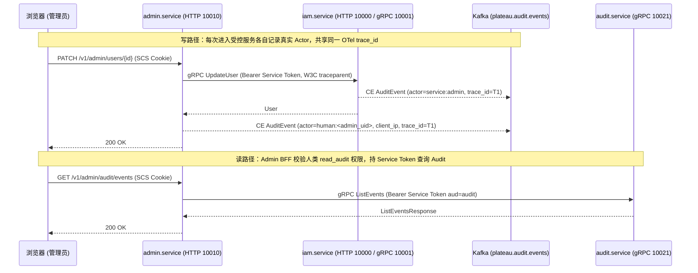

# IAM 与 Admin 审计接入及查询编排技术设计

需求来源：[本任务 PRD](prd.md) 与 [父任务 PRD](../11-23-audit-v1/prd.md)。前置契约：[共享审计运行时设计](../11-23-audit-v1-runtime/design.md)、[Audit 微服务设计](../11-23-audit-v1-service/design.md)。

## 1. 总体数据流与问责链路



---

## 2. IAM 控制面审计生产设计（`app/iam/service`）

### 2.1 Proto 声明式规则矩阵

绝大多数 IAM 接口均为 Kratos RPC，直接通过 `plateau.security.audit.v1` 注解交由 `audit.Server` 中间件统一捕获（含自动 `servora.redact.v3` 脱敏、请求/响应 AIP 资源名提取及 Kratos 错误 `Reason` 映射）：

| Proto 服务 | 默认规则 (`service_default`) | 方法级覆盖与上下文富化 |
| --- | --- | --- |
| `iam.user.v1.UserService` (`user.proto`) | `ENABLED` + `AUDIT_CATEGORY_RESOURCE` | `GetUser`、`ListUsers` 设为 `DISABLED`（若发生 403 `SECURITY_ERROR_REASON_PERMISSION_DENIED` 仍由 `audit.Server` 自动按 `AUDIT_CATEGORY_AUTHZ` 记录）；其余 10 个变更方法（`CreateUser`、`UpdateUser`、`DisableUser`、`EnableUser`、`SendUserVerificationEmail`、`SetUserPassword`、`RevokeUserSessions`、`DeleteUser`、`UndeleteUser`、`ExpungeUser`）全部自动审计。 |
| `iam.authn.v1.AuthnService` (`authn.proto`) | — | `Login` 设为 `ENABLED` + `AUDIT_CATEGORY_AUTHN`。入口为 `AUTHN_MODE_PUBLIC`：凭据核验通过后在 `service/authn.go` 调用 `audit.SetActor(ctx, security.Actor{Type: security.ActorTypeHuman, ID: user.GetUserId()})`（含 `required_actions` 待首次改密分支）；登录失败时保持 `actor_type = "anonymous"`，`password` 自动脱敏清空，`detail_json` 保留尝试邮箱，`error_code = "AUTHN_ERROR_REASON_INVALID_CREDENTIALS"`。 |
| `iam.account.v1.AccountService` (`account.proto`) | `ENABLED` + `AUDIT_CATEGORY_AUTHN` | `GetProfile` 设为 `DISABLED`；`Register`、`UpdateProfile`、`DeleteAccount` 覆盖为 `AUDIT_CATEGORY_RESOURCE`；`VerifyEmail`、`ResendVerificationEmail`、`ChangePassword`、`RequestPasswordReset`、`ConfirmPasswordReset`、`ChangeInitialPassword` 保持 `AUDIT_CATEGORY_AUTHN`。对于 `PUBLIC` 入口的 `VerifyEmail`、`ConfirmPasswordReset`、`ChangeInitialPassword`，在定位并核验通过目标用户后调用 `audit.SetActor` / `audit.SetResource(ctx, "iam.plateau.dev/User", "users/"+uid)` 补齐目标资源标识（`account.proto` 中全部 `password`、`token`、`cap_token` 均已标注 `servora.redact.v3.value`）。 |
| `iam.session.v1.SessionService` (`session.proto`) | `DISABLED` | `Logout` 覆盖为 `ENABLED` + `AUDIT_CATEGORY_AUTHN`（`GetSession` 保持 `DISABLED`）。 |

### 2.2 原生 OIDC HTTP 协议入口显式审计（`app/iam/service/internal/oidc/`）

`oidc.RegisterHTTPServer` 注册的 OIDC 端点为原生 `http.Handler`，不经过 Kratos RPC 中间件链。在 `IAMProvider` 中注入 `audit.Auditor`，仅对关键安全节点发出显式事件（高频只读 `/.well-known/openid-configuration`、`/keys`、`/userinfo` 及每 5 分钟自动续期的成功 `client_credentials` 请求不产生噪音）：

1. **浏览器授权完成（`/authorize/callback`）**：记录 `type = "plateau.iam.oidc.authorize.v1"`、`category = "authn"`、`actor = human:<uid>`（未登录拒绝时为 `anonymous`），`detail` 仅记录 `client_id` 与 `scopes`（严禁记录 `code` 或 Cookie）。
2. **RP 发起注销（`/end_session`）**：记录 `type = "plateau.iam.oidc.end_session.v1"`、`category = "authn"`。
3. **令牌端点异常（`/oauth/token` HTTP 状态码 `>= 400`）**：包装 `ResponseWriter` 状态码捕获客户端凭据错误、非法授权码或越权 `grant_type` / `scope`，发出 `type = "plateau.iam.oidc.token.v1"`、`category = "authn"`、`outcome = "failure"`，提取请求中的 `grant_type` 与 `client_id`（严禁记录 `client_secret`、`code`、`refresh_token`）。

### 2.3 IAM 中间件挂载与配置

- `internal/server/http.go` 与 `internal/server/grpc.go`：在 `session.Server` / `jwt.ServerFor` **之后**、`openfga.Server` **之前**挂载 `audit.Server(auditor, security.WithRulesFuncs(...))`。
- `configs/{local,docker}/`：新增 `kafka.yaml` 与 `audit_emitter.yaml`（`enabled: true`、`backend: kafka`、`topic: plateau.audit.events`），通过 `audit.New(emitterCfg, logger, auditkafka.Backend(kafkaClient))` 构造 `Auditor`（`*kgo.Client` 生命周期由 `infra/kafka` 的 `Data` cleanup 统一释放）。
- **扩展 Admin OAuth 客户端受众（`configs/{local,docker}/oidc.yaml` 与 `docs/iam-security.md`）**：
  - 将 `client_id: admin` 的 `audiences: [iam]` 扩展为 `audiences: [iam, audit]`，使 `security/oidc.NewServiceTokenMiddleware` 签发给 `admin` 的 `client_credentials` JWT 同时携带 `"iam"` 与 `"audit"` 受众声明，通过 `audit.service` 的 `audience: "audit"` 校验。

---

## 3. Admin 控制面审计生产设计（`app/admin/service`）

### 3.1 Proto 声明式规则矩阵

| Proto 服务 | 默认规则 (`service_default`) | 方法级覆盖 |
| --- | --- | --- |
| `admin.user.v1.UserService` (`user.proto`) | `ENABLED` + `AUDIT_CATEGORY_RESOURCE` | `ListUsers`、`GetUser` 设为 `DISABLED`；其余 10 个管理写方法自动记录 `actor = human:<admin_uid>`、浏览器 `client_ip` / `user_agent`、目标 `users/{user}`，并通过 gRPC Client OTel 拦截器与下游 IAM `service:admin` 事件共享同一 `trace_id`。 |
| `admin.auth.v1.AuthService` (`auth.proto`) | `DISABLED` | `Logout` 覆盖为 `ENABLED` + `AUDIT_CATEGORY_AUTHN`（`GetSession` 保持 `DISABLED`）。 |
| `admin.audit.v1.AuditService` (`audit.proto`) | `DISABLED` | 查询审计自身不重复写审计；非管理员调用触发的 403 `SECURITY_ERROR_REASON_PERMISSION_DENIED` 仍由 `audit.Server` 自动捕获。 |

### 3.2 浏览器 OIDC 回调显式审计（`app/admin/service/internal/service/auth.go`）

`AuthService.handleCallback`（`GET /v1/admin/auth/callback`）为原生 `http.Handler`，在 `AuthService` 注入 `audit.Auditor` 覆盖三类分支：
1. **OIDC 交换失败**（`CompleteLogin` 返回错误）：`type = "plateau.admin.auth.callback.v1"`、`category = "authn"`、`actor = anonymous`、`outcome = "failure"`、`errorcode` 区分 `"OIDC_PROVIDER_UNAVAILABLE"` 与 `"OIDC_LOGIN_FAILED"`；
2. **非管理员访问拒绝**（`CheckAccess` 返回 `false`，跳转 `?error=access_denied`）：`type = "plateau.security.authz.denied.v1"`、`category = "authz"`、`actor = human:<user_id>`、`resourcetype = "admin"`、`resourcename = "admin/global"`、`outcome = "failure"`、`errorcode = "SECURITY_ERROR_REASON_PERMISSION_DENIED"`；
3. **管理员登录成功**：`type = "plateau.admin.auth.callback.v1"`、`category = "authn"`、`actor = human:<user_id>`、`outcome = "success"`。

---

## 4. Admin 审计查询 BFF 与权限模型（`admin.audit.v1`）

### 4.1 OpenFGA 模型与服务授权元组

1. **人类管理员权限扩展（`manifests/openfga/admin.fga`）**：
   ```fga
   module admin

   type admin
     relations
       define admin: [user]
       define access: admin
       define manage_users: admin
       define expunge_users: admin
       define read_audit: admin
   ```
   - 同步更新 `manifests/openfga/admin.fga.yaml` 增加 `read_audit` 正负向断言（管理员为 `true`，普通用户与 `service:admin` 在 `admin:global` 上为 `false`）；
   - 更新 `app/admin/service/internal/biz/auth.go`：新增 `PermReadAudit = "read_audit"` 并加入 `adminPermissionOrder`，`GetSession` 通过一次 `BatchCheck` 动态返回含 `"read_audit"` 的权限数组；由于 `read_audit` 派生自 `admin`，现有 `SeedInitializer` 幂等写入的 `user:<id> admin admin:global` 元组自动生效，无需改动种子表结构。
2. **服务间授权元组（`service:admin read_events audit:global`）**：
   - 在 `docs/iam-security.md`、`app/admin/service/internal/server/integration_test.go` 及联调初始化命令中，与既有 `service:admin manage_users iam:global` 并列补充：
     ```bash
     fga tuple write --api-url "$FGA_API_URL" --store-id "$FGA_STORE_ID" --model-id "$FGA_MODEL_ID" --on-duplicate ignore service:admin read_events audit:global
     ```

### 4.2 Admin 查询 Proto 契约（`app/admin/service/api/protos/admin/audit/v1/audit.proto`）

对外暴露受管理员 SCS 会话与 `read_audit` 权限保护的 HTTP 查询接口，复用 `audit.event.v1.Event` 资源模型，生成 OpenAPI 与 `@plateau/api/admin/audit/v1` TS 客户端：

```protobuf
syntax = "proto3";

package admin.audit.v1;

import "audit/event/v1/event.proto";
import "buf/validate/validate.proto";
import "google/api/annotations.proto";
import "google/api/client.proto";
import "google/api/field_behavior.proto";
import "google/api/resource.proto";
import "google/protobuf/timestamp.proto";
import "plateau/security/authn/v1/annotations.proto";
import "plateau/security/audit/v1/annotations.proto";
import "plateau/security/authz/v1/annotations.proto";
import "servora/errors/v1/errors.proto";

option go_package = "github.com/Servora-Kit/plateau/api/gen/go/admin/audit/v1;adminauditv1";

service AuditService {
  option (plateau.security.authn.v1.service_default) = {mode: AUTHN_MODE_REQUIRED};
  option (plateau.security.authz.v1.service_default) = {
    mode: AUTHZ_MODE_REQUIRED
    action: "read_audit"
    resource_type: "admin"
    resource_id: "global"
  };
  option (plateau.security.audit.v1.service_default) = {mode: AUDIT_MODE_DISABLED};

  // ListEvents 分页检索平台控制面审计事件。
  rpc ListEvents(ListEventsRequest) returns (ListEventsResponse) {
    option (google.api.http) = {get: "/v1/admin/audit/events"};
  }

  // GetEvent 按规范资源名查询单条审计事件详情。
  rpc GetEvent(GetEventRequest) returns (audit.event.v1.Event) {
    option (google.api.http) = {get: "/v1/admin/audit/{name=events/*}"};
    option (google.api.method_signature) = "name";
  }
}

enum AdminAuditErrorReason {
  option (servora.errors.v1.default_code) = 500;

  ADMIN_AUDIT_ERROR_REASON_UNSPECIFIED = 0;
  ADMIN_AUDIT_ERROR_REASON_EVENT_NOT_FOUND = 1 [(servora.errors.v1.code) = 404];
  ADMIN_AUDIT_ERROR_REASON_INVALID_ARGUMENT = 2 [(servora.errors.v1.code) = 400];
  ADMIN_AUDIT_ERROR_REASON_INVALID_PAGE_TOKEN = 3 [(servora.errors.v1.code) = 400];
  ADMIN_AUDIT_ERROR_REASON_DOWNSTREAM_UNAVAILABLE = 4 [(servora.errors.v1.code) = 503];
}
```

- `ListEventsRequest` 字段与 `audit.event.v1.ListEventsRequest` 一一对应（`start_time`、`end_time`、`category`、`service`、`event_type`、`operation`、`actor_type`、`actor_id`、`resource_type`、`resource_name`、`optional bool success`、`trace_id`、`page_size`、`page_token`）；`ListEventsResponse` 返回 `repeated audit.event.v1.Event events = 1` 与 `string next_page_token = 2`。

### 4.3 下游 gRPC 调用与错误隔离不变量

1. **连接复用**：在 `app/admin/service/configs/{local,docker}/bootstrap.yaml` 的 `data.client.services` 下新增 `audit.service`（本地 `127.0.0.1:10021`，容器 `audit:10021`，超时 `5s`）；`internal/data/audit_event.go` 复用现有 `data.grpcDialer`（自动挂载 OAuth2 `client_credentials` Service Token 与 OTel Trace 传播）。
2. **错误转换保护人类会话（AC-P3 核心不变量）**：
   - 对齐 `app/admin/service/internal/service/user.go` 的 `userError` 模式，在 `service/audit.go` 实现 `auditError(ctx, err)`：
     - `audit.event.v1` `NOT_FOUND` → `ADMIN_AUDIT_ERROR_REASON_EVENT_NOT_FOUND`（404）；
     - `INVALID_PAGE_TOKEN` → `ADMIN_AUDIT_ERROR_REASON_INVALID_PAGE_TOKEN`（400）；
     - `INVALID_ARGUMENT` → `ADMIN_AUDIT_ERROR_REASON_INVALID_ARGUMENT`（400）；
     - **下游 `audit.service` 返回的 gRPC `Unauthenticated`、`PermissionDenied`、`Unavailable` 或 OIDC 取牌失败**：一律转换为 `ADMIN_AUDIT_ERROR_REASON_DOWNSTREAM_UNAVAILABLE`（HTTP **503**），**绝不原样透传为浏览器 401/403**，防止下游服务凭据配置错误或重启期间误清空管理员有效的本地登录会话。
