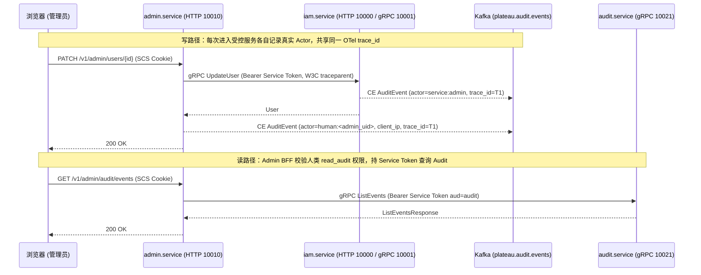

# IAM 与 Admin 审计接入及查询编排技术设计

需求来源：[本任务 PRD](prd.md) 与 [父任务 PRD](../11-23-audit-v1/prd.md)。前置契约：[共享审计运行时设计](../11-23-audit-v1-runtime/design.md)、[Audit 微服务设计](../11-23-audit-v1-service/design.md)。

## 1. 总体数据流与共享运行时扩展



### 1.1 Wire 极简装配与启动期强校验（对标 `openfga`）

基础设施（Kafka、PostgreSQL、Redis、OpenFGA）就绪顺序由编排层保障，微服务不对中间件启动延迟做妥协容忍，且不引入额外抽象包装结构体：
1. **`infra/kafka.New(cfg *kafkapb.Kafka, l *slog.Logger) (*kgo.Client, func(), error)`**（注入 `data.ProviderSet`）：内部调用 `NewClientOptional`；只要配置了 `kafka.yaml`（`brokers` 非空），启动期即执行同步 `Ping` 强校验，不可达直接终止启动（仅在单测未传 `kafka` 配置时返回 `(nil, noopCleanup, nil)`）。
2. **`security/audit/kafka.NewDefault(cfg *auditpb.AuditEmitter, client *kgo.Client, l *slog.Logger) (audit.Auditor, error)`**（注入 `server.ProviderSet`）：内部调用 `audit.New(cfg, l, Backend(client))`；当 `enabled && backend == "kafka"` 且 `client == nil` 时启动期直接报错。未来若切换其他消息中间件，仅替换 `server.ProviderSet` 中的该 Provider 即可，业务与中间件依赖的 `audit.Auditor` 零改动。

### 1.2 原生 `http.Handler` 无侵入审计包装（`security/audit`）

为保持 `app/iam/service/internal/oidc/`（`IAMProvider`、`OIDCStorage`）及 Admin `AuthService` 构造签名与协议职责纯净，在 `security/audit` 复用 `requestSlot` 扩展原生 HTTP 审计能力：
- **上下文被动富化辅助（`security/audit/context.go`）**：在既有 RPC/HTTP 共用的 `SetActor`、`SetResource` 之上新增 `HTTPHandler` 消费的被动富化辅助：
  - `SetDetail(ctx context.Context, detail map[string]any)`：附加非敏感键值摘要（落盘序列化为 JSON 对象）；
  - `SetError(ctx context.Context, code, message string)`：显式标记业务/下游错误码与安全消息；
  - `SetEventOverride(ctx context.Context, eventType, category string)`：允许将默认认证事件覆盖为授权拒绝（如 `AuthzDeniedEventType` + `CategoryAuthz`）；
  - `Skip(ctx context.Context)`：抑制当前请求落盘（如 OIDC 未登录正常 `302 /login` 引导）；当未挂载审计包装器（如协议层纯单测）时，全部 `Set*`/`Skip` 调用均为空操作。
- **HTTP 包装器（`security/audit/http.go`）**：
  - `HTTPHandler(auditor Auditor, eventType, category string, opts ...HTTPOption) func(http.Handler) http.Handler`（支持 `WithHTTPOnlyErrors()` 与 `WithHTTPPostHook(func(ctx context.Context, r *http.Request, statusCode int))`）；
  - 通过 `defer` 保障外层 SCS `LoadAndSave` 提交失败（`panic(responseAborted{})`）或原生 Handler 异常中止时强制按 `500` 发出失败审计；`statusRecorder` 在底层 `WriteHeader` 完成后锁存状态码；自动采集规范 `subject = r.Method + " " + r.URL.Path`、客户端 IP / User-Agent / `X-Request-Id` 及 OTel `traceparent`。

---

## 2. IAM 控制面审计生产设计（`app/iam/service`）

### 2.1 Proto 声明式规则与零业务 Proto 侵入富化

全部业务 `.proto` 请求与响应消息字段保持不变（100% 维持现行 AIP 契约）。24 个标准 RPC 完全依靠 `audit.Server` 自动提取请求/响应资源并递归执行 `servora.redact.v3` 脱敏，仅在 4 个公开验密入口和本人无返回体入口补充 `SetActor` / `SetResource`：

| Proto 服务 | 默认规则 (`service_default`) | 方法级覆盖与上下文富化 |
| --- | --- | --- |
| `iam.user.v1.UserService` (`user.proto`) | `ENABLED` + `AUDIT_CATEGORY_RESOURCE` | `GetUser`、`ListUsers` 设为 `DISABLED`（若发生 403 `SECURITY_ERROR_REASON_PERMISSION_DENIED` 仍由 `audit.Server` 自动按 `AUDIT_CATEGORY_AUTHZ` 记录）；其余 10 个变更方法在 `service/user.go` 零审计代码自动完成。 |
| `iam.authn.v1.AuthnService` (`authn.proto`) | — | `Login` 设为 `ENABLED` + `AUDIT_CATEGORY_AUTHN`。凭据核验通过后在 `service/authn.go` 调用 `audit.SetActor(ctx, human:<uid>)`（覆盖正常登录与 `required_actions` 首次改密分支；`LoginResponse.user` 自动提取 `users/{uid}`）；失败时保持 `anonymous`、`password` 自动脱敏清空、`detail_json` 保留尝试邮箱。 |
| `iam.account.v1.AccountService` (`account.proto`) | `ENABLED` + `AUDIT_CATEGORY_AUTHN` | `GetProfile` 设为 `DISABLED`；`Register`、`UpdateProfile`、`DeleteAccount` 覆盖为 `AUDIT_CATEGORY_RESOURCE`。`AccountUsecase.ConfirmPasswordReset` 返回 `(userID string, err error)`、`ChangeInitialPassword` 保持 `(*LoginSession, error)`，两者均仅在成功完成后由 `service/account.go` 注入 `SetActor` + `SetResource("iam.plateau.dev/User", "users/"+uid)`（失败保持 `anonymous`）；`VerifyEmail` 核验后调 `SetActor`（响应 `User` 自动提取资源）；已登录本人操作 `UpdateProfile`、`ChangePassword`、`DeleteAccount` 拿到会话用户后调 `SetResource`；防枚举接口 `ResendVerificationEmail`、`RequestPasswordReset` 保持 `anonymous` + 空 `resource_name`。 |
| `iam.session.v1.SessionService` (`session.proto`) | — | 唯一方法 `Logout` 设为 `ENABLED` + `AUDIT_CATEGORY_AUTHN`；在 `service/session.go` 拿到当前 `Actor` 后调用 `audit.SetResource(ctx, "iam.plateau.dev/User", "users/"+actor.ID)`。 |

### 2.2 原生 OIDC HTTP 协议入口无侵入审计（`internal/oidc/`）

`IAMProvider` 与 `OIDCStorage` 不注入 `audit.Auditor`、不导入 `cloudevents`、不改动构造签名；在 `oidc.RegisterHTTPServer(s, provider, auditor)` 按路径外包 `audit.HTTPHandler`（`/.well-known/openid-configuration`、`/keys`、`/userinfo` 及成功的 `/oauth/token` 请求不产生噪音）：

1. **浏览器授权回调（`GET /authorize/callback`）**：外包 `HTTPHandler(auditor, "plateau.iam.oidc.authorize.v1", audit.CategoryAuthn)`。未登录常规 `302 /login` 引导调用 `audit.Skip(ctx)` 抑制伪失败噪音；`CompleteAuthRequest` 入口在已核实浏览器会话 `userID` 后即注入 `SetActor(human:<uid>)` + `SetResource("iam.plateau.dev/User", "users/"+uid)`，`AuthRequestByID` 顺带写入 `SetDetail(ctx, {"client_id", "scopes"})`（严禁记录 `code` 或 Cookie）；请求非法返回 `400/405` 或协议层返回 `302 ?error=...` 重定向时均记为 `failure`。
2. **RP 发起注销（`GET|POST /end_session`）**：外包 `HTTPHandler(auditor, "plateau.iam.oidc.end_session.v1", audit.CategoryAuthn)`。`TerminateSession(ctx, userID, clientID)` 被动写入 `SetActor`、`SetResource` 与 `SetDetail(ctx, {"client_id"})`，请求结束时统一单次发出。
3. **令牌端点异常（`POST /oauth/token` 状态码 `>= 400`）**：外包 `HTTPHandler(auditor, "plateau.iam.oidc.token.v1", audit.CategoryAuthn, WithHTTPOnlyErrors(), WithHTTPPostHook(...))`，前置以 `http.MaxBytesReader`（`64 KiB`）限制请求体并在状态码 `>= 400` 时从 `r.BasicAuth()` / `r.PostForm` 提取且截断（`<= 256` 字节）非敏感 `grant_type` 与 `client_id`（严禁读取或记录 `client_secret`、`code`、`refresh_token`、`code_verifier`）。

### 2.3 IAM 中间件挂载与 OAuth 受众配置

- `internal/server/http.go` 与 `internal/server/grpc.go`：按 `AuthN → Audit → AuthZ` 顺序挂载 `audit.Server(auditor, security.WithRulesFuncs(...))`。
- `configs/{local,docker}/`：新增 `kafka.yaml` 与 `audit_emitter.yaml`（`enabled: true`、`backend: kafka`、`topic: plateau.audit.events`）；将 `oidc.yaml` 中 `client_id: admin` 的 `audiences` 扩为 `[iam, audit]`，由 `OIDCInitializer.reconcileClient` 启动期幂等同步至数据库。

---

## 3. Admin 控制面审计生产设计（`app/admin/service`）

### 3.1 Proto 声明式规则矩阵

| Proto 服务 | 默认规则 (`service_default`) | 方法级覆盖与上下文富化 |
| --- | --- | --- |
| `admin.user.v1.UserService` (`user.proto`) | `ENABLED` + `AUDIT_CATEGORY_RESOURCE` | `ListUsers`、`GetUser` 设为 `DISABLED`；其余 10 个管理写方法零审计代码自动记录 `actor = human:<admin_uid>`、浏览器 `client_ip` / `user_agent`、目标 `users/{user}`，并通过 gRPC Client OTel 拦截器与下游 IAM `service:admin` 事件共享同一 `trace_id`。 |
| `admin.auth.v1.AuthService` (`auth.proto`) | `DISABLED` | `Logout` 覆盖为 `ENABLED` + `AUDIT_CATEGORY_AUTHN`（`GetSession` 保持 `DISABLED`），在 `Logout` 内调用 `audit.SetResource(ctx, "iam.plateau.dev/User", "users/"+actor.ID)`。 |
| `admin.audit.v1.AuditService` (`audit.proto`) | `DISABLED` | 查询审计自身不重复写审计；非管理员调用触发的 403 `SECURITY_ERROR_REASON_PERMISSION_DENIED` 仍由 `audit.Server` 自动捕获。 |

### 3.2 浏览器 OIDC 回调全分支审计（`service/auth.go`）

`AuthService.RegisterOIDCHTTP(srv, auditor)` 为 `/v1/admin/auth/callback` 外包 `audit.HTTPHandler(auditor, "plateau.admin.auth.callback.v1", audit.CategoryAuthn)`（`operation = "GET /v1/admin/auth/callback"`），`handleCallback` 通过被动 `ctx` 辅助覆盖全部 4 类退出口：
1. **OIDC 交换失败**（`CompleteLogin` 报错）：`actor = anonymous`、`SetError` 区分 `"OIDC_PROVIDER_UNAVAILABLE"` 与 `"OIDC_LOGIN_FAILED"`；
2. **授权检查或会话持久化基础设施故障**（已拿到 `user` 后 `CheckAccess` 报错或 `SaveUser` 失败）：`SetActor(human:<uid>)`、`SetResource("iam.plateau.dev/User", "users/"+uid)`、`SetError` 分别记 `"AUTHZ_CHECK_UNAVAILABLE"` 或 `"SESSION_PERSIST_FAILED"`；
3. **非管理员访问拒绝**（`!allowed`，跳转 `?error=access_denied`）：`SetEventOverride(audit.AuthzDeniedEventType, audit.CategoryAuthz)`、`SetActor(human:<uid>)`、`SetResource("admin", "admin/global")`、`SetError("SECURITY_ERROR_REASON_PERMISSION_DENIED", "admin access denied")`；
4. **管理员登录成功**：`SetActor(human:<uid>)`、`SetResource("iam.plateau.dev/User", "users/"+uid)`，由包装器记录 `outcome = "success"`。

---

## 4. Admin 审计查询 BFF 与权限模型（`admin.audit.v1`）

### 4.1 OpenFGA 模型与服务授权元组

1. **人类管理员权限扩展（`manifests/openfga/admin.fga`）**：
   ```fga
   module admin

   type admin
     relations
       define admin: [user]
       define access: admin
       define manage_users: admin
       define expunge_users: admin
       define read_audit: admin
   ```
   - 同步更新 `manifests/openfga/admin.fga.yaml` 增加 `read_audit` 正负向断言；
   - 更新 `app/admin/service/internal/biz/auth.go`：新增 `PermReadAudit = "read_audit"` 并加入 `adminPermissionOrder`，`GetSession` 通过单次 `BatchCheck` 动态返回含 `"read_audit"` 的权限数组。
2. **服务间授权元组维护职责**：
   - `manifests/scripts/openfga/openfga.sh` 与根 `justfile` 保持纯 Store / 模型管理职责，不硬编码特定服务元组；
   - 在 `docs/iam-security.md` 与跨服务集成测试夹具中补充 `service:admin read_events audit:global`（与既有 `manage_users`、`expunge_users` 对称）。

### 4.2 Admin 查询 Proto 契约与零重复结构体实现

对外暴露受管理员 SCS 会话与 `read_audit` 权限保护的 HTTP 查询接口，直接 `import "audit/event/v1/event.proto"` 复用 `audit.event.v1.Event` 资源与 `plateau.security.audit.v1.AuditCategory`，在 `app/admin/service/api/buf.openapi.gen.yaml` 注册生成合并 `openapi.yaml` 与 `@plateau/api/admin/audit/v1` TS 客户端：

```protobuf
syntax = "proto3";

package admin.audit.v1;

import "audit/event/v1/event.proto";
import "google/api/annotations.proto";
import "google/api/client.proto";
import "google/api/field_behavior.proto";
import "google/api/resource.proto";
import "google/protobuf/timestamp.proto";
import "plateau/security/authn/v1/annotations.proto";
import "plateau/security/audit/v1/annotations.proto";
import "plateau/security/authz/v1/annotations.proto";
import "servora/errors/v1/errors.proto";

option go_package = "github.com/Servora-Kit/plateau/api/gen/go/admin/audit/v1;adminauditv1";

service AuditService {
  option (plateau.security.authn.v1.service_default) = {mode: AUTHN_MODE_REQUIRED};
  option (plateau.security.authz.v1.service_default) = {
    mode: AUTHZ_MODE_REQUIRED
    action: "read_audit"
    resource_type: "admin"
    resource_id: "global"
  };
  option (plateau.security.audit.v1.service_default) = {mode: AUDIT_MODE_DISABLED};

  // ListEvents 分页检索平台控制面审计事件。
  rpc ListEvents(ListEventsRequest) returns (ListEventsResponse) {
    option (google.api.http) = {get: "/v1/admin/audit/events"};
  }

  // GetEvent 按规范资源名查询单条审计事件详情。
  rpc GetEvent(GetEventRequest) returns (audit.event.v1.Event) {
    option (google.api.http) = {get: "/v1/admin/audit/{name=events/*}"};
    option (google.api.method_signature) = "name";
  }
}

enum AdminAuditErrorReason {
  option (servora.errors.v1.default_code) = 500;

  ADMIN_AUDIT_ERROR_REASON_UNSPECIFIED = 0;
  ADMIN_AUDIT_ERROR_REASON_EVENT_NOT_FOUND = 1 [(servora.errors.v1.code) = 404];
  ADMIN_AUDIT_ERROR_REASON_INVALID_ARGUMENT = 2 [(servora.errors.v1.code) = 400];
  ADMIN_AUDIT_ERROR_REASON_INVALID_PAGE_TOKEN = 3 [(servora.errors.v1.code) = 400];
  ADMIN_AUDIT_ERROR_REASON_DOWNSTREAM_UNAVAILABLE = 4 [(servora.errors.v1.code) = 503];
}
```

- **零重复结构体与分页分工**：`service -> biz <- data` 直接传递 `*auditeventpb.ListEventsRequest`、`*auditeventpb.ListEventsResponse` 与 `*auditeventpb.Event`；Admin 仅前置校验非空资源名格式（`auditeventpb.ParseEventName`）、`page_size >= 0` 与 `start_time <= end_time`，默认页大小（`50`）与最大页上限（`200`）统一委托下游 `audit.service`。

### 4.3 下游 gRPC 连接复用与 `503` 故障屏蔽

1. **连接复用**：在 `app/admin/service/configs/{local,docker}/bootstrap.yaml` 的 `data.client.services` 下新增 `audit.service`（本地 `127.0.0.1:10021`，容器 `audit:10021`，超时 `5s`）；`internal/data/audit_event.go` 复用现有 `data.dialer`（自动挂载双受众 `client_credentials` Service Token 与 OTel Trace 传播）。
2. **错误转换保护人类会话（AC-P3）**：对齐 `service/user.go` 的 `userError` 模式，在 `service/audit.go` 实现 `auditError(ctx, err)`：
   - `audit.event.v1` `NOT_FOUND` → `ADMIN_AUDIT_ERROR_REASON_EVENT_NOT_FOUND`（404）；
   - `INVALID_PAGE_TOKEN` → `ADMIN_AUDIT_ERROR_REASON_INVALID_PAGE_TOKEN`（400）；
   - `INVALID_ARGUMENT` → `ADMIN_AUDIT_ERROR_REASON_INVALID_ARGUMENT`（400）；
   - 请求自身的 `context.Canceled` / `DeadlineExceeded` → `499` / `504`；
   - 下游 `audit.service` 返回的 `STORAGE_UNAVAILABLE`、gRPC `Unauthenticated`、`PermissionDenied`、`Unavailable` 或 OIDC 取牌失败：一律转换为 `ADMIN_AUDIT_ERROR_REASON_DOWNSTREAM_UNAVAILABLE`（HTTP **503**），避免前端全局 `401` 拦截器误判为管理员本地会话失效。
