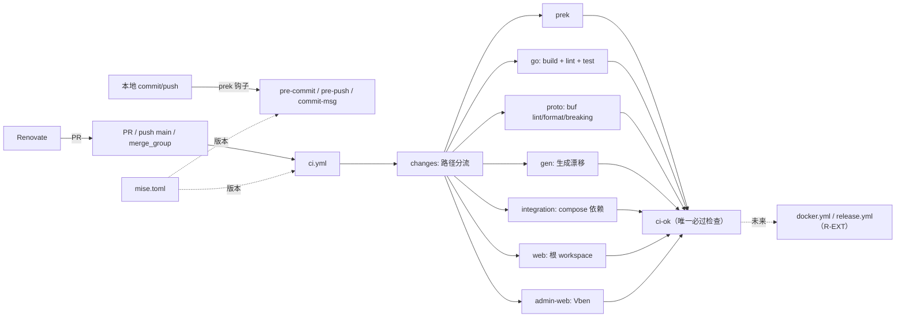

# Design：Plateau CI 与 prek

## 1. 总体结构

单一事实来源：

| 维度 | 来源 | 本地 | CI | 自动升级 |
| --- | --- | --- | --- | --- |
| Go 版本 | `go.mod` `go` 指令 | 父级 go.work / mise 全局 | `actions/setup-go` `go-version-file: go.mod` | Renovate gomod |
| protoc 插件、Wire、Ent | `go.mod` `tool` | `go tool` | `go tool` | Renovate gomod（Servora 插件跟随 servora 依赖） |
| buf、golangci-lint、just、fga、prek、node、pnpm、air | `mise.toml` | `mise install` | `jdx/mise-action` | Renovate mise |
| 检查规则 | `prek.toml` + just recipe | git hook | `prek run` + just | — |
| 依赖镜像（postgres/redis/openfga） | `docker-compose.yaml` 固定 tag | `just compose-up` | integration job 用同一份 compose 启动 | Renovate docker-compose |

## 2. 生成器版本固定（D2）

- `go get -tool` 加入以下工具：`google.golang.org/protobuf/cmd/protoc-gen-go`、`google.golang.org/grpc/cmd/protoc-gen-go-grpc`、`github.com/go-kratos/kratos/cmd/protoc-gen-go-http/v3`、`github.com/google/gnostic/cmd/protoc-gen-openapi`、`github.com/envoyproxy/protoc-gen-validate`、Servora 的 6 个插件（`protoc-gen-typescript-http`、`-go-errors`、`-redact`、`-servora-audit`、`-servora-conf`、`-servora-crud`；都在 servora 根 module 内，版本跟随 go.mod 里的 `github.com/Servora-Kit/servora`），以及本仓库的 `./cmd/protoc-gen-plateau-authn`、`./cmd/protoc-gen-plateau-authz`。
- `buf.go.gen.yaml`、`buf.typescript.gen.yaml`、各服务的 `api/buf.openapi.gen.yaml`/`buf.typescript.gen.yaml`：`local: protoc-gen-x` 改为 `local: ["go", "tool", "protoc-gen-x"]`。
- buf **不**进 `tool`：buf 的依赖图很大，一旦进入根 module 的 MVS，可能把 protobuf、grpc 等运行时依赖一并抬高。buf 改由 `mise.toml` 固定。golangci-lint 同理，官方也不建议用 `go tool` 方式安装。
- 删除 `SERVORA_PKG`、`SERVORA_VERSION`、`just plugin`、`just cli`；`just init` 改为 `mise install` → `prek install` → `pnpm install --frozen-lockfile`。
- 迁移时重新生成一次。`protoc-gen-go` 的版本头会变成 go.mod 里 protobuf 对应的版本（现在是 `v1.36.11-devel`，来自 `go install @latest`），这是一次性变化，和迁移一起提交。
- 父级 `go.work` 会让本地 `go tool` 解析到 servora 源码。为了跨仓联调，`just gen` 保持当前环境；`gen-check`（pre-push 与 CI 都用它）固定使用 `GOWORK=off`，与 CI 一致。

## 3. 新增/调整的 just recipe

| recipe | 内容 | 用途 |
| --- | --- | --- |
| `init` | `mise install`、`prek install`、`pnpm install --frozen-lockfile` | 新人一条命令完成环境准备 |
| `test` | `go test -race -count=1 ./...` | CI go job、本地 |
| `lint-proto` | 保持 `buf lint` | 已有 |
| `fmt-proto-check` | `buf format -d --exit-code` | CI proto job |
| `breaking` | `buf breaking --against <ref>`，ref 默认是本地 `origin/main` 对应的 git 引用，可用 env 覆盖 | pre-push、CI proto job |
| `gen-check` | 在 `GOWORK=off` 下执行 `just gen`，然后对生成路径做 `git diff --exit-code`，并检查有无未跟踪的生成文件 | pre-push、CI gen job |

既有的 `[unix]`/`[windows]` 双实现约定照旧：环境变量前缀和 shell 语法有差异时，分别写两份。

## 4. prek（D3）

`prek.toml`（prek 原生格式；仓库里没有旧的 pre-commit 配置，不需要用 YAML 兼容格式），`default_install_hook_types = ["pre-commit", "pre-push", "commit-msg"]`。

全局 `exclude`：`api/gen/`、`**/wire_gen.go`、`app/*/service/internal/data/ent/`、`**/openapi.yaml`、`pnpm-lock.yaml`、`node_modules/`。

| stage | hook | 实现 |
| --- | --- | --- |
| pre-commit | trailing-whitespace、end-of-file-fixer、check-yaml/json/toml、check-merge-conflict、detect-private-key、check-added-large-files、mixed-line-ending | `pre-commit-hooks`，prek 自动走内置 Rust 快速路径 |
| pre-commit | `gofmt -l -w`（暂存的 `.go` 文件） | `repo: local`，`language: system` |
| pre-commit | `buf format -w`（暂存的 `.proto` 文件） | local/system |
| pre-commit | `just --fmt --check --unstable`（`justfile`、`*.just`） | local/system，`pass_filenames = false` |
| pre-push | `just lint-go`、`just lint-proto`、`just breaking`、`just gen-check` | local/system，`pass_filenames = false`，`always_run` |
| commit-msg | Conventional Commits：`^(feat\|fix\|docs\|style\|refactor\|perf\|test\|build\|ci\|chore\|revert)(\([^)]+\))?!?: .+`；放行 `Merge `、`Revert "`、`fixup!`/`squash!` | `language: pygrep`，`args = ["--negate"]`；prek 不支持时退回写一个小脚本 |

admin web 子项目 `app/admin/web/prek.toml`（prek workspace 会自动发现）：
- pre-commit：oxlint `--fix`、oxfmt、eslint `--fix`、stylelint `--fix`，只跑暂存文件；修复后的文件由 prek 判定为改动并失败，需要重新暂存。
- pre-push：`pnpm check:type`。lefthook 原本在每次 commit 都跑全量类型检查，现在移到 push，保证 pre-commit 能在几秒内跑完。
- 删除 `app/admin/web/lefthook.yml`；`.commitlintrc.js` 由根 commit-msg 钩子替代后一并删除，同时移除对应的 devDependency。
- 根 workspace 的其他 Web（iam 等）pre-commit 先只做通用卫生检查，eslint 交给 CI web job。日后需要时在各自目录加子配置即可，不改根配置。

CI prek job：`prek run --all-files --hook-stage pre-commit --skip app/admin/web/`。admin 的 lint 由 admin-web job 全量执行，这样 prek job 不必安装 Vben 依赖。

## 5. ci.yml

公共设置：`on: pull_request(main) / push(main) / merge_group / workflow_dispatch`；`concurrency: ci-${{ github.ref }}`，非 main 分支 `cancel-in-progress`；`permissions: contents: read`；`env: GOWORK: "off"`。

| job | 运行条件（来自 changes） | 步骤 |
| --- | --- | --- |
| `changes` | 总是 | `dorny/paths-filter`，输出 `go`、`proto`、`web`、`admin`、`ci`（workflow、mise.toml、justfile 等变化时强制全量运行） |
| `prek` | 总是 | checkout、mise-action、prek run（同 §4） |
| `go` | go \|\| proto \|\| ci | setup-go（含缓存）、mise-action、`go build ./...`、`just lint-go`（缓存 `~/.cache/golangci-lint`）、`just test`；覆盖率写入 step summary |
| `proto` | proto \|\| ci | mise-action、`just lint-proto`、`just fmt-proto-check`、PR 上执行 `just breaking`（`fetch-depth: 0`，以 PR base 为对比基准），使用 `--error-format=github-actions` 生成注释 |
| `gen` | go \|\| proto \|\| ci | setup-go、mise-action、`just gen-check`；失败时输出 `::error title=Generated code out of date::` 和 diff 摘要 |
| `integration` | go \|\| proto \|\| ci（D4） | 用仓库 compose 启动 postgres、postgres-provision、openfga-migrate、openfga、redis（`docker compose up -d --wait`）；`just openfga-model-test`；用 fga CLI 建测试 store 并写入 model，store/model id 输出到 env；注入 `IAM_TEST_POSTGRES_DSN`、`IAM_TEST_FGA_URL`、`IAM_TEST_FGA_STORE_ID`、`IAM_TEST_FGA_MODEL_ID`、`ADMIN_TEST_POSTGRES_DSN`、`FGA_API_URL`；执行 `go test -count=1 ./app/...`；失败时 dump compose 日志 |
| `web` | web \|\| ci | mise-action（node/pnpm）、pnpm store 缓存、`pnpm install --frozen-lockfile`、`just api-ts-check`、`pnpm -r --if-present run lint`、`typecheck`、`build`（递归覆盖 workspace 内所有包，不写死包名） |
| `admin-web` | admin \|\| web-contract（`api/gen/ts`、`web/packages`）\|\| ci | mise-action、在 `app/admin/web` 安装依赖、`pnpm run lint`、`pnpm run check`、`pnpm run build`、`pnpm run test:unit` |
| `ci-ok` | `if: always()`，needs 以上全部 | needs 中任一 job 为 failure/cancelled 即失败；skipped 视为通过 |

- 用 job 级路径分流，而不是 workflow 级 `paths`：后者在被跳过时会让必过检查一直停在 pending。分支保护只要求 `ci-ok`，job 增减不需要改保护规则（R-EXT）。
- 门禁不按服务拆矩阵：根 module 的 `./...` 和 pnpm 递归命令本身就覆盖全部服务，服务增减不影响 workflow（R-DYN）。将来镜像 workflow 需要矩阵时，从 `app/*/service/Dockerfile` 动态生成。
- 集成测试只用 compose 中的 5 个服务；`docker-compose.yaml` 里的 `openfga/openfga:latest` 改为固定 tag（Renovate 负责升级）。其余 `latest` 镜像不在这个任务范围内。

## 6. security.yml（待用户在最终评审时确认）

- `govulncheck ./...`：PR 改到 `go.mod`/`go.sum` 时运行，另外每周定时运行一次。定时运行发现漏洞时只让该 workflow 失败，不阻塞其他 PR。
- 不加 CodeQL：主流框架里只有 Kratos、go-zero 用了；对 plateau 来说收益低，而且每次要多跑 5 分钟以上。

## 7. renovate.json

- `extends: ["config:recommended", ":semanticCommits", ":dependencyDashboard"]`，`timezone: Asia/Shanghai`，每周一定时；`postUpdateOptions: ["gomodTidy"]`。
- 分组：`servora`（`github.com/Servora-Kit/**` + `@servora/*`）、`go-tools`（go.mod 中的 tool 依赖）、`github-actions`、`mise`、`root-web`（根 pnpm workspace）、`admin-web`（`app/admin/web`，Vben 依赖多，按月一次）、`compose-images`。
- 关闭自动合并。servora 或插件升级后生成代码会变，`gen-check` 会失败；托管版 Renovate 不能执行 `just gen`，需要人在该 PR 上重新生成并提交。这是有意保留的信号：生成代码必须和插件版本一致。
- 安装方式：Mend Renovate Community App（免费），选 Renovate Only。组织默认模式可以保持 Silent（不打扰其他仓库），但 plateau 必须在 Mend Developer Portal 的仓库设置里切到 Interactive。Silent 即 `dryRun=lookup`，即使仓库里有 `renovate.json` 也不提 PR、不建 Issue（D5）。

## 8. 兼容与风险

| 风险 | 处理 |
| --- | --- |
| 另一个 agent 正在移除 test/example（工作区已有 162 处未提交改动，涉及 `AGENTS.md`、`api/AGENTS.md`、`generation.md`、`api/gen/go/{example,test}`） | 等那次移除提交后再 `task.py start`；实施前重新确认 `just/services.just`、`justfile`、buf.yaml 的 module 列表 |
| `go tool` 首次编译插件较慢 | Go build cache 由 setup-go 缓存；本地编译一次后复用 |
| 插件改为 go.mod 固定后，首次重新生成的版本头会变 | 和迁移放在同一个提交 |
| buf breaking 首次运行时 main 上还没有 baseline | 对比 PR base；proto 模块路径变化（移除 test/example）发生在 main 上，不影响后续 PR |
| admin web build 需要 8GB 内存 | 公开仓库的 ubuntu-latest runner 有 16GB；单独 job，不和其他 job 抢资源 |
| admin 通过 `link:` 依赖 `@plateau/api`，exports 可能指向构建产物 | 实施时确认；如有需要，先在 `api/gen` 执行 build |
| IAM openapi 输出路径为 `app/iam/service/api/internal/assets`，与其他服务的 `internal/assets` 不一致 | 只记录，不在这个任务里修改；gen-check 只校验一致性 |
| pre-push 的 gen-check 在工作区有未提交改动时可能误报 | gen-check 只 diff 生成路径；文档注明 push 前工作区应干净，或用 `PREK_SKIP` 临时跳过 |

## 9. 回滚

所有改动都是新增配置或可逆修改。回滚 = 撤销对应提交；Renovate 可在 App 设置中停用。go.mod tool 回滚时需要恢复 `just plugin`。
