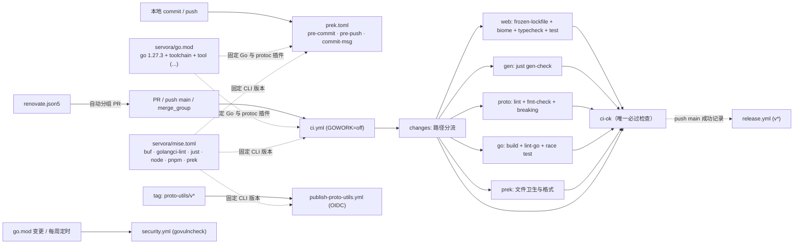

# Design：阶段一 Servora 工具链与工程化门禁统一

需求来源：[prd.md](prd.md)，架构上位约束见父任务 [design.md](../11-25-servora-kit-engineering/design.md) 与同系列已验收设计 [11-23-plateau-ci-prek](../archive/2026-11/11-23-plateau-ci-prek/design.md)。

---

## 1. 总体门禁与版本单一来源拓扑



### 版本单一事实来源矩阵

| 维度 | 唯一来源 | 本地消费方式 | CI 消费方式 | 自动更新通道 |
| --- | --- | --- | --- | --- |
| Go 最低版本与安全补丁工具链 | `go.mod` `go` + `toolchain` 指令 | 本地 Go / 父级 `go.work` | `actions/setup-go@v7` (`go-version-file: go.mod`) | Renovate `gomod`（忽略 `go` patch，仅升 `toolchain` 或 minor） |
| `protoc` 插件与 `ent` CLI | `go.mod` `tool (...)` | `buf generate` → `go tool <plugin>` | 同左（Go build cache 加速） | Renovate `go-tools` 分组 |
| `buf`、`golangci-lint`、`just`、`node`、`pnpm`、`prek` | `mise.toml` | `mise install` | `jdx/mise-action@v5` | Renovate `mise` 分组 |
| 前端包与发布冷却期 | `web/pnpm-workspace.yaml` + `web/pnpm-lock.yaml` | `pnpm --dir web install --frozen-lockfile` | 同左 + pnpm store 缓存 | Renovate `web` 分组（启用 `minimumReleaseAgePackageManagerSync`） |

---

## 2. 遗留文件清理与依赖影响（R1）

1. **删除文件清单**：
   - `Makefile`（彻底结束 Makefile / Just 双维护期）。
   - `cmd/svr/`（整目录移除，含 `cmd/svr/AGENTS.md` 与 `internal/`）。
   - `docker-compose.yaml`（引用不存在的 `./manifests/*`、已迁出服务及 `:latest` 标签，仓内零引用；移除后避免 Renovate `docker-compose` 产生无效 PR）。
   - `CLAUDE.md`（0 字节空跟踪文件；仓库统一以 `AGENTS.md` 作为 AI 协作上下文入口）。
2. **`go.mod` 依赖收敛预期**：
   - 全仓检索确认 `github.com/charmbracelet/huh`、`github.com/charmbracelet/lipgloss`、`github.com/glebarez/sqlite`、`github.com/spf13/cobra` 仅被 `cmd/svr/` 导入；删除后执行 `GOWORK=off go mod tidy` 将连同 `modernc.org/*`、Charm TUI 等传递依赖一并清理，对所有库包零 API 影响。

---

## 3. 工具链、生成器固定与 `justfile` 设计（R2）

### 3.1 `servora/mise.toml`

精简对齐 `plateau/mise.toml`，剔除 `servora` 不使用的 `air`、`process-compose` 与 `openfga/cli`：

```toml
[tools]
buf = "1.75.0"
golangci-lint = "2.15.0"
just = "1.59.0"
node = "24.22.3"
pnpm = "12.21.0"
prek = "0.5.11"
```

### 3.2 `go.mod` `tool` 与 Buf 生成模板

- 在 `servora/go.mod` 声明 `toolchain go1.27.4`（与 `plateau` 一致，规避 `go 1.27.3` 标准库已知漏洞触发 `govulncheck` 告警，同时保持 `go 1.27.3` 最低版本承诺不抬高下游），并将阶段一仍在使用的生成器统一写入 `tool (...)`：
  - 外部插件：`google.golang.org/protobuf/cmd/protoc-gen-go`、`google.golang.org/grpc/cmd/protoc-gen-go-grpc`、`github.com/go-kratos/kratos/cmd/protoc-gen-go-http/v3`、`github.com/envoyproxy/protoc-gen-validate`、`entgo.io/ent/cmd/ent`（注：`ent` 与 `protoc-gen-servora-crud` 在阶段一保留以维持零破坏性，阶段二随模块一并移除）。
  - 本仓插件：`github.com/Servora-Kit/servora/cmd/protoc-gen-{go-errors,redact,servora-conf,servora-crud,typescript-http}`。
- **不将 `buf` 或 `golangci-lint` 放入 `go.mod tool`**：避免庞大 CLI 依赖图经 MVS 污染或抬高框架运行时依赖，统一由 `mise.toml` 管理。
- `buf.go.gen.yaml` 与 `buf.typescript.gen.yaml` 中所有 `local: protoc-gen-*` 改为 `local: ["go", "tool", "protoc-gen-*"]`。切换后重新执行一次生成，将 `protoc-gen-go` 版本注释头固定为 `go.mod` 锁定版本并随本次变更提交。

### 3.3 `servora/justfile` 核心命令设计

对齐 `plateau/justfile` 命名与跨平台（`[unix]` / `[windows]`）写法，注意**不启用会覆盖测试环境变量的空默认变量导出**：

| Recipe | 行为定义 | 说明 |
| --- | --- | --- |
| `init` | `mise install` → `prek install` → `just web-install` | 一条命令完成本地工具、钩子与前端依赖初始化 |
| `gen-go` / `gen-ts` | 分别执行 `buf generate --template buf.go.gen.yaml` / `buf.typescript.gen.yaml` | 保留 `gen-ts` 兼容既有使用习惯 |
| `gen` | 串联 `gen-go` 与 `gen-ts` | 与 `plateau` 的 `api` 对齐，确保一次 `just gen` 同步刷新 Go 与 TS 生成物 |
| `gen-fresh` | 清理 `api/gen/go` 与 `web/packages/proto-utils/src/gen` 后执行 `gen` | 供删除/重命名 Proto 或移除插件时使用 |
| `gen-check` | `GOWORK=off` 下运行 `just gen`，校验 `api/gen/go` 与 `web/packages/proto-utils/src/gen` 的 `git diff --exit-code` 及未跟踪文件 | 本地 `pre-push` 与 CI `gen` 门禁共用 |
| `test *args` / `test-all *args` | `go test -short -race -count=1 {{ args }} ./...` / `go test -race -count=1 {{ args }} ./...` | 默认开启 `-race -count=1` 禁用测试缓存假绿 |
| `lint-go` / `lint-proto` / `fmt-proto` / `fmt-proto-check` / `breaking` | 对齐 `plateau`（`breaking` 默认对比 `.git#ref=origin/main`，支持 `BUF_BREAKING_AGAINST` 覆盖与 `--exclude-imports`） | 本地与 CI 参数完全同构 |
| `lint` | 串联 `web-check`、`web-typecheck`、`lint-proto`、`lint-go` | 全仓静态检查总入口 |
| `web-install` / `web-check` / `web-typecheck` / `web-build` / `web-test` | 在 `web` 或 `web/packages/proto-utils` 下运行 `--frozen-lockfile`、`biome check`、`typecheck`、`build`、`test` | 覆盖 `@servora/proto-utils` 全生命周期 |

### 3.4 `web/` pnpm 版本与冷却策略对齐

- 移除 `servora/web/package.json` 中硬编码的 `"packageManager": "pnpm@10.33.0"`，由根 `mise.toml`（`pnpm = "12.21.0"`）统一控制版本，避免 Corepack 拦截。
- 在 `servora/web/pnpm-workspace.yaml` 补充 `minimumReleaseAge: 1440`（1 天冷却期，匹配 pnpm v12 与 `plateau` 策略），并在 `pnpm 12.21.0` 下刷新 `web/pnpm-lock.yaml`。

---

## 4. `prek.toml`、GitHub Actions 与 Renovate 设计（R3–R5）

### 4.1 `servora/prek.toml`

- `default_install_hook_types = ["pre-commit", "pre-push", "commit-msg"]`。
- `exclude`：`api/gen/**`、`web/packages/proto-utils/src/gen/**`、`web/packages/proto-utils/dist/**`、`**/pnpm-lock.yaml`、`**/node_modules/**`、`coverage.out`、`.agent/**`、`.agents/**`、`.omp/**`、`.claude/**`、`.opencode/**`、`.codegraph/**`、`.gitnexus/**`。
- 三阶段钩子：
  - `pre-commit`：`repo = "builtin"` 9 项基础卫生钩子 + 本地 `gofmt`、`buf-format`、`just-fmt`（`just --fmt --check --unstable --justfile`）、`biome-check`（针对 `web/**/*.{ts,mts,mjs,js,json}` 运行 `pnpm --dir web exec biome check --write --no-errors-on-unmatched`）。
  - `pre-push`：`lint-go`（`GOWORK=off`）、`lint-proto`、`buf-breaking`、`gen-check`（`GOWORK=off`）。
  - `commit-msg`：与 `plateau/prek.toml` 完全一致的 `pygrep` Conventional Commits 规则。

### 4.2 `.github/workflows/` 门禁矩阵与兼容性

1. **`ci.yml`（重构）**：
   - 触发：`pull_request` (`main`)、`push` (`main`)、`merge_group`、`workflow_dispatch`；`GOWORK: "off"`；`main` 分支不取消进行中的 run（确保 `release.yml` 依赖的 `push` CI 记录不被中途取消）。
   - `changes`（`dorny/paths-filter@v4`，`some-with-excludes`）：输出 `go`、`proto`、`web`、`ci` 四个布尔量（非 `pull_request` 事件恒为 `true`，保证 `push main` 全量运行）。
   - 并行检查 Job：`prek`（常驻运行）、`go`（`go || proto || ci`）、`proto`（`proto || ci`，PR 额外跑 `just breaking`）、`gen`（`go || proto || ci`，跑 `just gen-check`）、`web`（`web || ci`，跑 `just web-install`、`just web-check`、`just web-typecheck`、`just web-test`）。
   - `ci-ok`：`if: always()`，`needs: [changes, prek, go, proto, gen, web]`，仅当所有上游为 `success` 或 `skipped` 时通过，作为分支保护唯一必过检查。
   - **与 `release.yml` 兼容验证**：`release.yml` 通过 `repos/${GITHUB_REPOSITORY}/actions/workflows/ci.yml/runs` 查询 `branch=main`、`event=push` 且 `conclusion == "success"` 的工作流记录；保留文件名 `ci.yml` 且 `push main` 全跑并汇总至 `ci-ok` 后，`release.yml` 无需改动即可获得更严格的发版前校验（顺带将 `release.yml` / `buf-ci.yml` 的 checkout 等 action 版本对齐最新稳定主版本或交由 Renovate 统一管理）。
2. **`publish-proto-utils.yml`（对齐工具链）**：
   - 使用 `jdx/mise-action@v5` 安装 `mise.toml` 锁定的 Node 与 pnpm，同时保留 `actions/setup-node` 配置 `registry-url: "https://registry.npmjs.org"`（生成 OIDC Trusted Publishing 所需的 `.npmrc` 认证配置，传 `node-version-file` 或复用 mise Node），消除硬编码 `pnpm@10.33.0`；发包前显式执行 `pnpm run test`（含构建、类型检查与单测）再执行 `npm publish --provenance --access public`。
3. **`security.yml`（新增）**：
   - 与 `plateau/.github/workflows/security.yml` 同构，在 `go.mod` / `go.sum` / `security.yml` 变更及每周一凌晨定时运行 `golang/govulncheck-action@v1`（`go-package: ./...`）。

### 4.3 `servora/renovate.json5`

与 `plateau/renovate.json5` 同构，裁剪 `plateau` 专属项（无 `app/admin/web`、无 `docker-compose`、无自指 `servora` 分组）：
- 开启 `mise.enabled: true`、`postUpdateOptions: ["gomodTidy"]`、`minimumReleaseAgePackageManagerSync: true`、`automerge: false`。
- 分组：`go-tools`（`gomod` `tool` + 间接依赖的 `protoc-gen-go-grpc`、`protoc-gen-go-http/**`、`protoc-gen-validate`）、`github-actions`、`mise`、`web`（`matchManagers: ["npm"]`）。

---

## 5. 风险与回滚策略

| 风险点 | 影响与应对措施 |
| --- | --- |
| **`go tool` 切换后生成产物头部注释变化** | `protoc-gen-go` 版本由宿主全局二进制切换为 `go.mod` 锁定版本时，`*.pb.go` 顶部版本注释可能发生一次性变更；在迁移提交中运行 `GOWORK=off just gen-fresh` 一并提交，并连续跑两次 `just gen-check` 确认幂等。 |
| **`prek --all-files` 检出历史文件尾随空格或格式差异** | 存量 Markdown/YAML/Go/TS 文件可能存在尾随空格或换行符问题；按 `11-23-plateau-ci-prek` 经验在本地跑通 `prek run --all-files` 一次性修复后再提交。 |
| **`govulncheck` 检出标准库或传递依赖漏洞** | 本地实施阶段实跑 `govulncheck ./...`，通过 `toolchain go1.27.4` 或最小补丁升级在推远端前清零漏洞。 |
| **回滚方案** | 本子任务不涉及外部状态变更或破坏性发版，所有改动集中在构建配置与工具链文件；按关注点拆分提交（遗留清理 / 工具链与再生成 / 钩子与 CI），任一环节需回退可直接 `git revert` 对应提交。 |
