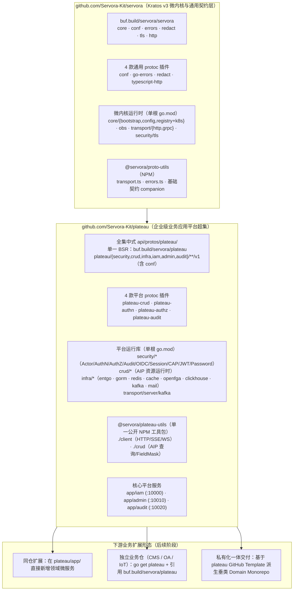

# Design：servora-kit 工程化优化与两仓定位重构

需求来源：[prd.md](prd.md)。本文档完整沉淀跨仓定位推演、备选方案取舍、目录迁移映射、全集中式 Proto / 单一 BSR / 单一 NPM 包方案及四阶段演进策略。

---

## 1. 总体架构与生态拓扑



---

## 2. 关键架构决策与取舍记录（ADR 留痕）

### D1：采用「轻 `servora` 微内核 + 重 `plateau` 超集」，放弃「重 `servora` 多模块全家桶」与「两仓强行合一」

| 方案 | 核心思路 | 评估结论与放弃/采纳理由 |
| --- | --- | --- |
| 方案 A：两仓合一改名 `servora` | 将 `servora` 直接并入含 `app/` 的 `plateau` 后对外发库 | **放弃**。`plateau` 含 Next.js 16、Vue Vben 两套重前端及三个完整微服务，外部轻量项目（如 `servora-example`）仅需 Kratos 基础传输封装时会被迫拉取整棵业务依赖树与前端工程资产 |
| 方案 B：重 `servora`（拆多 `go.mod`）+ 纯业务 `plateau` | 把 `security`、`infra`、安全插件全部下沉进 `servora/contrib/*`，`plateau` 只留 `app/` | **放弃**。源码核查证实 `Actor`、`oidc/rp.go`（直接产出 `plateau.iam.user.v1.User`）、`authn/session/user.go` 与平台身份领域紧密咬合；强行下沉不仅要拆解业务映射，还会让高频演进的 CRUD / 安全 / 基础设施每次改动都经历“改 `servora` → 发版推 BSR → 回 `plateau` 升版本”的跨仓往返，并引入 ~10 个子 `go.mod` 的锁步打标复杂度 |
| **方案 C（采纳）：轻 `servora` 微内核 + 重 `plateau` 业务平台超集** | `servora` 收缩为极少变动的 Kratos v3 协议与启动微内核；`crud` 与数据库/缓存 `contrib` 上移至 `plateau`，由 `plateau` 对外发布自己的 BSR、Go 包与 NPM 包 | **采纳**。1) `servora` 自然瘦身，单根 `go.mod` 即可保持极简稳定；2) `Actor`、`oidc`、`crud`、`entgo`/`gorm`、`openfga`、`kafka`、`clickhouse` 与 `iam`/`admin`/`audit` 在同一仓内零摩擦闭环演进；3) `plateau` 自身发布 BSR 与 Go/NPM 包后，下游独立微服务照样能直接引用平台能力与 `iam`/`audit` 契约 |

### D2：多业务与垂类扩展（CMS / OA / IoT）——拒绝长期 Git 分支

- **明确排除**：不在 `plateau` 仓库内通过长期 Git 分支（`cms` / `oa` / `iot`）维护不同垂类版本；多分支会导致底座 `iam` / `admin` / `audit` 与 `just` / CI 的每次修复都陷入跨 N 个分支 cherry-pick 的维护泥潭。
- **行业对照与落地策略**：主流微服务工程采用「底层框架仓 + 共享平台底座 + 业务域 Monorepo（Domain Monorepo）」三层结构。`plateau` 发布自身 Go 包、BSR 与 NPM 包后同时支持三种扩展方式：
  1. **单企业多业务（≤15 个服务）**：直接在 `plateau/app/<domain>` 下新增服务目录；
  2. **独立业务微服务仓**：新仓不复制 `iam`/`admin`/`audit` 源码，直接通过 `github.com/Servora-Kit/plateau` 与 `buf.build/servora/plateau` 对接运行态底座（`audit.service` 的 `ListServices` 动态发现已原生支持新服务零改动挂载）；
  3. **独立垂类发行版（对标 `go-wind` 系列）**：后续在 `plateau` 补齐服务脚手架并开启 GitHub Template，派生出的 `plateau-cms` / `plateau-iot` 通过 `git merge upstream/main` 低冲突同步底座演进。

### D3：全集中式 `api/protos/` 与单一 BSR 源 `buf.build/servora/plateau`

- **实测约束**：经 `buf 1.75.0` 实测，Buf v2 不允许在 `buf.yaml` 的多个 `modules` 条目上声明相同的 `name: buf.build/servora/plateau`（报错 `duplicate full names in input`），且 `STANDARD` lint 要求文件路径严格匹配 Proto `package` 层级。
- **决策（全集中式与统一命名空间）**：将 `app/{iam,admin,audit}/service/api/protos/**`（含各服务自身的 `conf/v1/config.proto` 与 `iam/oidc/conf/v1/config.proto`）全部集中迁入根 `api/protos/plateau/{iam,admin,audit}/.../v1/` 下（全仓 29 个公开 `.proto` 统一采用 `plateau.*.*.v1` 命名空间），彻底移除 `app/*/service/api/` 目录，并以根级唯一 `buf.openapi.gen.yaml` 统一生成各服务 `internal/assets/openapi.yaml`。
- **命名隔离与目录归属**：
  - `buf.go.gen.yaml` 与 `buf.typescript.gen.yaml` 均采用 `paths=source_relative`（相对于模块根目录），源文件迁至 `api/protos/plateau/{iam,admin,audit}/.../v1/` 后，生成的 `api/gen/go/plateau/{iam,admin,audit}/.../v1/` 与 `api/gen/ts/plateau/{iam,admin,audit}/.../v1/` 均带顶层 `plateau` 前缀，避免单一 BSR 模块导出裸包名时与下游业务仓命名冲突，同时全栈 `/v1/...` HTTP 路由保持不变；
  - 未来开发平台脚手架生成新服务 Proto 时，也统一向唯一入口 `api/protos/plateau/<service>/` 写入。

### D4：前端收敛为单一公开 NPM 工具包（`@servora/plateau-utils`）

- **决策**：不把 `crud` 与 `client` 拆成两个 NPM 包维护，而是在 `plateau/web/packages/plateau-utils`（发布包名 `@servora/plateau-utils`，复用 npmjs 上已配置 Trusted Publishing 的 `@servora` 组织）内合并为单个公开包。
- **零体积膨胀机制**：`package.json` 声明 `"sideEffects": false`，并通过 `exports` 划分 `./client`（含 `ofetch`、SSE、WebSocket）与 `./crud`（零第三方依赖的 `ResourceNameError`、AIP 查询与 FieldMask 辅助函数）及平台公共 `./error-reasons/*`；打包器按子路径按需 Tree-shake。
- **`@plateau/api` 定位保持不变**：`plateau/api/gen` 继续作为本仓 `noEmit` 源码态生成包服务 `app/iam/web` 与 `app/admin/web`。

### D5：删除 `servora/cmd/svr`、保留 `contrib/k8s` 于 `servora`、保留 `gorm` 于 `plateau`

- **删除 `servora/cmd/svr`**：该 CLI（811 行）中的 `svr new api` 默认模板路径 `api/protos/template/service/v1` 已不存在且强耦合 `app/<name>/service` 业务仓布局，`svr gen gorm` 则为 `servora` 拖入了 `charmbracelet/huh`、`modernc.org/sqlite`、`gorm.io/gen` 等无关依赖；直接删除，不迁移。
- **`contrib/k8s` 留在 `servora`**：`servora/core/registry/kubernetes.go` 直接依赖 `contrib/k8s`（仅 63 行）构造 InCluster / kubeconfig `Clientset`，属于微内核服务注册发现的一部分。
- **`contrib/db/gorm` 迁入 `plateau`**：连同 `entgo` 一并迁入 `plateau/infra/`，保留 Ent 与 GORM 双 ORM 的 AIP CRUD 适配器，供后续偏好 GORM 的业务微服务选用。

---

## 3. 跨仓目录与资产迁移映射表

### 3.1 从 `servora` 处置或迁往 `plateau` 的资产

| 原 `servora` 路径 | 动作 | 目标 `plateau` 路径 / 命名空间 | 关键迁移说明 |
| --- | --- | --- | --- |
| `Makefile` | **删除** | — | `justfile` 成为 `servora` 唯一命令入口 |
| `cmd/svr/` | **删除** | — | 移除 `huh`、`lipgloss`、`glebarez/sqlite`、`modernc.org/sqlite`、`spf13/cobra` 等专属依赖 |
| `api/protos/servora/example/` | **删除** | — | 早期 CRUD 演示契约（`plateau` 已有真实 `iam` / `admin` / `audit` 契约及 `conformance/crud` 测试契约） |
| `api/protos/servora/crud/v1/` | **迁出** | `api/protos/plateau/crud/v1/` | package 改为 `plateau.crud.v1`（`errors.proto`、`page_token.proto`） |
| `core/crud/` · `conformance/crud/` | **迁出** | `crud/` · `conformance/crud/` | 顶层独立为 `plateau/crud`（含 `mapper/`），脱离 `servora/core` |
| `cmd/protoc-gen-servora-crud/` | **迁出** | `cmd/protoc-gen-plateau-crud/` | Go 生成代码引用 `plateau/crud`；TS 生成代码 `*.crud.ts` 改为引用 `@servora/plateau-utils/crud` |
| `cmd/internal/protoreach/` | **双边保留副本** | `internal/codegen/protoreach/` | `servora` 的 `protoc-gen-servora-conf` 与迁入 `plateau` 的 `protoc-gen-plateau-crud` 均依赖该轻量内部包（同 `plugintest` 先例） |
| `api/protos/servora/contrib/db/redis/v1/` | **迁出** | `api/protos/plateau/infra/redis/v1/` | package 改为 `plateau.infra.redis.v1`（对齐 `plateau.infra.{kafka,clickhouse,openfga,mail}.v1`）；`servora/core/bootstrap/scan_test.go` 改用 `corev1`/`corsv1` 测例，解除对 `redispb` 的测试依赖 |
| `contrib/db/entgo/`（含 `crud/`） | **迁出合并** | `infra/entgo/`（含既有 `mixin/` 与迁入的 `crud/`） | 合并通用 Ent 驱动、事务透传、AIP CRUD adapter 与既有软删除 mixin |
| `contrib/db/gorm/`（含 `crud/`） | **迁出** | `infra/gorm/`（含 `crud/`） | 保留 GORM 连接构造与 AIP CRUD adapter |
| `contrib/db/redis/` · `contrib/cache/` | **迁出** | `infra/redis/` · `infra/cache/` | 统一纳入 `plateau/infra/` 体系 |
| `web/packages/proto-utils/src/crud/` | **迁出合并** | `web/packages/plateau-utils/src/crud/` | 从 `@servora/proto-utils` `exports` 中移除 `./crud`，并入 `@servora/plateau-utils` |

### 3.2 留在 `servora` 的微内核最终目录清单

```text
servora/
├── api/
│   ├── protos/servora/          # conf/v1 · core/v1 · errors/v1 · redact/v3 · security/tls/v1 · transport/http/{apidocs,cors}/v1
│   └── gen/go/                  # 根模块内生成代码（buf.build/servora/servora）
├── cmd/
│   ├── internal/{plugintest,protoreach}/
│   ├── protoc-gen-go-errors/
│   ├── protoc-gen-redact/
│   ├── protoc-gen-servora-conf/
│   └── protoc-gen-typescript-http/
├── core/{bootstrap,config,registry}/
├── contrib/k8s/                 # 供 core/registry/kubernetes.go 调用
├── obs/{logger,metrics,tracing}/
├── security/tls/
├── transport/{client,server}/   # HTTP / gRPC 封装与通用中间件链
└── web/packages/proto-utils/    # 仅保留 transport.ts、errors.ts 与基础生成契约
```

---

## 4. Plateau 核心工程化设计细节

### 4.1 全集中式 `api/protos/` 与 Buf 配置

1. **目录合并（全仓 29 个契约统一归属 `api/protos/plateau/.../v1/`）**：
   ```text
   plateau/api/protos/plateau/
   ├── crud/v1/             # 迁自 servora
   ├── infra/               # clickhouse · kafka · mail · openfga · redis（迁自 servora）
   ├── security/            # audit · authn · authz · cap · errors · jwt · oidc · session
   ├── iam/                 # account · authn · conf · oidc/conf · session · user
   ├── admin/               # audit · auth · conf · user
   └── audit/               # conf · event
   ```
2. **`buf.yaml` 简化为单一命名模块**：
   ```yaml
   version: v2

   modules:
     - path: api/protos
       name: buf.build/servora/plateau

   deps:
     - buf.build/servora/servora
     - buf.build/googleapis/googleapis
     - buf.build/bufbuild/protovalidate
   ```
3. **根级唯一 OpenAPI 生成模板**：
   - 移除 `app/{iam,admin}/service/api/buf.openapi.gen.yaml` 与已空的 `app/{iam,admin,audit}/service/api/` 目录，在仓库根目录保留唯一 `buf.openapi.gen.yaml`（`out: internal/assets`），由 `just/service.just` 单行参数化生成 `buf generate --template buf.openapi.gen.yaml --path "api/protos/plateau/{{ SERVICE_NAME }}" -o "{{ SERVICE_MODULE }}"`。

### 4.2 单一公开 NPM 工具包 `@servora/plateau-utils`

- 路径：`web/packages/plateau-utils`（替代原私有包 `web/packages/client`）。
- 子路径规划：
  - `@servora/plateau-utils` / `@servora/plateau-utils/client`：原 `@plateau/client` 的 `createHttpClient`、`createTransport`、SSE 与 WebSocket 流封装；
  - `@servora/plateau-utils/crud`：迁自 `@servora/proto-utils/crud` 的 `ResourceNameError`、AIP Filter / OrderBy / FieldMask 工具（同时供 `protoc-gen-plateau-crud` 生成的 `*.crud.ts` 引用）；
  - `@servora/plateau-utils/error-reasons/*`：暴露 `plateau/crud/v1` 与 `plateau/security/errors/v1` 的 TS 错误枚举判断函数，方便下游前端直接判别统一认证/权限/CRUD 错误。
- 构建与本地联动：在 `plateau` 根 pnpm workspace 与 `app/admin/web`（`link:`）中直接本地链接源码或 `dist`；对外通过独立 tag `plateau-utils/v*` 触发 GitHub Actions OIDC Trusted Publishing（`npm publish --provenance --access public`）。
- Renovate 冷却豁免：`plateau` 的 `pnpm-workspace.yaml` 将 `@servora/plateau-utils` 与 `@servora/proto-utils` 一并列入 `minimumReleaseAgeExclude`（或通配 `@servora/*`），保证刚发布的自有包可立即被下游升级。

### 4.3 两仓统一的 CI 与发布工作流矩阵

| 工作流文件 | `servora`（目标态） | `plateau`（目标态） |
| --- | --- | --- |
| `mise.toml` + `prek.toml` + `renovate.json5` | 新增，与 `plateau` 同构（省去 OpenFGA CLI 与 Vben 独立子仓规则） | 已有，更新包名与路径规则 |
| `.github/workflows/ci.yml` | 重构为 `changes` → `prek` / `go` / `proto` / `gen` / `web` → `ci-ok` 唯一必过门禁 | 已有，随目录调整更新 `changes` 过滤规则（加入 `crud/**`） |
| `.github/workflows/security.yml` | 新增 `govulncheck ./...`（`go.mod`/`go.sum` 变更及每周定时） | 已有 |
| `.github/workflows/buf-ci.yml` | 已有（推送 `buf.build/servora/servora`） | 新增（PR 校验与 `main` 推送 `buf.build/servora/plateau`） |
| `.github/workflows/release.yml` | 已有（校验 tag 位于 `main` 且 `ci.yml` 通过后创建 GitHub Release） | 新增同款机制（校验 `ci-ok` 通过后串行推送 BSR `v*` 标签并创建 GitHub Release） |
| `.github/workflows/publish-*.yml` | 已有 `publish-proto-utils.yml`（tag `proto-utils/v*`） | 新增 `publish-plateau-utils.yml`（tag `plateau-utils/v*`，OIDC `--provenance`） |

---

## 5. 四阶段无死锁演进顺序与风险控制

由于 `plateau` 依赖 `servora`，跨仓剥离必须严格按以下单向顺序推进，确保**任一阶段提交后两仓在 `GOWORK=off` 下均保持可独立编译通过**：

1. **阶段一（仅改 `servora`，零破坏性）**：删除 `Makefile` 与 `cmd/svr`，落地 `mise.toml`、`go.mod tool`、`prek.toml`、`ci.yml` (`ci-ok`)、`security.yml` 与 `renovate.json5`。验收标准：`servora` 新 CI 全绿。
2. **阶段二（仅改 `servora`，发布新 minor 版本）**：在 `servora` 移除 `crud` 与 `contrib/{db,cache}`，发布新版 `servora` Go tag（如 `v0.12.0`）、BSR 与精简后的 `@servora/proto-utils`（如 `v0.2.0`）。此时 `plateau` 仍锁定旧版 `servora v0.11.0` 与 `@servora/proto-utils v0.1.11`，不受任何破坏性影响。
3. **阶段三（改 `plateau`，一次性完成承接与升级）**：在 `plateau` 迁入 `crud`、`protoc-gen-plateau-crud`、`infra/{entgo,gorm,redis,cache}`，合并 `web/packages/plateau-utils`，同时在同一个 PR 内将 `plateau` 升级至阶段二发布的瘦身版 `servora` 与 `@servora/proto-utils`。验收标准：`GOWORK=off` 下 `plateau` 全量单测、生成校验、前端构建与集成测试全绿。
4. **阶段四（改 `plateau`，打通对外发布）**：将 `app/{iam,admin,audit}/service/api/protos/**` 集中迁入根 `api/protos/plateau/{iam,admin,audit}/.../v1/`，配置 `name: buf.build/servora/plateau`，隔离非测试代码的 CGO 依赖，落地 `buf-ci.yml`、`release.yml` 与 `publish-plateau-utils.yml`，首次完成 `buf.build/servora/plateau`、`@servora/plateau-utils` 与 `plateau` Go Release 实发验证，最后刷新两仓文档与 `.trellis/spec/`。

### 关键风险与应对

| 风险点 | 具体表现 | 应对措施 |
| --- | --- | --- |
| **`buf breaking` 在模块搬迁 PR 报错** | 阶段二 `servora` 删除 `crud`/`contrib` Proto、阶段四 `plateau` 合并 `app/*/api/protos` 到根 `api/protos/` 均属于有意结构重组，PR 对 `origin/main` 跑 `buf breaking` 会提示文件删除 | 在该次结构迁移 PR 上明确标注破坏性重构并按需调整基准，合入 `main` 后后续 PR 自动以新结构作为 `breaking` 对比基准 |
| **生产包 CGO 传染（`mattn/go-sqlite3`）** | 当前 `plateau/go.mod` 含 `github.com/mattn/go-sqlite3`，若被非 `*_test.go` 引用会导致下游 `CGO_ENABLED=0` 构建失败 | 阶段三/四核查 `infra/entgo` 与 `infra/gorm` 生产代码，确保 SQLite 驱动仅出现在 `*_test.go` 或纯 Go 驱动中，并在 CI 增加 `CGO_ENABLED=0 go build ./...` 校验 |
| **NPM Trusted Publisher 首次配置** | 新包 `@servora/plateau-utils` 首次发布前若未在 npmjs 后台绑定 GitHub Actions workflow，OIDC 发布将 404/403 | 阶段四发布前按 npmjs 规范完成首次包初始化或 Trusted Publisher 绑定（人类运维步骤单独列出） |
