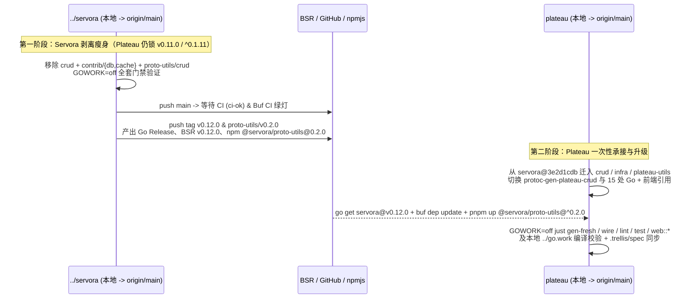

# Design：Servora 瘦身发版与 Plateau 承接 CRUD / 基础设施 / 前端工具包

关联文档：[prd.md](prd.md) · 父任务 [11-25-servora-kit-engineering/design.md](../11-25-servora-kit-engineering/design.md)

---

## 1. 架构与执行拓扑



---

## 2. 跨仓模块与包路径精确映射

### 2.1 Proto 契约与生成器映射

| 原 `servora` 资产 | 处置方式 | 新 `plateau` 路径与声明 | 说明 |
| --- | --- | --- | --- |
| `api/protos/servora/crud/v1/{errors,page_token}.proto` | 迁入改包 | `api/protos/plateau/crud/v1/{errors,page_token}.proto`<br/>`package plateau.crud.v1;`<br/>`go_package = ".../plateau/api/gen/go/plateau/crud/v1;crudpb"` | 错误枚举 `CrudErrorReason` 与 `PageTokenPayload` 枚举值、字段号保持 100% 兼容 |
| `api/protos/servora/contrib/db/redis/v1/config.proto` | 迁入改包 | `api/protos/plateau/infra/redis/v1/config.proto`<br/>`package plateau.infra.redis.v1;`<br/>`go_package = ".../plateau/api/gen/go/plateau/infra/redis/v1;redispb"` | 与 `plateau.infra.{kafka,clickhouse,openfga,mail}.v1` 命名空间统一；YAML 配置键 `redis:` 保持不变 |
| `api/protos/servora/example/v1/example.proto` | 降级为内部测试夹具 | `crud/testdata/examplepb/example.proto`<br/>`package plateau.crud.testdata.example.v1;`<br/>`go_package = ".../plateau/crud/testdata/examplepb;examplepb"` | 仿照 `crud/mapper/testdata/nestedpb/` 预生成 `.pb.go`、`_crud.pb.go` 与 `.crud.ts`，既保留多段资源 `tenants/{tenant}/users/{user}` 全量测试覆盖，又避免新增顶层目录并确保 `api/protos/` 零演示契约污染 |
| `cmd/protoc-gen-servora-crud/` | 迁入重命名 | `cmd/protoc-gen-plateau-crud/` + `internal/codegen/protoreach/` | Go 输出头改为 `protoc-gen-plateau-crud`，导入 `plateau/api/gen/go/plateau/crud/v1`；TS 输出 `*.crud.ts` 导入 `@servora/plateau-utils/crud` |

### 2.2 Go 运行时与基础设施映射

| 原 `servora` 包路径 | 目标 `plateau` 包路径 | 关键适配点 |
| --- | --- | --- |
| `github.com/Servora-Kit/servora/core/crud` | `github.com/Servora-Kit/plateau/crud` | 脱离 `core` 成为顶层包（包名 `crud`），含 `crud/mapper` 子包 |
| `github.com/Servora-Kit/servora/conformance/crud` | `crud/testdata`（测试数据目录） | 将 `resource_names.json` 与 `string_matches.json` 跨语言共享测试向量直接置于 `crud/testdata/`，消除独立顶层 `conformance/` 目录 |
| `github.com/Servora-Kit/servora/contrib/db/entgo` | `github.com/Servora-Kit/plateau/infra/entgo` | `driver.go`、`tracing.go` 与迁入的 `infra/entgo/crud` 同既有 `infra/entgo/mixin` 共存；`driver.go` 继续消费 `servora/core/v1` 的 `Data_Database` 配置；内存 SQLite 契约随 `just test` 默认运行，PostgreSQL 契约通过 `PLATEAU_ENT_POSTGRES_DSN` 在随机隔离 Schema 中运行并接入 CI `integration` 任务 |
| `github.com/Servora-Kit/servora/contrib/db/gorm` | `github.com/Servora-Kit/plateau/infra/gorm` | 保留 `slog.go` 与 `infra/gorm/crud` 扩展骨架 |
| `github.com/Servora-Kit/servora/contrib/db/redis` | `github.com/Servora-Kit/plateau/infra/redis` | `New(*redispb.Redis)` 与分布式锁 `lock.go` 切换至 `plateau/infra/redis/v1` |
| `github.com/Servora-Kit/servora/contrib/cache` | `github.com/Servora-Kit/plateau/infra/cache` | 含内存实现、`keyspace.go` 与 `infra/cache/redis` 子包 |

---

## 3. 前端工具包拆分与合并设计

### 3.1 `@servora/proto-utils@0.2.0`（瘦身微内核态）

- 移除 `src/crud/`、`test/crud.test.mjs`、`test/error-reasons.test.mjs`、`test/error-reasons.types.ts`；移除 `tsconfig*.json` 中 `@servora/proto-utils/crud` 路径映射。
- `package.json` 版本升至 `0.2.0`，`exports` 严格保留四项：
  - `.` → `./dist/index.{js,d.ts}`
  - `./transport` → `./dist/transport.{js,d.ts}`
  - `./errors` → `./dist/errors.{js,d.ts}`
  - `./proto/*` → `./dist/gen/*/index.{js,d.ts}`
- 在 `test/errors.test.mjs` 或独立导出测试中断言 `import("@servora/proto-utils/crud")` 抛出 `ERR_PACKAGE_PATH_NOT_EXPORTED`。

### 3.2 `@servora/plateau-utils@0.1.0`（`plateau/web/packages/plateau-utils`）

为同时满足「阶段四 `npm publish --provenance` 直接发布编译产物」与「`plateau` 本地/CI `pnpm install` 后无需手动预构建即可运行 `just api-ts-check` 和 `admin-web` 检查」，采用标准 ESM `dist` 构建配合工作区 `prepare` 钩子：

1. **目录结构**：
   ```text
   web/packages/plateau-utils/
   ├── package.json
   ├── tsconfig.json               # noEmit: true，覆盖 src/** 与 test/**
   ├── tsconfig.build.json         # rootDir: src -> outDir: dist, declaration: true
   ├── src/
   │   ├── index.ts                # 重导出 ./client/index.js
   │   ├── client/                 # 原 web/packages/client/src/*（内部相对导入改为 .js 后缀）
   │   │   ├── index.ts
   │   │   ├── http.ts
   │   │   ├── sse.ts
   │   │   ├── stream-utils.ts
   │   │   ├── types.ts
   │   │   └── websocket.ts
   │   ├── crud/                   # 迁自 servora/web/packages/proto-utils/src/crud/*
   │   │   └── index.ts
   │   └── gen/                    # 由 buf.typescript.gen.yaml（types 过滤）自动生成（纳入 git 与 gen-check）
   │       └── plateau/
   │           ├── crud/v1/errors.errors.ts
   │           └── security/errors/v1/errors.errors.ts
   └── test/
       ├── http.test.ts            # 原 client HTTP/SSE/WS 测试
       ├── kratos_stream_fixture.go
       ├── crud.test.ts            # 迁自 proto-utils CRUD + conformance 向量测试
       └── error-reasons.test.ts   # 验证 CrudErrorReason / SecurityErrorReason 导出与收窄
   ```
2. **`package.json` 导出契约与生命周期**：
   - `"name": "@servora/plateau-utils"`，`"version": "0.1.0"`，`"type": "module"`，`"sideEffects": false`，`"license": "MIT"`（不设 `"private": true`，为阶段四发布就绪）。
   - `"files": ["dist", "src"]`，在根 `.gitignore` 增加 `/web/packages/*/dist/`。
   - `"exports"`：
     - `"."`: `{ "types": "./dist/index.d.ts", "import": "./dist/index.js" }`
     - `"./client"`: `{ "types": "./dist/client/index.d.ts", "import": "./dist/client/index.js" }`
     - `"./crud"`: `{ "types": "./dist/crud/index.d.ts", "import": "./dist/crud/index.js" }`
     - `"./error-reasons/*"`: `{ "types": "./dist/gen/*.errors.d.ts", "import": "./dist/gen/*.errors.js" }`
   - `"scripts"`：
     - `"build": "tsc -p tsconfig.build.json"`
     - `"clean": "rm -rf dist"`
     - `"prepare": "pnpm run build"`（确保根工作区 `pnpm install --frozen-lockfile` 自动产出 `dist/`，`api-ts-check` 与 `admin-web` 零阻塞）
     - `"prepublishOnly": "pnpm run clean && pnpm run build"`
     - `"typecheck": "tsc --noEmit"`
     - `"test": "pnpm run build && node --experimental-strip-types --test test/*.test.ts"`
3. **公共错误原因生成（合并入 `buf.typescript.gen.yaml`）**：
   - 在 `buf.typescript.gen.yaml` 追加两组带 `types: [plateau.crud.v1.CrudErrorReason, plateau.security.errors.v1.SecurityErrorReason]` 的插件配置，输出至 `web/packages/plateau-utils/src/gen`（单模板保持 `buf.<语言>.gen.yaml` 统一命名）。
   - 接入 `justfile` 的 `gen-check`、`gen-clean` 及 `prek.toml` `exclude` 列表；阶段四合并服务 Proto 至 `api/protos/{iam,admin,audit}` 时，因 `types` 显式白名单过滤，不会混入业务服务错误枚举。
4. **消费侧切换清单**：
   - `api/gen/package.json`：依赖新增 `"@servora/plateau-utils": "workspace:*"`，`"@servora/proto-utils"` 升至 `"^0.2.0"`。
   - `app/iam/web`：`package.json` 将 `"@plateau/client": "workspace:*"` 替换为 `"@servora/plateau-utils": "workspace:*"`，`"@servora/proto-utils"` 升至 `"^0.2.0"`；`next.config.ts` `transpilePackages` 更新为 `["@plateau/api", "@servora/plateau-utils"]`；`lib/iam-api.ts` 改为从 `@servora/plateau-utils/client`（或 `@servora/plateau-utils`）导入。
   - `app/admin/web`：`pnpm-workspace.yaml` catalog 将 `@servora/proto-utils` 升至 `^0.2.0`；`apps/web-antd/package.json` 将 `@plateau/client` 替换为 `"@servora/plateau-utils": "link:../../../../../web/packages/plateau-utils"`；`vite.config.ts` `dedupe` 更新为 `['@servora/proto-utils', '@servora/plateau-utils']`；`src/api/client.ts`、`src/api/errors.ts`、`src/api/__tests__/errors.test.ts`、`src/views/users/schemas.ts` 全部切换至 `@servora/plateau-utils/{client,crud,error-reasons/...}`。
   - `pnpm-workspace.yaml` 与 `renovate.json5`：`minimumReleaseAgeExclude` 同时登记 `@servora/proto-utils` 与 `@servora/plateau-utils`。

---

## 4. 自举顺序、兼容性与回滚策略

1. **`plateau` 首次切换 `protoc-gen-plateau-crud` 的自举顺序**：
   - `cmd/protoc-gen-plateau-crud` 自身仅使用 `protogen`、`protoreflect` 与 `internal/codegen/protoreach`，**不直接编译期 import `api/gen/go/plateau/crud/v1`**（仅在生成代码文本中写出该导入路径）；但 `buf generate` 会一并编译 `api/protos/plateau/crud/v1/*.proto` 产出 `api/gen/go/plateau/crud/v1`，因此直接执行 `GOWORK=off just gen-fresh` 即可一步生成全部 Go 与 TS 产物，不存在循环编译死锁。
2. **有意破坏性提交的 `buf breaking` 处理**：
   - `../servora` 移除 `crud` / `example` / `contrib` Proto 属于 minor 破坏性重构（`v0.11.0` → `v0.12.0`）。本地推送 `servora/main` 时通过 `SKIP=buf-breaking git push` 显式放行本地 `pre-push` 钩子；远端 `ci.yml` 与 `buf-ci.yml` 在 `push main` 分支天然不跑 `breaking` 检查，合入后后续 PR 自动以瘦身后的 `main` 作为对比参照。
3. **严格两段式回滚锚点**：
   - 在 `servora v0.12.0` 与 `@servora/proto-utils@0.2.0` 远端发布成功前，绝不改动 `plateau` 业务源码；若发版环节异常，仅需在 `../servora` 修复，`plateau` 仍锁定 `v0.11.0` / `^0.1.11` 保持完好。
   - 若 `plateau` 承接阶段发现问题，所有变更均位于 `plateau` 单仓工作区内，无需回撤已发布的 `servora v0.12.0`。
