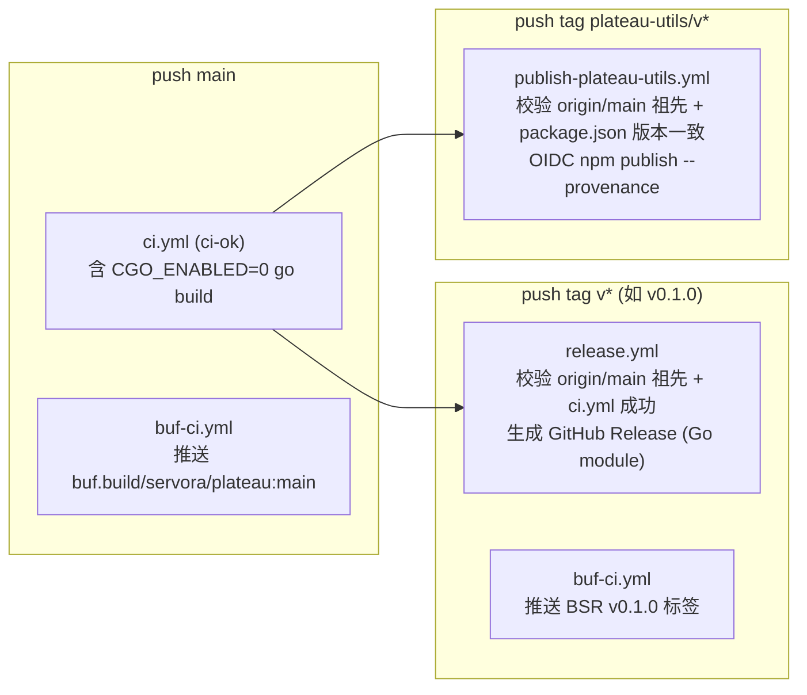

# Design：Plateau 单一 BSR、Go 包与 NPM 自动化发布流水线

需求来源：[prd.md](prd.md) 及父任务架构方案 [11-25-servora-kit-engineering/design.md](../11-25-servora-kit-engineering/design.md)。

---

## 1. 全集中式 `api/protos/` 与 Buf 模块整合

### 1.1 目录迁移映射

将分散在三个服务下的 12 个 `.proto` 文件按原相对包路径迁入根 `api/protos/`，与既有 `api/protos/plateau/**`（17 个文件）共同构成单一模块 `buf.build/servora/plateau`（共 29 个文件）：

| 原路径 | 目标路径 | 后续清理动作 |
| --- | --- | --- |
| `app/iam/service/api/protos/iam/**`（6 个） | `api/protos/iam/**` | 删除 `app/iam/service/api/protos/`，保留 `app/iam/service/api/buf.openapi.gen.yaml` |
| `app/admin/service/api/protos/admin/**`（4 个） | `api/protos/admin/**` | 删除 `app/admin/service/api/protos/`，保留 `app/admin/service/api/buf.openapi.gen.yaml` |
| `app/audit/service/api/protos/audit/**`（2 个） | `api/protos/audit/**` | 删除整个 `app/audit/service/api/`（该服务仅提供内部运维端口与 gRPC，无 OpenAPI 模板） |

### 1.2 生成产物零漂移不变量

1. **Go 与 TypeScript 生成模板无需改动**：
   - [buf.go.gen.yaml](../../../buf.go.gen.yaml) 与 [buf.typescript.gen.yaml](../../../buf.typescript.gen.yaml) 所有插件均相对于 Buf 模块根目录计算输出路径（`paths=source_relative` 或按 package 层级）。
   - 迁移前 `app/iam/service/api/protos` 是模块根，`iam/user/v1/user.proto` 相对模块根路径为 `iam/user/v1/user.proto`；迁移后 `api/protos` 是唯一模块根，`api/protos/iam/user/v1/user.proto` 相对模块根路径仍为 `iam/user/v1/user.proto`。
   - 因此 `api/gen/go/**`、`api/gen/ts/**` 与 `web/packages/plateau-utils/src/gen/**` 的输出文件路径、Go `import` 路径及 `.proto` 内部 `import "..."` 语句**完全不变**。
2. **服务级 OpenAPI 生成模板路径更新**：
   - [just/service.just](../../../just/service.just#L47-L50) 在仓库根目录（`ROOT_DIR`）下执行 `buf generate --template app/<svc>/service/api/buf.openapi.gen.yaml`。
   - `app/{iam,admin}/service/api/buf.openapi.gen.yaml` 的 `inputs` 必须保留 `directory: .`（使 Buf 从仓库根读取 `buf.yaml` 与 `buf.lock` 以解析 `buf.build/servora/servora`、`googleapis`、`protovalidate` 依赖），仅将 `paths` 数组前缀由 `app/<svc>/service/api/protos/<svc>/...` 改为 `api/protos/<svc>/...`：
     - IAM：`api/protos/iam/{user,account,authn,session}/v1`
     - Admin：`api/protos/admin/{audit,auth,user}/v1`
3. **`buf.yaml` 与 `buf.lock`**：
   - [buf.yaml](../../../buf.yaml) 的 `modules` 精简为：
     ```yaml
     modules:
       - path: api/protos
         name: buf.build/servora/plateau
     ```
   - 执行 `buf dep update` 确认 `buf.lock` 与单一命名模块一致。

---

## 2. CI 门禁加固与三条自动化发布工作流



### 2.1 `ci.yml`：锁定生产代码 `CGO_ENABLED=0`

- 在 [.github/workflows/ci.yml](../../../.github/workflows/ci.yml#L133-L135) `go` 任务的 `Build` 步骤设置 `env: CGO_ENABLED: "0"` 执行 `go build ./...`（`just test` 仍保持默认环境以支持 `*_test.go` 中的 `mattn/go-sqlite3` 竞态单测）。一旦生产包意外引入 CGO 依赖，PR 阶段即刻阻断。
- 在 `ci.yml` `changes` 的 `ci` 过滤器中保持对 `.github/workflows/ci.yml` 的监听（发布工作流仅在各自触发条件下运行，无需重跑全量业务集成测试）。

### 2.2 `buf-ci.yml`：对齐 `servora` 的 BSR 校验与自动推送

- 触发条件：`push`（`branches: [main]`、`tags: ["v*"]`，路径过滤 `**.proto`、`**/buf.yaml`、`**/buf.lock`；注意 tag 推送不受分支名限制，但若配置 `paths` 在 GitHub Actions 中与 `tags` 同处 `push` 下会导致 tag push 被 `paths` 过滤跳过！）。
- **关键修正点**：核查 `../servora/.github/workflows/buf-ci.yml` 可知，GitHub Actions 的 `on.push` 同时声明 `branches`、`tags` 与 `paths` 时，`paths` 也会作用于 `tags` 推送（若打 tag 的提交本身未改 `.proto`，比如先改 proto 合入后再补文档提交打 `v0.1.0`，`buf-ci.yml` 在 tag 上会被跳过！）。
  - 改进设计：将 `push` 拆为日常提交检查与版本发布一致性保障，或不在 `push` 上设阻断 tag 的窄路径过滤（仅对 `pull_request` 设 `paths`，或在 `release.yml` / `buf-ci.yml` 中确保 `v*` tag 必定触发 BSR 打标推送）。在 `plateau` 的 `buf-ci.yml` 中：对 `pull_request` 保留 `paths: ["**.proto", "buf.yaml", "buf.lock"]`，对 `push`（`branches: [main]` 与 `tags: ["v*"]`）不加 `paths` 截断（`buf-action@v1` 仅耗时约 5 秒，且能确保任意 `v*` 发布 tag 都在 `buf.build/servora/plateau` 上留下同名版本标签）。

### 2.3 `release.yml`：受 `main` CI 保护的 Go Release 流水线

- 复用 `../servora/.github/workflows/release.yml` 成熟模型：
  - 仅响应 `push.tags: ["v*"]`（与 `plateau-utils/v*` 互不重叠）；
  - 强制校验两点：① `git merge-base --is-ancestor "$GITHUB_SHA" origin/main`；② 调用 GitHub Actions API 确认该 `$GITHUB_SHA` 在 `main` 分支的 `ci.yml` `push` 运行结果为 `success`；
  - 自动提取上一 `^v` tag 至当前的提交列表，通过 `softprops/action-gh-release@v3` 发布 GitHub Release。

### 2.4 `publish-plateau-utils.yml`：根工作区适配与 OIDC Provenance 发布

相较于 `../servora/.github/workflows/publish-proto-utils.yml`，针对 `plateau` 仓库结构做三项精准适配：
1. **工作区安装路径**：`plateau` 的 `pnpm-workspace.yaml` 与 `pnpm-lock.yaml` 在仓库根目录，因此在仓库根执行 `pnpm install --frozen-lockfile --filter @servora/plateau-utils...`，随后在 `web/packages/plateau-utils` 下运行 `pnpm run typecheck` 与 `pnpm run test`。
2. **分支祖先与版本号强校验**：
   - 校验 `$GITHUB_SHA` 已合入 `origin/main`；
   - 校验 `GITHUB_REF_NAME`（如 `plateau-utils/v0.1.0`）严格等于 `"plateau-utils/v$(jq -r .version web/packages/plateau-utils/package.json)"`，防止错标发布。
3. **`prepublishOnly` 工具链兼容**：将 [web/packages/plateau-utils/package.json](../../../web/packages/plateau-utils/package.json#L34) 的 `"prepublishOnly"` 改为 `"npm run clean && npm run build"`（对齐 `proto-utils`），避免 `npm publish` 子进程生命周期依赖外部包管理器命令。

---

## 3. 外部凭据配置与首次实发流程（交互式 Wizard）

### 3.1 两个外部前置阻塞与最小解法

| 阻塞项 | 事实依据 | 最小操作方案 |
| --- | --- | --- |
| `Servora-Kit/plateau` 缺少 `BUF_TOKEN` | `gh secret list -R Servora-Kit/plateau` 为空；`buf.build/servora/plateau` 已建好 | 在临时向导中引导输入具备 `servora` BSR 写入权限的 Token，执行 `gh secret set BUF_TOKEN -R Servora-Kit/plateau` |
| npmjs 全新包不支持 OIDC 直接创建 | `npm view @servora/plateau-utils` 返回 E404；npmjs Trusted Publisher 只能在已存在包的设置页配置 | 在临时向导中将本地 `package.json` 临时设为 `0.1.0-alpha.0`（不提交 Git），执行 `npm publish --access public --tag alpha` 创建包名后立即还原 `0.1.0`；随后打开 `https://www.npmjs.com/package/@servora/plateau-utils/access` 绑定 GitHub Actions（Org: `Servora-Kit`、Repo: `plateau`、Workflow: `publish-plateau-utils.yml`） |

> 向导脚本存放于会话临时目录（不写入 Git 跟踪路径，执行完毕即删除），严格遵循 `wizard` 技能模板规范。

### 3.2 破坏性检查过渡与首发顺序

1. **本地提交与远端 `main` 推送**：
   - 先推送 `../servora` 的文档提交 `c12fd4fb`，确认 `servora` `main` CI 绿灯；
   - `plateau` 本次合并 `app/*/service/api/protos` 至 `api/protos` 属于一次性模块合并，本地 `prek` `pre-push` 的 `just breaking` 对比旧 `origin/main`（4 个未命名模块 → 1 个命名模块）会因旧模块移除报错；因此在首次推送 `plateau` `main` 时仅跳过 `buf-breaking` 单项钩子（`SKIP=buf-breaking git push origin main`），合入后立即在本地复跑 `just breaking` 验证与新 `origin/main` 对比为 0 差异。
2. **双 Tag 实发与外部消费者验收**：
   - 等待 `Servora-Kit/plateau` `main` 上的 `CI`（`ci-ok`）与 `Buf CI` 全部 `success`；
   - 推送 `plateau-utils/v0.1.0`，等待 `Publish @servora/plateau-utils` 工作流通过 OIDC `--provenance` 发布成功；
   - 推送 `v0.1.0`，等待 `Release` 与 `Buf CI`（BSR `v0.1.0` 标签）全部成功；
   - 在仓库外临时目录 `/tmp/plateau-consumer-smoke-*`（`GOWORK=off`、`CGO_ENABLED=0`）初始化最小模块，验证：
     - `buf.yaml` 依赖 `buf.build/servora/plateau:v0.1.0` 执行 `buf build` 通过；
     - `go get github.com/Servora-Kit/plateau@v0.1.0` 并导入 `iam/user/v1`、`audit/event/v1`、`security`、`crud` 执行 `CGO_ENABLED=0 go build` 通过；
     - `npm view @servora/plateau-utils@0.1.0 dist.attestations` 确认存在 OIDC provenance 签名证明。

---

## 4. 回滚策略

- **推送远端前**：所有变更均在本地 Git 分支，可通过 `git checkout` / `git reset` 无损回退。
- **`main` 推送后、打 Tag 前**：若 `CI` 或 `Buf CI` 因工作流细节失败，直接在 `main` 追加修复提交并等待绿灯后再打 `v0.1.0` / `plateau-utils/v0.1.0`，不会污染任何正式版本号。
- **NPM 首发引导**：引导包使用 `--tag alpha`（`0.1.0-alpha.0`），不影响 `latest` dist-tag；正式 `0.1.0` 由 GitHub Actions OIDC 发布并自动成为 `latest`。
