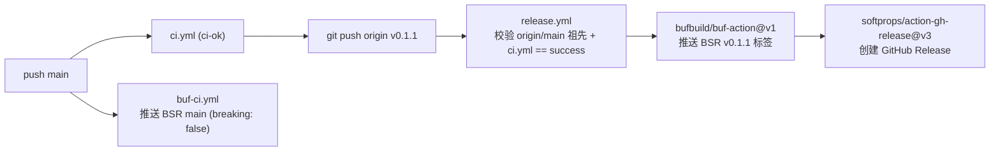

# Design：Plateau 单一 BSR 统一命名空间、CGO 门禁与原子发布流水线

需求来源：[prd.md](prd.md) 及父任务架构方案 [11-25-servora-kit-engineering/design.md](../11-25-servora-kit-engineering/design.md)。

---

## 1. 12 个服务 `.proto` 补齐顶层命名空间（全仓统一 `plateau.*.*.v1`）

### 1.1 命名规范依据与不变量

1. **采用正序产品前缀 `plateau.<service>...v1`**：
   - Protobuf 官方与 Buf `STANDARD`（`PACKAGE_DIRECTORY_MATCH`）规范采用 `<产品>.<领域>.<版本>`（对齐既有 17 个平台契约 `plateau.{security,crud,infra}.*.v1` 与同系 `servora.<domain>.v1`），消除单一 BSR 模块 `buf.build/servora/plateau` 导出裸 `iam.*` / `admin.*` / `audit.*` 包名时与下游业务仓冲突的隐患。
2. **保持 `.v1` 后缀与 `/v1/...` 全栈路由不变**：
   - 平台处于 `0.x` 快速迭代阶段，无需将包名降级为 `v1alpha1`（避免 `v1.0.0` 时二次全栈重命名）；17 个平台公共契约、4 款 `protoc-gen-plateau-*` 插件、`buf.typescript.gen.yaml`、`@servora/plateau-utils@0.1.0` 错误原因子路径、HTTP `/v1/{iam,admin}/...` 路由、Admin OIDC `redirect_uri`、Traefik 规则与会话 `JSONPrefixes` 全部保持不变。
3. **服务配置 `conf.proto` 统一留在 `api/protos/plateau/` 并推送 BSR**：
   - 4 个服务配置契约（`iam/conf`、`iam/oidc/conf`、`admin/conf`、`audit/conf`）仅声明结构与 `protovalidate` 规则，不含任何敏感值，与既有 11 个 `infra`/`security` 配置契约同构。

### 1.2 12 个迁移的服务 `.proto` 完整映射表

所有文件统一迁至 `api/protos/plateau/{iam,admin,audit}/.../v1/`，`option go_package` 格式统一为 `"github.com/Servora-Kit/plateau/api/gen/go/plateau/<subpath>/v1;<alias>v1"`：

| 原路径（`api/protos/...`） | 新路径（`api/protos/...`） | 新 `package` | `go_package` 包别名 |
| --- | --- | --- | --- |
| `admin/audit/v1/audit.proto` | `plateau/admin/audit/v1/audit.proto` | `plateau.admin.audit.v1` | `adminauditv1` |
| `admin/auth/v1/auth.proto` | `plateau/admin/auth/v1/auth.proto` | `plateau.admin.auth.v1` | `adminauthv1` |
| `admin/conf/v1/config.proto` | `plateau/admin/conf/v1/config.proto` | `plateau.admin.conf.v1` | `adminconfv1` |
| `admin/user/v1/user.proto` | `plateau/admin/user/v1/user.proto` | `plateau.admin.user.v1` | `adminuserv1` |
| `audit/conf/v1/config.proto` | `plateau/audit/conf/v1/config.proto` | `plateau.audit.conf.v1` | `auditconfv1` |
| `audit/event/v1/event.proto` | `plateau/audit/event/v1/event.proto` | `plateau.audit.event.v1` | `auditeventv1` |
| `iam/account/v1/account.proto` | `plateau/iam/account/v1/account.proto` | `plateau.iam.account.v1` | `iamaccountv1` |
| `iam/authn/v1/authn.proto` | `plateau/iam/authn/v1/authn.proto` | `plateau.iam.authn.v1` | `iamauthnv1` |
| `iam/conf/v1/config.proto` | `plateau/iam/conf/v1/config.proto` | `plateau.iam.conf.v1` | `iamconfv1` |
| `iam/oidc/conf/v1/config.proto` | `plateau/iam/oidc/conf/v1/config.proto` | `plateau.iam.oidc.conf.v1` | `iamoidcconfv1` |
| `iam/session/v1/session.proto` | `plateau/iam/session/v1/session.proto` | `plateau.iam.session.v1` | `iamsessionv1` |
| `iam/user/v1/user.proto` | `plateau/iam/user/v1/user.proto` | `plateau.iam.user.v1` | `iamuserv1` |

### 1.3 调用侧联动范围

1. **生成产物更新**：运行 `just gen-clean && GOWORK=off just gen`，清理 `api/gen/{go,ts}/{iam,admin,audit}`，产出 `api/gen/{go,ts}/plateau/{iam,admin,audit}/.../v1`（由于 `protoc-gen-plateau-*` 仅依赖保持不变的 `plateau.{security,crud}.*.v1`，无需分阶段自举）。
2. **Go 导入与测试全限定方法名更新**：
   - `app/{iam,admin,audit}/service` 下各层导入路径由 `.../api/gen/go/{iam,admin,audit}/.../v1` 切换为 `.../api/gen/go/plateau/{iam,admin,audit}/.../v1`，重新运行 `just wire`；
   - `security/` 下直接引用 `iam/audit` 契约的文件（`security/authn/session/{user.go,authn_test.go}`、`security/oidc/{rp.go,oidc_test.go}`、`security/audit/kafka/{kafka.go,kafka_test.go}`）同步切换导入路径；
   - 单测中涉及 gRPC 方法全限定名的断言同步更新为 `/plateau.{iam,admin,audit}.*.v1.<Service>/<Method>`。
3. **前端 `@plateau/api` 导入更新**：
   - `app/iam/web` 与 `app/admin/web` 中对 `@plateau/api/{iam,admin,audit}/.../v1` 的导入切换至 `@plateau/api/plateau/{iam,admin,audit}/.../v1`；`@servora/plateau-utils` 零改动。

---

## 2. `0.x` 演进期关闭三处自动 `breaking` 拦截

- **[buf.yaml](../../../buf.yaml#L12-L16)**：保留 `breaking: use: [FILE]` 配置不变，供本地按需手动执行 `just breaking` 检查契约差异。
- **[prek.toml](../../../prek.toml)**：移除 `pre-push` 中的 `buf-breaking` 钩子，添加注释说明 `0.x` 阶段不拦截推送、待 `v1.0.0` 发布前恢复。
- **[.github/workflows/ci.yml](../../../.github/workflows/ci.yml)**：移除 `proto` 任务的 `Check breaking changes` 步骤，保留 `Lint proto` 与 `Check proto formatting`。
- **[.github/workflows/buf-ci.yml](../../../.github/workflows/buf-ci.yml)**：在 `bufbuild/buf-action@v1` 的 `with` 中显式设置 `breaking: false`（`buf-action@v1` 默认在 `pull_request` 事件开启 `breaking`），保留 PR 阶段的 `lint`/`format` 与 `main` 推送阶段的 `push`。

---

## 3. 根级单一 `buf.openapi.gen.yaml` 与无分支 `just openapi`

1. **仓库根目录新增唯一 `buf.openapi.gen.yaml`**：
   ```yaml
   version: v2
   clean: false
   managed:
     enabled: true
     disable:
       - module: buf.build/googleapis/googleapis
       - module: buf.build/bufbuild/protovalidate
       - module: buf.build/servora/servora
   plugins:
     - local: ["go", "tool", "protoc-gen-openapi"]
       strategy: all
       out: internal/assets
       opt:
         - naming=json
         - depth=2
         - default_response=false
         - enum_type=string
         - output_mode=merged
         - fq_schema_naming=false
   ```
2. **`just/service.just` 单行参数化生成**：
   - 删除 `OPENAPI_TEMPLATE` 变量及 `if path_exists(...)` 判断，`openapi` 配方精简为：
     ```just
     [working-directory(ROOT_DIR)]
     openapi:
         @buf generate --template buf.openapi.gen.yaml --path "api/protos/plateau/{{ SERVICE_NAME }}" -o "{{ SERVICE_MODULE }}"
     ```
   - `protoc-gen-openapi` 仅提取带 `google.api.http` 绑定的 RPC 及其可达消息（`conf.proto` 不会混入 Schema）；对于纯 gRPC/Kafka 的 `audit` 服务，生成的极简合法 `app/audit/service/internal/assets/openapi.yaml` 直接纳入版本控制，由 [justfile](../../../justfile#L107) 的 `:(glob)app/*/service/**/openapi.yaml` 统一校验。
   - 删除已废弃的 `app/iam/service/api/`、`app/admin/service/api/` 目录，并移除 [.github/workflows/ci.yml](../../../.github/workflows/ci.yml#L59) 中的 `- 'app/*/service/api/buf.*.gen.yaml'`。

---

## 4. 三处 `CGO_ENABLED=0` 构建门禁与原子化 Tag 发布流水线

### 4.1 三处统一强制 `CGO_ENABLED=0`

- **远端 CI**：[.github/workflows/ci.yml](../../../.github/workflows/ci.yml#L133-L136) `go` 任务 `Build (CGO disabled)` 保持 `CGO_ENABLED: "0" go build ./...`。
- **本地服务构建**：[just/service.just](../../../just/service.just) 顶部新增 `CGO_ENABLED := env("CGO_ENABLED", "0")`，Unix `_build` 使用 `CGO_ENABLED="{{ CGO_ENABLED }}" go build ...`，Windows `_build` 设置 `$env:CGO_ENABLED = "{{ CGO_ENABLED }}"` 后执行 `go build ...`。
- **本地推送门禁**：[prek.toml](../../../prek.toml) `pre-push` 阶段新增钩子 `go-build-nocgo`（`entry = "go build ./..."`，`env = { CGO_ENABLED = "0", GOWORK = "off" }`，`pass_filenames = false`，`always_run = true`）。
- **竞态单测保持不变**：`just test` 继续使用默认环境以支持 `-race` 与测试专用的 `mattn/go-sqlite3`。

### 4.2 原子化 Tag 发布架构



- **[.github/workflows/buf-ci.yml](../../../.github/workflows/buf-ci.yml)**：从 `on.push` 中移除 `tags: ["v*"]`，将 `concurrency.cancel-in-progress` 简化为 `${{ github.ref != 'refs/heads/main' }}`，并设置 `breaking: false`。
- **[.github/workflows/release.yml](../../../.github/workflows/release.yml)**：在 `Verify tag commit passed CI on main` 之后、`Generate changelog` 之前插入 `uses: bufbuild/buf-action@v1`（`token: ${{ secrets.BUF_TOKEN }}`、`push_disable_create: true`），确保未通过 `main` `ci-ok` 的任意 `v*` 标签既不会生成 GitHub Release，也不会污染 BSR 版本标签。

---

## 5. `v0.1.1` 发布策略与回滚设计

- **补丁修订号发版 `v0.1.1`**：`v0.1.0` 昨日刚完成首发，此次补齐 12 个服务 `.proto` 的 `plateau.` 前缀与构建/发布流水线修正按补丁修订号 `v0.1.1` 发布（不提前消耗 `v0.2.0` 功能版本号）；`go.mod` 不写 `retract`，`.proto` 不标 `deprecated`；`@servora/plateau-utils` 无任何变更，继续沿用已发布的 `0.1.0`。
- **回滚机制**：打 `v0.1.1` 标签前，所有改动先在本地全量门禁与远端 `main` 的 `CI` + `Buf CI` 完整跑通；若远端流水线发现任何问题，直接在 `main` 追加修复提交并等待绿灯后再推送 `v0.1.1` 标签，不提前消耗版本号。
