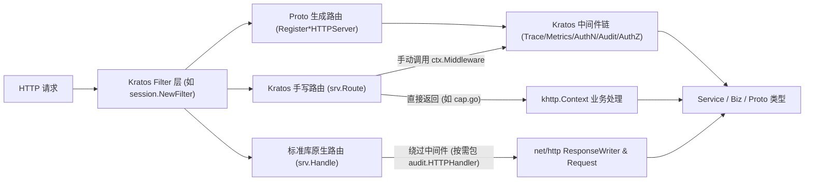

# Plateau HTTP 现有能力与拓展探索

> 沉淀日期：2026-11-27
> 核查快照：`github.com/go-kratos/kratos/v3@v3.0.0`、`github.com/go-kratos/kratos/cmd/protoc-gen-go-http/v3@v3.0.0-20261123032133-56cfd65deee9`、`github.com/go-kratos/kratos/contrib/encoding/json/v3@v3.0.0-20260626125723-668db92c2c00`、`servora`、`plateau` 当前 `main`；外部对照本地仓库 `tx7do/go-wind-toolkit` 与 `tx7do/go-wind-admin`。

---

## 一、Kratos HTTP 路由机制与原生 Handler 扩展

### 1.1 `google.api.http` 生成的传输层胶水

对照 `protoc-gen-go-http` 生成结果（以 `api/gen/go/plateau/admin/user/v1/user_http.pb.go:62-136` 为例），`google.api.http` 注释并非只做 URL 映射，而是自动生成 5 步传输层逻辑：

1. **路由注册**：`r := s.Route("/"); r.Handle("POST", "/v1/admin/users", ...)`。
2. **入参绑定**：自动调用 `ctx.Bind(&in)`（Body）、`ctx.BindVars(&in)`（路径参数）、`ctx.BindQuery(&in)`（Query）。
3. **声明 `Operation`**：调用 `http.SetOperation(ctx, OperationUserServiceCreateUser)`（如 `"/plateau.admin.user.v1.UserService/CreateUser"`）。
4. **进入 Kratos 中间件链**：调用 `ctx.Middleware(...)`，触发在 `app/admin/service/internal/server/http.go:49-58` 等处注册的 Trace、Metrics、Session/JWT AuthN、Audit、OpenFGA AuthZ 等中间件。
5. **统一序列化与错误编码**：通过 `ctx.Result(200, reply)` 走统一 JSON Codec 与错误编码器，同时上游工具链同步产出 `@plateau/api` TS SDK 与 `*_rules.gen.go` 安全规则表。

手写原生 HTTP 路由的实质，是**按需绕过或接管上述第 2~5 步**，将原始 `*http.Request` 与 `http.ResponseWriter` 交还给业务代码掌控。

### 1.2 请求在 Kratos HTTP Server 内的流向



关键特性：

- **最外层 `Filter` 对所有路由均生效**：例如 `security/session/filter.go:73-98` 会按路径前缀与精确路径决定是否加载 Cookie Session 与校验 `Origin`。
- **Kratos `Middleware` 链仅在调用 `ctx.Middleware(...)` 时触发**：绕过中间件链的路由必须自行按需处理认证、鉴权、审计与入参校验。

### 1.3 仓库内两种手写路由形态

两者均在服务装配的 `svrhttp.WithServices` 回调内注册（见 `app/iam/service/internal/server/http.go:57-63`、`app/admin/service/internal/server/http.go:65-70`）。

#### 形态 A：纯标准库 `net/http`（`srv.Handle` / `srv.HandlePrefix`）

适合 302 重定向、表单提交、第三方 XML/原始体验签回调、文件流，或直接挂载现成第三方 `http.Handler`。

- 仓库实例：Admin OIDC 登录与回调（`app/admin/service/internal/service/auth.go:67-85`）、IAM OIDC 端点（`app/iam/service/internal/oidc/provider.go:246-279`）。

```go
// 摘自 app/admin/service/internal/service/auth.go
func (s *AuthService) RegisterOIDCHTTP(srv *khttp.Server, auditor audit.Auditor) {
	srv.Handle("/v1/admin/auth/login", http.HandlerFunc(s.handleLogin))
	// 因绕过 Kratos audit.Server 中间件，需手工用 audit.HTTPHandler 补审计
	srv.Handle(
		"/v1/admin/auth/callback",
		audit.HTTPHandler(auditor, "plateau.admin.auth.callback.v1", audit.CategoryAuthn)(
			http.HandlerFunc(s.handleCallback),
		),
	)
}

func (s *AuthService) handleLogin(w http.ResponseWriter, r *http.Request) {
	if r.Method != http.MethodGet {
		http.Error(w, http.StatusText(http.StatusMethodNotAllowed), http.StatusMethodNotAllowed)
		return
	}
	// 直接操作 ResponseWriter / Redirect / Header / Body
}
```

#### 形态 B：Kratos `Route`（`srv.Route` + `khttp.Context`）

开发体验接近 Gin/Echo，支持路径参数、HTTP Method 分发以及 `ctx.JSON` / `ctx.Bind` / `ctx.Result`。

- 仓库实例：嵌入式验证码端点（`security/cap/cap.go:509-538`）。

```go
// 摘自 security/cap/cap.go
func Register(server *khttp.Server, captcha *Cap) {
	route := server.Route("/cap")
	route.POST("/redeem", func(ctx khttp.Context) error {
		khttp.SetOperation(ctx, OperationCapRedeem)
		var body struct {
			Token     string `json:"token"`
			Solutions []int  `json:"solutions"`
		}
		if err := json.UnmarshalRead(ctx.Request().Body, &body, json.RejectUnknownMembers(true)); err != nil {
			return ctx.JSON(http.StatusBadRequest, map[string]string{"error": "invalid body"})
		}
		response, err := captcha.RedeemChallenge(ctx, body.Token, body.Solutions)
		if err != nil {
			return ctx.JSON(http.StatusInternalServerError, map[string]string{"error": "internal error"})
		}
		return ctx.JSON(http.StatusOK, response)
	})
}
```

> **fail-closed 踩坑提醒**：`cap.go` 未调用 `ctx.Middleware(...)`，因此不经过全局认证/鉴权/审计中间件。若在 `srv.Route` 内显式调用 `ctx.Middleware(...)`，必须同时通过 `security/rules.go:18-22` 的 `security.WithRulesFuncs` 为该 `Operation` 注册对应规则，否则 `security/authn/session/middleware.go:30-34` 与 `security/authz/openfga/middleware.go:38-42` 会因查无规则直接 fail-closed 拒绝请求。

### 1.4 `srv.Handle` vs `srv.Route` 对比与选型

基于 `kratos/v3@v3.0.0`（`transport/http/server.go:237-260`、`transport/http/router.go:20-104`）：

| 维度 | `srv.Handle`（及 `HandlePrefix`/`HandleFunc`） | `srv.Route`（返回 `*khttp.Router`） |
| --- | --- | --- |
| **底层行为** | 直接注册到 `gorilla/mux.Router` | 包装 `khttp.Context` 与路由级 `FilterChain` 后注册到 `mux.Router` |
| **Handler 签名** | 标准库 `http.Handler`（无 `error` 返回） | `func(ctx khttp.Context) error` |
| **HTTP Method 限制** | **默认不限**（需在 handler 内手写判断）；`WalkRoute()` 会跳过 | 原生按 `GET`/`POST`/`PUT` 等分发，`WalkRoute()` 可枚举 |
| **分组与局部 Filter** | 无 | 支持前缀、`Group(...)` 嵌套、分组/单路由级 `FilterFunc` |
| **绑定与响应辅助** | 无，纯手操作 `r`/`w` | 内置 `Bind`/`BindVars`/`BindQuery`/`BindForm`、`JSON`/`Blob`/`Stream`/`Result`，且可经 `ctx.Request()`/`ctx.Response()` 退回原始 `r`/`w` |
| **统一错误处理** | 无，需自行写状态码和响应体 | 返回 `error` 自动走 Server 的 `ErrorEncoder`（支持 Kratos 错误与 `Redirector`） |
| **Kratos 中间件链** | 无法直接调 `ctx.Middleware(...)`（仅经过全局 `Filter` 与 `s.filter()` 超时/Transport 注入） | 可按需调 `ctx.Middleware(...)` 接入全局 Trace/AuthN/Audit/AuthZ |

**选型原则**：

- **手写业务接口**（自定义上传下载、Webhook 验签回调、非标准 RPC）：优先 **`srv.Route`**（`protoc-gen-go-http` 自身也是经 `s.Route("/")` 注册，见 `httpTemplate.tpl:23-32`），兼顾 Method 校验、分组局部 Filter、统一错误编码与按需退回原生 `ResponseWriter`/`Request`。
- **直接挂载第三方 `http.Handler` 或标准库组件**（如 IAM 挂 `zitadel/oidc` handler、`http.FileServer`、`pprof`、纯 302 跳转）：用 **`srv.Handle` / `srv.HandlePrefix`**，避免多余封装。

### 1.5 手写 Handler 复用 Proto 生成代码矩阵

Proto 生成产物中「数据结构 / 错误 / 下游客户端」与「HTTP 路由胶水」彼此解耦：

| Proto 生成产物 | 手写 HTTP Handler 能否复用 | 说明 |
| --- | --- | --- |
| Message 结构体（`*.pb.go`）与校验（`*.pb.validate.go`） | **可直接复用** | 可用 `protojson.Unmarshal`/`Marshal` 编解码，或把解析后的 multipart/XML 数据组装成 Proto Message 传给下游 |
| 错误构造器（`*_errors.pb.go`） | **可直接复用** | 可直接返回 `securityerrorspb.ErrorSecurityErrorReasonUnauthenticated(...)`（`srv.Route` 下自动走统一错误编码器） |
| 内部 gRPC Client / 共享 Biz 与 Service | **可直接复用** | 如 `app/admin/service/internal/service/auth.go:30-37` 中同一个 `AuthService` 同时承载 Proto RPC（`GetSession`/`Logout`）与原生 HTTP Handler（`handleLogin`/`handleCallback`），共享 `s.uc`、`s.manager` 与 Proto 类型 |
| `*_http.pb.go` 路由绑定 | **不走** | 由手写 handler 自行解析请求与写出响应 |
| `*_rules.gen.go` 安全规则 & `@plateau/api` TS SDK | **不会自动生成** | 路径未声明在 `.proto` 的 `rpc` 中，需手工处理鉴权/审计，前端也需手写对应请求调用 |

---

## 二、Kratos HTTP 序列化机制：`protojson` 与 `json` Codec

### 2.1 Kratos v3 的三个 JSON Codec 与选型规则

Kratos v3 将 v2 单一的 `encoding/json` 拆分为三个包（见 `kratos/v3@v3.0.0/docs/migration/v2-to-v3_zh.md:26-49`）：

| 包 | 注册 Codec 名（对应 MIME subtype） | `proto.Message` 编解码 | 普通 Go struct / map / slice |
| --- | --- | --- | --- |
| `kratos/v3/encoding/json`（`encoding/json/json.go:1-42`） | `"json"`（`application/json`） | 标准库 `encoding/json` | 标准库 `encoding/json` |
| `kratos/v3/encoding/protojson`（`encoding/protojson/protojson.go:1-54`） | `"protojson"`（`application/protojson`） | `google.golang.org/protobuf/encoding/protojson`（默认 `EmitUnpopulated: true`, `DiscardUnknown: true`） | **直接报错**（`want proto.Message`） |
| `kratos/contrib/encoding/json/v3`（`json.go:1-71`） | `"json"`（`application/json`） | 优先 `json.Marshaler`/`Unmarshaler`，其次按 **`proto.Message` 走 `protojson`** | 兜底走标准库 `encoding/json` |

**Kratos HTTP 选择 Codec 的规则**：

- **Unary HTTP**（`transport/http/codec.go:79-161`）：请求体按 `Content-Type` subtype 查表，响应体和错误按 `Accept` subtype 查表，匹配不到时**回退 `"json"`**。
- **HTTP Stream（SSE/WS）**（`transport/http/stream.go:858-877`）：按 `Accept`/`Content-Type` 匹配不到（例如 SSE 固定发 `Accept: text/event-stream`）时，**优先回退 `"protojson"`，再退回 `"json"`**。

### 2.2 Servora / Plateau 当前装配与隐性风险

- **当前装配**：`../servora/transport/server/http/server.go:9-10` 同时 blank import 了 `contrib/encoding/json/v3` 与 `v3/encoding/protojson`（规范见 `.trellis/spec/servora/framework/transport.md:9`，测试锁定在 `../servora/transport/server/http/server_test.go:26-99`）。
- **实际效果**：前端发标准 `application/json`（`web/packages/plateau-utils/src/client/index.ts:52-55`）时，服务端走 `contrib/encoding/json/v3` —— **Proto 消息自动走 `protojson`，非 Proto 结构体自动回落标准库 `encoding/json`**；同时 `application/protojson` 也保持可用。应用 handler 禁止替换全局 codec。
- **隐性风险**：`kratos/v3/config` 内部 blank import 了标准库版 `kratos/v3/encoding/json`（`config/config.go:11`），与 `contrib/encoding/json/v3` 竞争同一个 `"json"` 注册名；目前依赖 `contrib/encoding/json/v3` 在初始化顺序上后注册覆盖生效，并由 `server_test.go:26-49` 做回归断言保障。

### 2.3 序列化语义差异：`encoding/json` vs `protojson`

| 对比项 | 标准库 `encoding/json` | `protojson`（Protobuf Canonical JSON） |
| --- | --- | --- |
| **字段命名** | 按 Go struct tag（`protoc-gen-go` 生成默认 `snake_case`） | 序列化默认 `lowerCamelCase`（可配 `UseProtoNames`）；反序列化同时兼容 camelCase 与 snake_case |
| **`int64` / `uint64` / `fixed64`** | 输出 JSON **number**（超过 `2^53 - 1` 在 JS 中丢精度） | 输出 JSON **string**（如 `"9223372036854775807"`），防止前端精度丢失；反序列化同时接受 string/number |
| **Enum 枚举** | 输出底层 **int32 数字**（如 `1`） | 默认输出**枚举名字符串**（如 `"USER_STATUS_ACTIVE"`）；反序列化同时接受名称和数字 |
| **`oneof` 联合字段** | 输出内部包装结构体（`{"Event":{"ChatChunk":{...}}}`），且**反序列化会直接失败**（Go 接口类型无法实例化） | 扁平化为外层字段（`{"chatChunk":{...}}`），正反序列化均正常 |
| **Well-Known Types** | 按内部 Go 字段展开（`Timestamp` 变成 `{"seconds":...,"nanos":...}`，`FieldMask`/`Duration`/`Any`/`Struct`/`Int64Value` 均不合规范） | 按规范格式编解码：`Timestamp` → RFC3339、`Duration` → `"1.5s"`、`FieldMask` → `"a,b.c"`、`Int64Value` → `"123"`、`Any` → `@type`、`Struct`/`Value` → 原生 JSON |
| **零值 / 空字段** | 依赖 `omitempty` tag（零值字段常被省略） | 由 `EmitUnpopulated` / `EmitDefaultValues` 统一控制（Kratos 默认 `EmitUnpopulated: true`） |
| **非 Proto 类型** | 原生支持 | 纯 `kratos/v3/encoding/protojson` 直接报错；`contrib/encoding/json/v3` 自动回落标准库 `encoding/json` |

结论：只要 HTTP 契约基于 Protobuf（特别是涉及 `int64`、`Timestamp`、`FieldMask`、`oneof`、枚举），必须使用 `protojson` 语义；Servora 通过 `contrib/encoding/json/v3` 接管 `"json"`，使标准 `application/json` 请求兼具 `protojson` 正确性与普通 Go 结构体兼容性。

---

## 三、Proto 契约优先 vs Gin / Echo 传统 HTTP 开发

基于 Plateau 现有工具链（Kratos v3 + Buf + 自定义代码生成插件）与传统 Gin/Echo 开发模式对比：

| 维度 | Proto 契约优先（Plateau 模式） | Gin / Echo 传统 HTTP |
| --- | --- | --- |
| **前后端契约同步** | `.proto` 为单一事实源；`just gen` 一键产出 Go 代码、TS SDK、错误码枚举；`buf breaking` 在 CI 拦截破坏性改动 | 手写 Struct + JSON tag，文档靠 Swagger 注释或外部平台维护，字段/错误码易与实现漂移 |
| **安全与治理一致性** | 认证/鉴权/审计/脱敏/校验全部声明在 Proto（`protoc-gen-plateau-authn/authz/audit/crud`、`validate`、`redact`），集中生成规则表，漏配鉴权在运行前 fail-closed 拦截 | 依赖路由分组、手工中间件与 Handler 内编码，接口增多后易出现漏挂鉴权、日志漏脱敏、审计口径不统一 |
| **多协议与服务间通信** | 一套实现同时提供对外 HTTP/JSON 与内部强类型 gRPC（及流式通信），无需维护两套 DTO | 原生仅 HTTP；内部服务互调多走 HTTP JSON，后期切 gRPC 需重写 IDL 与转换层 |
| **非标准 HTTP 场景灵活度** | 受 `google.api.http` 映射约束，文件上传/下载、Multipart、第三方 XML/验签回调、自定义 Cookie/重定向需绕开 Proto 写原生 Handler | 直接掌控 `Context` 与 `http.ResponseWriter`，各类表单、流式下载、微信/支付宝回调无缝支持 |
| **开发迭代速度与心智负担** | 前期链路较重：改字段 → 编 Proto → `just gen` → 改业务；需理解 Proto3 零值/`optional`、`FieldMask`、`oneof` 及生成插件机制 | 极轻：改完 Go 代码即可运行，新人上手快，IDE 跳转直达业务无生成文件干扰 |
| **JSON 细节与性能** | 外部 HTTP 走 `protojson`（默认 camelCase、`int64` 转字符串防 JS 精度丢失）；JSON 编解码开销略高于极速库，内部 gRPC 则显著更省带宽与 CPU | 字段命名与类型完全自由，可直接接入 `sonic`/`goccy/go-json` 等高性能库 |
| **第三方社区中间件生态** | Kratos 中间件需抽象 HTTP/gRPC 两套传输，社区纯 Gin 插件无法直接复用 | Go Web 生态最成熟，限流、支付回调、脚手架现成方案最多 |

**选型判断**：

- **适合直接用 Plateau（Proto 优先）**：多端共享后端（Web 管理台 + 小程序 + App/开放 API）、存在多微服务协同、对权限模型（OpenFGA）与操作审计有强合规要求的中长期项目。
- **更适合 Gin / Echo**：1~2 人快速验证的独立轻量应用、以第三方回调/文件处理/非标 HTTP 接口为主的边缘胶水服务，或团队不熟悉 Proto/Buf 且无多服务拆分计划。
- **常见折中模式**：核心域服务与规范 CRUD 走 Proto 沉淀契约；特殊回调（支付通知/客服消息/媒体上传）在 BFF 挂原生 HTTP 路由，不强行用 Proto 建模。

---

## 四、客户端形态适配：小程序 vs 普通 H5

### 4.1 Plateau 面向小程序的复用与改造点

Plateau 可以作为小程序后端并复用大部分生成 TS 类型与客户端代码，但**并非开箱即用**。

#### 可直接复用的 4 项能力

1. **标准 HTTP/JSON 接口**：`buf.go.gen.yaml:16-19` 通过 `protoc-gen-go-http` 暴露普通 REST/JSON（非 gRPC-Web，也不依赖 HTTP/2 流），`wx.request` / `uni.request` / `Taro.request` 可直接调用。
2. **轻量 TS 客户端代码**：`buf.typescript.gen.yaml:6-7` 生成的客户端（如 `api/gen/ts/plateau/iam/authn/v1/index.ts:119-154`）仅包含类型定义、必填校验与 `JSON.stringify`，无重型 Protobuf 运行时，不撑爆小程序主包体积；且通过注入 `ClientTransport` 与底层网络解耦。
3. **已有 Bearer JWT 认证基础**：`security/authn/jwt/claims.go:62-87` 与 `security/authn/jwt/middleware.go:17-65` 已提供 `jwt.ServerFor[jwt.HumanClaims]`，支持从 `Authorization: Bearer <token>`（`security/authn/jwt/credential.go:5-14`）解析人类用户 `Actor`。
4. **原生 HTTP 逃生通道**：微信支付回调（XML/原始体验签）、消息推送、文件上传下载等可直接参照 `app/iam/service/internal/server/http.go:58-59` 挂原生 HTTP Handler。

#### 需改造或避坑的 3 个硬点

1. **认证体系（最大工作量）**：
   - 现有 IAM 与 Admin 对外 HTTP 服务（`app/iam/service/internal/server/http.go:31-53`、`security/session/filter.go:19-35`）面向浏览器设计，依赖 `HttpOnly` Cookie 会话与 OIDC 302 重定向；小程序无默认 Cookie Jar，也无法走传统 OIDC 重定向。
   - **方案**：面向小程序的服务（或独立小程序 BFF）改用 `jwt.ServerFor[jwt.HumanClaims]`，不挂 `security/session.NewFilter`；并在 IAM 或 BFF 补齐 `wx.login`（`code2Session` → 绑定/创建 `openid`/`unionid` 账号 → 签发 Access JWT + Refresh Token）登录流。
2. **前端传输层不能直接用 `@servora/plateau-utils/client`**：
   - `web/packages/plateau-utils/src/client/http.ts:47-138` 与 `web/packages/plateau-utils/package.json:47-51` 强依赖 `ofetch`、`globalThis.fetch`、`Headers`、`URL`、`AbortController`、`DOMException`、`Promise.withResolvers`（ES2024）以及 `@microsoft/fetch-event-source`，微信小程序基础库环境无法直接运行。
   - **方案**：保留 `@plateau/api` 的类型与 `create*ServiceClient(transport)`，在小程序侧用约 50~80 行代码基于 `wx.request` / `uni.request` / `Taro.request` 实现 `ClientTransport` 适配器（含 Token 注入与 `ApiError` 统一映射）。
3. **AIP 默认 `PATCH` 与微信小程序不兼容**：
   - 项目遵循 Google AIP，资源局部更新默认用 `PATCH`（如 `api/protos/plateau/admin/user/v1/user.proto:68-74`）。**微信小程序 `wx.request` 不支持 `PATCH`**（仅支持 `GET`/`POST`/`PUT`/`DELETE`/`HEAD`/`OPTIONS`/`TRACE`/`CONNECT`）。
   - **方案**：面向小程序的 Proto 路由统一使用 `PUT` 或 `POST`（如 `:update`），或在网关层支持 `X-HTTP-Method-Override` 转换。

### 4.2 小程序 vs 普通 H5 核心差异

| 维度 | 普通 H5（浏览器） | 小程序（以微信为例） | 对 Plateau 后端 / SDK 的影响 |
| --- | --- | --- | --- |
| **运行环境** | 单进程浏览器，完整 DOM/BOM（`window`/`document`/`fetch`） | **双线程沙箱**：逻辑层纯 JS 引擎（无 DOM/BOM），视图层 WebView/Skyline 渲染 | 依赖 `window` / DOM / 标准 Web API 的 npm 包不能直接跑 |
| **网络请求** | 标准 `fetch` / `XHR` / `EventSource` / `WebSocket` | 私有 API（`wx.request` / `wx.uploadFile` / `wx.connectSocket`），强制 HTTPS + 合法域名白名单 + 并发上限 | `http.ts:62-83` 依赖 `globalThis.fetch` 与 `window.location.origin`，小程序需自写 `wx.request` 适配器 |
| **会话与认证** | 浏览器自动托管 `HttpOnly` Cookie，原生支持 302 OIDC 登录重定向 | **无浏览器 Cookie 容器**；通过 `wx.login()` 换 `code` → `code2Session` → 签发 Token 放 Header 传回 | H5 直接复用 Session Cookie + OIDC；小程序走 `Authorization: Bearer` 通道并自行处理 Token 存储与续期 |
| **Origin / CSRF** | 浏览器自动附带 `Origin` / `Sec-Fetch-Site`，跨域受 CORS 限制，带 Cookie 写操作有 CSRF 风险 | **无 CORS 限制**（平台域名白名单控制），不自动带 Cookie 无传统浏览器 CSRF；请求不带网页 `Origin`（微信发固定格式 `Referer`） | `session.NewFilter`（`filter.go:30-35`）按 `PublicOrigin` 校验，天然面向浏览器，不适用于小程序请求 |
| **文件与流式传输** | `FormData` 多文件上传、`Blob`/`ReadableStream`、`EventSource` SSE | `wx.uploadFile` 单次仅单文件；SSE 靠 `enableChunked` 手动解码 `ArrayBuffer` | 小程序侧流式/上传写法独立，不能直接复用 Web 的 SSE/流式封装 |
| **发布与生态能力** | 随时部署无审核、无包体积上限、URL 直达；系统原生能力弱 | 强制平台审核、主包/分包体积受限；具备快捷登录、手机号组件、微信支付、订阅消息、强社交入口 | 属于业务形态取舍，非纯技术优劣 |

### 4.3 切换普通 H5 后的问题变化

- **确实会消失的问题**：
  1. 认证与会话零额外适配：沿用现有 BFF Cookie Session（`HttpOnly`）+ IAM OIDC 重定向闭环，避免前端自管 Token、并发刷新竞态与 `localStorage` XSS 风险。
  2. `@servora/plateau-utils`（`ofetch` + `credentials: "same-origin"`）和 `@plateau/api` 开箱即用。
  3. 摆脱域名白名单、审核周期、2MB 主包体积和 `wx.uploadFile` 单文件限制。
- **依然存在（甚至新增）的问题**：
  1. 后端非 JSON 协议手写原生 HTTP 路由的需求不变（OIDC 302、文件流、二进制导出、第三方支付异步回调、验证码）。
  2. 浏览器专属成本：分域时的 CORS 预检与 iOS Safari ITP 第三方 Cookie 拦截（Plateau 通过同域反向代理/BFF 规避）；CSRF/XSS 防护（`session.NewFilter` 的 `Origin`/`Sec-Fetch-Site`/`Content-Type` 校验）；若入口仍在微信内打开 H5，还需处理公众号网页授权、JS-SDK 验签与 WebView 缓存兼容。
  3. 多端扩展迟早需要 Bearer Token：接入原生 App 或开放 API 时仍需启用 `security/authn/jwt` 通道。

**选型判断**：纯 Web / 管理后台 / 独立移动端站点优先 H5；强依赖微信生态转化的 C 端业务使用小程序，后端按「Web 走 Session Filter、小程序走 Bearer JWT + 少量平台登录/回调原生路由」双通道并行，核心业务 RPC 与 Proto 契约完全复用。

---

## 五、文件上传下载、二进制流能力与拓展方案

### 5.1 现有工具链能力与缺口

核查 `kratos/v3@v3.0.0`、`protoc-gen-go-http/v3@v3.0.0-20261123032133-56cfd65deee9` 与 `servora` 的 `protoc-gen-typescript-http`：

- **已原生支持的能力**：
  - Unary 请求或响应（含 `body`/`response_body` 字段）声明为 `google.api.HttpBody` 时：上传由 `transport/http/codec.go:69-78` 把整个 `r.Body` 读入 `body.Data`；下载由 `httpTemplate.tpl:138-139` 调用 `ctx.Blob(200, ...)` 原样输出二进制字节。
  - 客户端流（`stream Req`）映射为 **WebSocket**（`httpTemplate.tpl:67-78`），支持用 `body: "<field>"` 逐帧收发 `HttpBody` 分块（`transport/http/stream.go:802-821`）。
- **现实缺口**：
  1. **无 `multipart/form-data` 解析与多文件绑定**：`kratos/v3/encoding` 仅有 `json`/`protojson`/`proto`/`xml`/`yaml`/`form`（urlencoded），`transport/http/binding.go:19-27` 仅调用 `req.ParseForm()`。即使套 `HttpBody`，`codec.go:70-71` 会 `io.ReadAll(r.Body)` 并拷回 `r.Body`，大文件/多文件直接爆内存。
  2. **无流式大文件下载与 `Range` 续传**：Unary `HttpBody` 必须将完整文件装入内存 `[]byte` 后 `ctx.Blob` 写出；无法直接返回 `io.Reader`（`ctx.Stream` 仅手写 `srv.Route` 可用）、无法用 `http.ServeContent` 支持 `Range`/`ETag`/断点续传，也无法边压缩边流式导出多文件 ZIP；Server-Streaming 固定输出 `text/event-stream`，非二进制文件流。
  3. **TS 工具链未打通二进制流**：`../servora/cmd/protoc-gen-typescript-http/internal/plugin/servicegen.go:387-396` 显式跳过 client-only streaming，也未针对 `HttpBody` 生成 `Blob`/`FormData` 传输代码。

### 5.2 为什么不 fork `protoc-gen-go-http`

**结论：不要 fork `protoc-gen-go-http`。**

1. **`google.api.http` 表达不了文件传输语义**：`HttpRule` 只有路径/Query/单 Body，缺少多文件 `multipart` 字段名、`io.Reader` 流式读取、MIME 魔数嗅探、`Range`/`ETag`/`Content-Disposition` 语义。造私有注解会破坏 BSR / OpenAPI 生态兼容，并带来持续同步上游 `kratos/v3` 的维护成本。
2. **安全执行顺序天生冲突**：生成的 handler 均为「先 `ctx.Bind` 整包读体，再进 `ctx.Middleware` 认证/鉴权」。大文件端点照此顺序，未认证请求即可打爆服务端内存（`go-wind-admin` 曾因此披露 CVE `GHSA-vq5w-97vx-4gj3`，见 `tx7do/go-wind-admin/CHANGELOG.md:15-28`）。
3. **投入产出比极低**：整个平台里真正需要二进制传输的通常只有 1–3 个端点，其余 95%+ 都是标准 JSON RPC。

### 5.3 推荐的两条正交路线（按文件体积分流）

| 场景 | 推荐实现 | 内存占用 | 多文件 / 进度 / 断点续传 |
| --- | --- | --- | --- |
| **中小文件服务端中转**（如 ≤ 50–100 MiB，或必须服务端实时嗅探 MIME、算 SHA-256、强制审计） | **Proto 只定控制面/响应类型 + `srv.Route` 手写流式 Handler** | 恒定 `O(1)`（不整包落内存） | 原生支持标准多文件 `FormData`、上传进度、`Range`/`206` 下载、多文件流式 ZIP |
| **大文件 / 高并发对象传输**（> 100 MiB、视频、软件包、分片续传） | **S3 预签名直传/直下 + Control Plane 走标准 Proto Unary RPC** | 业务进程零流量 | 原生支持 S3 Multipart 分片、断点续传、并发多文件、CDN 加速 |

#### 路线 A：`srv.Route` 手写流式上传/下载关键实现要点

- **多文件流式上传**：
  1. 路由级挂 `http.FilterFunc`：检查 `Content-Length` 并用 `http.MaxBytesReader` 做硬封顶。
  2. Handler 内先 `http.SetOperation(ctx, ...)`，将读体逻辑放到 `ctx.Middleware(...)` 回调**内部**（先过 AuthN / AuthZ / Audit 再碰 Body）。
  3. **禁止使用 `r.ParseMultipartForm` / `r.FormFile`**（会整包缓冲至内存或 `/tmp`），改用 **`r.MultipartReader()`** 循环 `mr.NextPart()`：每读到一个文件 part，读前 512 字节 `http.DetectContentType` 嗅探真实 MIME，再用 `io.MultiReader(headerBuf, part)` + `io.TeeReader` 边算 SHA-256 边直接流式 `PutObject` 到对象存储。
  4. 响应直接返回 Proto 生成的 `UploadFilesResponse`（如 `repeated FileItem`），维持前后端 DTO 单一事实源。
- **流式大文件下载**：
  - 单文件：在 `ctx.Middleware` 鉴权后拿到对象存储或本地文件的 `io.ReadSeekCloser`，交给标准库 **`http.ServeContent(w, r, filename, modTime, rs)`**，直接获得完整 `Range` / `206` / `416` / `ETag` 支持；大文件需配合 `http.ResponseController.SetWriteDeadline` 放宽写超时。
  - 多文件打包：设 `Content-Type: application/zip`，直接 `zip.NewWriter(w)` 逐个流式 `io.Copy` 写出，不落临时文件。

#### 路线 B：大文件预签名直传闭环（100% 标准 Proto 生成）

1. `InitUpload(files[])`（普通 Unary RPC）：鉴权 + 配额预检，写入待确认表，返回 `upload_id` 与预签名 PUT（或 S3 分片）URL。
2. 客户端直传对象存储（SeaweedFS / S3 / OSS），自带分片、并发与进度。
3. `CompleteUpload(upload_id, etag/parts)`（普通 Unary RPC）：服务端 `HeadObject` / `CompleteMultipartUpload` 核实对象存在与大小后落正式元数据表，定时任务清理过期未确认记录与孤儿对象。
4. 下载调用 `GetDownloadUrl` 返回短期预签名 URL，或由后端返回 Kratos `http.Redirector`（302）。

#### 前端配套建议

在 `@servora/plateau-utils/client` 中补充薄封装（如 `uploadMultipart<TRes>(path, formData, { onProgress, signal })` 与 `downloadBlob`），复用现有鉴权、刷新令牌与 `ApiError` 解析逻辑，响应类型直接引用 `@plateau/api` 的 Proto 生成类型，无需改动 `protoc-gen-typescript-http`。

### 5.4 外部对照：`tx7do/go-wind-toolkit` 与 `tx7do/go-wind-admin`

本地核查 `tx7do` 两个仓库源码，其**工具链层**与**实际应用落地层**处于不同状态：

- **工具链层（`go-wind-toolkit`）**：
  - TS 插件（`protoc-gen-typescript-http/internal/plugin/transportgen.go:23-63`、`httpbody.go:13-16`）相比 `servora` 的 `transport.ts:17-30` 仅多出一个 `ClientTransport.byteStream(path, meta): ServerStream<Uint8Array>`，仅命中 `returns (stream google.api.HttpBody)` 时触发，吐原始 `Uint8Array`；**同样不支持** client-only streaming、`FormData`/`multipart` 生成与 `onUploadProgress`。
  - Go 插件（`protoc-gen-go-http/httpTemplate.tpl:13-88`）自写了一套脱离 Kratos、基于标准库 `net/http` 的生成器，特判 `stream google.api.HttpBody`，但同样不处理 `multipart` 多文件与 `Range`。
- **实际应用层（`go-wind-admin`）**：后端仍运行原版 `kratos/v2 v2.9.2`（`backend/go.mod:12`），**并未启用**上述 `byteStream` 或自研 Go 生成器：
  1. **后端手写路由取代生成代码**：底层 `storage/service/v1/file_transfer.proto:12-21` 声明了 `stream google.api.HttpBody`，但对外 BFF `admin/service/v1/i_file_transfer.proto:10-33` 均为普通 Unary RPC（请求直接携带 `bytes file = 2`）；启动时不调生成的 `RegisterFileTransferServiceHTTPServer`，而在 `internal/server/i_file_transfer_http.pb.go:31-50, 255-339` 用 `srv.Route("/")` 手动注册：上传挂 `uploadBodyGuard()` Filter 并将 `parseUploadFileRequest` 放进 `ctx.Middleware` 内部（兼容 `FormFile("file")` 与 JSON base64，限 50 MiB 单文件整包读入）；下载手写 `Content-Disposition` 和基于内存 `[]byte` 切片的单区间 `Range`/`206`；图片直出另写免 Operation 鉴权、靠 HMAC 验签的 `GET /admin/v1/file/image` 流式代理。
  2. **前端 `ClientTransport` 仅接 `unary`**：三端 `client.ts:32-42` 中 `serverStream`/`byteStream`/`duplexStream` 全部直接 `throw new Error("... not supported via ApiClient")`。
  3. **前端上传绕开 `apiClient` 且走 JSON + base64**：`file-transfer.ts:106-131` 直接调底层 Axios 传 `onUploadProgress`，2026-09-17 起三端统一用 `FileReader` 转 base64 放 JSON（`docs/backend_file_upload.md:68`），体积膨胀 33% 且双端整包入内存，**不适合照搬来做多文件与大文件**。
  4. **前端下载**：`file-transfer.ts:12-40` 默认 `preferPresignedUrl: true` 调生成 Unary RPC 拿预签名 URL 后 `<a download>` 浏览器直下，关闭预签名才回退 base64 转 `Blob`。
  5. **多事件 SSE**：完全不走生成 `serverStream`，而是独立部署 `kratos-transport/transport/sse` + 前端单例 `globalSSEClient`，按 `notification` / `ai_chat_chunk` / `ai_chat_tool` / `agent_run` 多事件名分发。

**对 Plateau 的借鉴与取舍**：不 fork 生成器、不照搬 JSON+base64 上传；吸收其路由级 body 限制 + `ctx.Middleware` 内读体的安全顺序以及预签名下载主路径，并在中转链路升级为 `r.MultipartReader()` + `http.ServeContent` 真流式实现。

---

## 六、Server-Sent Events（SSE）与多事件流能力及拓展方案

### 6.1 Plateau 全链路现状与限制

Plateau 基于 **Kratos v3 + Servora**，已原生打通「Proto 声明 → Go SSE 服务端 → TS SSE 客户端」全链路：

- **后端生成**：`protoc-gen-go-http` 遇 `returns (stream Resp)` 自动生成路由、参数绑定、`http.NewServerSentEventServerStream(ctx)`、`SetOperation` 及完整 `ctx.Middleware` 链（`httpTemplate.tpl:79-107`）；后端支持 `GET`（query/vars）与 `POST`（body）建连，且 `detachStreamContext` 剥离单请求超时并保留 Trace/Auth 上下文（`transport/http/stream.go:127-141`）。
- **后端硬编码限制**（`transport/http/stream.go:262-345`）：
  1. **事件名写死**：`Send(msg)` 固定输出 `event: message\ndata: <JSON>\n\n`，错误固定输出 `event: error\ndata: <Error JSON>\n\n`，无法输出自定义 `event:` 帧名（如 `delta`、`tool_call`、`done`）。
  2. **无 `id:` / `retry:` / 注释心跳**：`sendSSE` 不支持输出 SSE `id:`（做 `Last-Event-ID` 断点续传）、`retry:` 或 `: keep-alive` 保活注释行。
  3. **含客户端流时强制切 WebSocket**：只要声明 `stream Req`，生成器写死走 WebSocket（`GET`）。
- **前端配套限制**：
  - `../servora/cmd/protoc-gen-typescript-http/internal/plugin/transportgen.go:140-168` 生成 `transport.serverStream<T>(...)`；
  - `web/packages/plateau-utils/src/client/sse.ts:61-291`（规范见 `.trellis/spec/web/plateau-utils/sse.md:7-9`）中的 `createServerStream` 固定发 `GET` 请求，且**只派发 `event: ""` / `event: "message"`，收到 `event: "error"` 终止流，其余自定义 `event:` 名会被直接忽略**。

### 6.2 多事件 SSE 三种落地方式对比

| 方案 | 适用场景 | 优点 | 局限 / 代价 |
| --- | --- | --- | --- |
| **Proto `server streaming` + `oneof`**（内部场景首选） | 站内通知、任务进度、可由 `GET` 订阅的内部多事件流（靠消息体 `oneof` 区分事件类型） | 零手写路由；强类型前后端一致；自动走 AuthN/AuthZ/Audit 中间件；HTTP 与 gRPC 契约统一 | 固定 `event: message`，无原生 `id:`/`Last-Event-ID`/`retry:`；当前 `createServerStream` 仅支持 `GET`（若需 POST 提交大参数，需先 Unary POST 创建任务再 GET 订阅） |
| **`srv.Route` 手写 SSE Handler** | 需兼容外部 SSE 规范（自定义 `event:` 帧名、OpenAI/AG-UI/MCP 协议）、`POST` 推流、或 `Last-Event-ID` 断点续传 | 复用主 HTTP 端口、Traefik 路由、Cookie/Session/CORS Filter 与 `ctx.Middleware`；完全掌控 `id:`/`event:`/`retry:`、心跳注释与 `SetWriteDeadline` | 脱离生成器，需手写 `http.SetOperation`、把推流放进 `ctx.Middleware` 内、自行监听 `r.Context().Done()` |
| **独立 `transport.Server`**（参考 `go-wind-admin` 的 `sse_server.go:12-45`） | 跨多个业务模块共享同一推送中心，且需要独立端口/连接池隔离 | 发布订阅解耦，不干扰主 HTTP Server 超时配置 | 额外占用端口、增加网关配置与独立鉴权回调维护成本 |

### 6.3 关键运行坑点：断连感知

Kratos v3 的 `detachStreamContext` 会剥离请求级超时与取消（`transport/http/stream.go:138-146`）。因此空闲长连接下，**`stream.Context().Done()` 不会随客户端断开立即触发**，需要服务端定期发送心跳帧（或在手写 `srv.Route` 中直接监听 `ctx.Request().Context().Done()`）并依赖 `Send` 写错及时清理连接资源。

---

## 七、决策速查表与待继续探索议题

### 7.1 已形成共识的工程决策

| 议题 | 结论 |
| --- | --- |
| 手写原生路由选型 | 手写业务接口用 `srv.Route`；挂载第三方 `http.Handler`/纯跳转用 `srv.Handle`/`HandlePrefix` |
| 手写路由接入安全链 | 调 `ctx.Middleware(...)` 时必须同时通过 `security.WithRulesFuncs` 注册该 `Operation` 规则，避免 fail-closed |
| HTTP JSON 序列化 | 沿用 Servora 的 `contrib/encoding/json/v3` + `v3/encoding/protojson` 装配，不替换全局 codec；注意 `kratos/v3/config` 的 `"json"` 注册竞争并保持单测守护 |
| 文件传输工具链 | **不 fork `protoc-gen-go-http`**，**不照搬 JSON+base64 上传**；中小文件走 `srv.Route` 流式 `MultipartReader` + `http.ServeContent`，大文件走 S3 预签名 + Unary 控制面 RPC，前端在 `@servora/plateau-utils/client` 补薄封装 |
| 多事件 SSE | 内部业务优先 Proto `server streaming` + `oneof`；需自定义 `event:`/`id:`/`Last-Event-ID`/`POST` 推流时手写 `srv.Route`；注意 `detachStreamContext` 断连心跳 |
| 客户端形态 | 纯 Web/后台优先 H5（零适配现有 Cookie Session + OIDC + SDK）；微信小程序走 Bearer JWT 通道 + 自写 `ClientTransport` + 规避 `PATCH` |

### 7.2 后续可继续探索的开放议题

1. **小程序技术栈选型细化**：微信原生 / Taro / UniApp 各自对复用 `@plateau/api` 与封装 `ClientTransport`（含上传进度、分片 SSE `enableChunked`）的具体实现差异。
2. **轻量 C 端裁剪方案**：只面向独立 C 端/小程序场景时，如何只保留 Plateau 的 IAM 与安全组件而按需裁剪 OpenFGA / Kafka / ClickHouse。
3. **`PATCH` 兼容与 JWT 刷新落点**：`X-HTTP-Method-Override` 与 Access/Refresh Token 续期放在网关层还是小程序 BFF 层更稳妥。
4. **`@servora/plateau-utils/client` 拓展规划**：是否正式补充 `uploadMultipart` / `downloadBlob` 以及 `createServerStream` 对 `POST` 建连或自定义 `event:` 的支持。
5. **Kratos v3 `detachStreamContext` 客户端断连优化**：验证在生成式 SSE 与手写 `srv.Route` SSE 下的优雅断连、心跳周期及反向代理（Traefik）超时配置。
6. **Kratos WebSocket 双向流实测**：盘点 `createDuplexStream`（`web/packages/plateau-utils/src/client/websocket.ts`）与 Kratos v3 `client/bidi streaming` 联调时的浏览器 Cookie 握手认证、控制帧协议与心跳行为。
