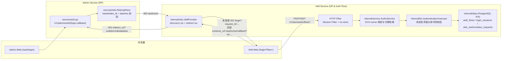
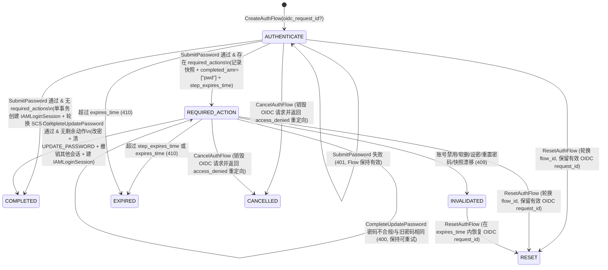
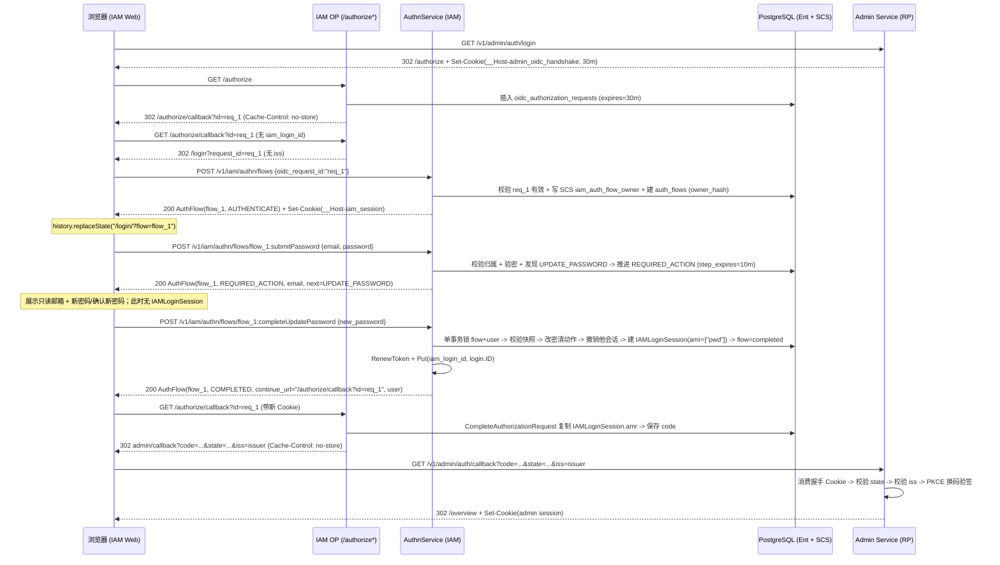

# IAM Auth Flow 认证状态机一期技术设计

## 1. 架构总览与职责划分

### 分层职责

| 模块 | 职责 |
|---|---|
| `api/protos/plateau/iam/authn/v1/authn.proto` | 声明基于资源的 `AuthnService`（6 个 RPC）、`AuthFlow` 状态视图、`AuthnErrorReason` 与脱敏/审计注解 |
| `api/protos/plateau/iam/account/v1/account.proto` | 移除 `ChangeInitialPassword` 及对应请求/响应消息，保留其余账户自助能力 |
| `api/protos/plateau/{iam/conf,iam/oidc/conf,security/oidc}/v1/config.proto` | 声明 4 个静态 TTL 配置项与默认值（`30m / 10m / 30m / 30m`） |
| `app/iam/service/internal/data/` | 新增 `AuthFlow` Ent Schema（`auth_flows`），为 `LoginSession`（`login_sessions`）与 `OIDCAuthorizationRequest` 增加 `amr` 字段；实现全事务原子状态流转与 `revokeUserSessions` 级联失效 |
| `app/iam/service/internal/biz/` | `AuthenticationUsecase` 直接消费 `*iamconfpb.IAM` 与 `*oidcconfpb.OIDC`，通过 `loadOwnedFlow` 统一前置校验，实现状态机求值（独立于 `authn_flow.go`）及密码/改密/重置/取消（含 RFC 6749/9207 取消重定向 URL 组装）用例，零协议库耦合 |
| `app/iam/service/internal/oidc/` | 纯 OIDC OP HTTP 端点适配器：发现文档声明 `authorization_response_iss_parameter_supported: true`；`/authorize` 与 `/authorize/callback` 注入 `iss`（独立于 `redirect_writer.go`）与 `Cache-Control: no-store`；消费真实 `amr` |
| `security/session/` & `app/iam/service/internal/service/` | `session.NewFilter` 对命中的三类浏览器会话路由默认写入 `Cache-Control: no-store`（`iam/server/http.go` 零改动）；`AuthnService` 解包 RPC 请求、绑定 SCS `iam_auth_flow_owner`、轮换令牌与富化审计 |
| `security/oidc/` | 配置化 `handshake_ttl`；`CompleteLogin` 顺序校验 Cookie、`state`、`iss` 与 `error=access_denied` → `ErrAccessDenied` |
| `app/admin/service/` & `app/admin/web/` | 区分 `login_cancelled`（用户取消）与 `access_denied`（OpenFGA 无管理权限） |
| `app/iam/web/` | `/login/` 全面由 Auth Flow 驱动，规范化 `?flow=<id>`，首次改密展示只读邮箱，提供切换账号与取消登录 |

---

## 2. 状态机与核心流程

### 2.1 状态迁移图

### 2.2 面向二期扩展的状态求值模型

状态流转不硬编码「密码 → 2FA → 改密」，而是由统一纯函数 `evaluateFlowProgress(completedAMR []string, policy AuthPolicy, remainingActions []userpb.UserRequiredAction)` 计算下一阶段：

1. **认证因素策略未满足** → `AUTH_FLOW_STATE_AUTHENTICATE`，由策略返回当前可用方法集合 `available_methods`：
   - 一期策略：要求 `completed_amr` 包含 `"pwd"`；未满足时 `available_methods = [AUTH_FACTOR_METHOD_PASSWORD]`。
   - 二期扩展：账号启用 MFA 时，若仅通过 `["pwd"]` 则策略尚未满足，继续保持 `AUTHENTICATE` 并输出 `[TOTP, WEBAUTHN_PASSKEY, RECOVERY_CODE]`；若通过带用户验证的 Passkey 一步产出 `["hwk", "user", "mfa"]`，则策略直接满足并跳过二步挑战。
2. **认证因素策略已满足，且 `len(remainingActions) > 0`** → `AUTH_FLOW_STATE_REQUIRED_ACTION`，输出 `remaining_required_actions` 与 `next_required_action = remainingActions[0]`（一期为 `USER_REQUIRED_ACTION_UPDATE_PASSWORD`；二期可增量追加 `ENROLL_MFA`）。
3. **认证因素策略已满足，且 `len(remainingActions) == 0`** → 进入原子完成阶段：持久化 `IAMLoginSession`（携带去重排序后的 RFC 8176 `completed_amr`），置 Flow 为 `status=completed, state=completed`，输出 `continue_url`（若绑定 `oidc_request_id` 为 `"/authorize/callback?id=" + url.QueryEscape(oidcRequestID)`，否则 `"/account/"`）与投影 `User`。

### 2.3 端到端时序（首次改密 + OIDC 登录）

---

## 3. API 与配置契约

### 3.1 `api/protos/plateau/iam/authn/v1/authn.proto`

服务默认注解：
- `option (plateau.security.authz.v1.service_default) = {mode: AUTHZ_MODE_NONE};`
- `option (plateau.security.authn.v1.service_default) = {mode: AUTHN_MODE_PUBLIC};`

| RPC | HTTP 路由 | 审计注解 | 核心请求字段 | 核心响应字段 |
|---|---|---|---|---|
| `CreateAuthFlow` | `POST /v1/iam/authn/flows` | `AUDIT_MODE_DISABLED` | `oidc_request_id` (可选) | `AuthFlow flow` |
| `GetAuthFlow` | `GET /v1/iam/authn/flows/{flow_id}` | `AUDIT_MODE_DISABLED` | `flow_id` (必填) | `AuthFlow flow` |
| `SubmitPassword` | `POST /v1/iam/authn/flows/{flow_id}:submitPassword` | `ENABLED / AUTHN` | `flow_id`, `email`, `password` (脱敏, 8–128) | `AuthFlow flow` |
| `CompleteUpdatePassword` | `POST /v1/iam/authn/flows/{flow_id}:completeUpdatePassword` | `ENABLED / AUTHN` | `flow_id`, `new_password` (脱敏, 8–128) | `AuthFlow flow` |
| `ResetAuthFlow` | `POST /v1/iam/authn/flows/{flow_id}:reset` | `ENABLED / AUTHN` | `flow_id` | `AuthFlow flow`（新 `flow_id`） |
| `CancelAuthFlow` | `POST /v1/iam/authn/flows/{flow_id}:cancel` | `ENABLED / AUTHN` | `flow_id` | `string redirect_uri` |

#### `AuthFlow` 消息与枚举

- `AuthFlowState`：`AUTH_FLOW_STATE_UNSPECIFIED = 0`、`AUTHENTICATE = 1`、`REQUIRED_ACTION = 2`、`COMPLETED = 3`。
- `AuthFactorMethod`：`AUTH_FACTOR_METHOD_UNSPECIFIED = 0`、`AUTH_FACTOR_METHOD_PASSWORD = 1`（二期增量追加 `TOTP`、`WEBAUTHN_PASSKEY`、`RECOVERY_CODE`）。
- `AuthFlowOidcContext`：`string client_id = 1`（不返回 `state`/`nonce`/`redirect_uri`）。
- `AuthFlow` 字段：
  1. `string flow_id` (`OUTPUT_ONLY`；当 `CreateAuthFlow` 命中当前浏览器已有有效登录会话直接短接为 `COMPLETED` 时可为空串，不落库)
  2. `AuthFlowState state` (`OUTPUT_ONLY`)
  3. `repeated AuthFactorMethod available_methods` (`OUTPUT_ONLY`)
  4. `repeated string completed_amr` (`OUTPUT_ONLY`)
  5. `repeated plateau.iam.user.v1.UserRequiredAction remaining_required_actions` (`OUTPUT_ONLY`)
  6. `plateau.iam.user.v1.UserRequiredAction next_required_action` (`OUTPUT_ONLY`)
  7. `string email` (`OUTPUT_ONLY`，仅在主认证通过后填充只读展示邮箱)
  8. `AuthFlowOidcContext oidc` (`OUTPUT_ONLY`)
  9. `google.protobuf.Timestamp expires_time` (`OUTPUT_ONLY`)
  10. `google.protobuf.Timestamp step_expires_time` (`OUTPUT_ONLY`)
  11. `string continue_url` (`OUTPUT_ONLY`，仅 `state == COMPLETED` 时填充)
  12. `plateau.iam.user.v1.User user` (`OUTPUT_ONLY`，仅 `state == COMPLETED` 时填充)

#### `AuthnErrorReason`

| 枚举值 | HTTP 状态码 | 触发场景与安全策略 |
|---|---|---|
| `AUTHN_ERROR_REASON_INVALID_CREDENTIALS = 1` | 401 | 邮箱/密码错误、账号不存在/禁用/未验证（统一防枚举，Flow 保持有效） |
| `AUTHN_ERROR_REASON_FLOW_NOT_FOUND = 2` | 404 | `flow_id` 不存在、跨浏览器归属不匹配、或 Flow 已处于终态（`completed`/`cancelled`/`reset`） |
| `AUTHN_ERROR_REASON_FLOW_EXPIRED = 3` | 410 | **仅在归属匹配后**判定：超过 `step_expires_time` 或 `expires_time` |
| `AUTHN_ERROR_REASON_FLOW_INVALIDATED = 4` | 409 | **仅在归属匹配后**判定：账号/凭据/动作并发变化、Flow 已被级联失效、或当前步骤不匹配 |
| `AUTHN_ERROR_REASON_INVALID_PASSWORD = 5` | 400 | 新密码不符合 8–128 长度规则或与当前密码相同（Flow 保持可重试，不顺延时钟） |
| `AUTHN_ERROR_REASON_OIDC_REQUEST_INVALID = 6` | 400 | `CreateAuthFlow`、`GetAuthFlow`（未登录态）或 `ResetAuthFlow` 关联的 `oidc_request_id` 不存在、已完成或已过期 |

### 3.2 `api/protos/plateau/iam/account/v1/account.proto`

- 移除 `rpc ChangeInitialPassword`、`message ChangeInitialPasswordRequest`、`message ChangeInitialPasswordResponse`。
- 保留 `ACCOUNT_ERROR_REASON_INVALID_STATE`（仍由 `ConfirmPasswordReset` 使用）。

### 3.3 多时钟配置 Proto

| 文件 | Message | 新增字段 | 默认值 | 段内启动校验 |
|---|---|---|---|---|
| `api/protos/plateau/iam/conf/v1/config.proto` | `IAM` / `AuthFlow` | `AuthFlow auth_flow = 2`（含 `ttl = 1`, `step_ttl = 2`） | `"30m"` `"10m"` | `ttl > 0`、`step_ttl > 0`、`step_ttl <= ttl` |
| `api/protos/plateau/iam/oidc/conf/v1/config.proto` | `OIDC` | `google.protobuf.Duration auth_request_ttl = 6` | `"30m"` | `> 0`（在 `NewOIDCStorage` 中与 `service_access_token_ttl` 一并校验） |
| `api/protos/plateau/security/oidc/v1/config.proto` | `OIDCClient` | `google.protobuf.Duration handshake_ttl = 8` | `"30m"` | `>= 1s`（驱动 `WithMaxAge(int(ttl/time.Second))`） |

遵循 `.trellis/spec/servora/proto/annotations.md`「不为每个模块增加配置准备包装」约定：不新增独立 `AuthFlowConfig` 包装类型，`NewAuthenticationUsecase` 直接接收 `*iamconfpb.IAM` 与 `*oidcconfpb.OIDC`（复用 `NormalizeOIDCIssuer` 提取权威 `issuer` 供 `CancelAuthFlow` 组装 RFC 9207 `iss`），对 `*iamconfpb.IAM` 先 `proto.Clone`（避免原地修改入参指针），当 `auth_flow` 块为 `nil` 时补 `&iamconfpb.AuthFlow{}` 并调用 `Apply()`，随后校验 `ttl > 0`、`step_ttl > 0` 且 `step_ttl <= ttl`。运行时 `CreateAuthFlow` 自动按 `min(now + auth_flow.ttl, oidc_request.expires_time)` 取较早截止时间。

---

## 4. 数据模型与事务并发设计

### 4.1 新增 Ent Schema：`auth_flows`

文件路径：`app/iam/service/internal/data/schema/auth_flow.go`（Ent Schema：`AuthFlow`，表名：`auth_flows`）

- `id` (`string`, Immutable)：256-bit CSPRNG URL-safe base64url 令牌（通过 `biz.NewOpaqueSecret()` 生成原始值，不暴露自增或时间戳）。
- `owner_hash` (`string`, NotEmpty, Immutable, Sensitive)：SCS `iam_auth_flow_owner` 的 SHA-256 十六进制哈希。
- `status` (`enum`: `active`, `completed`, `cancelled`, `reset`, `invalidated`，默认 `active`)。
- `state` (`enum`: `authenticate`, `required_action`, `completed`，默认 `authenticate`)。
- `oidc_request_id` (`string`, Optional, Nillable, Immutable)。
- `user_id`、`user_email`、`user_etag`、`authenticator_id`、`password_authenticator_id` (`string`, Optional, Nillable)。
- `password_changed_time` (`time.Time`, Optional, Nillable)：写入与比对统一执行 `.UTC().Truncate(time.Microsecond)`，消除 PostgreSQL `timestamptz` 微秒精度与 Go 纳秒精度差异。
- `completed_amr` (`[]string` JSON, Optional)、`required_actions` (`[]string` JSON, Optional)。
- `expires_time` (`time.Time`, Immutable)、`step_expires_time` (`time.Time`, Optional, Nillable)。
- `create_time`、`update_time` (`time.Time`)。
- 索引：`("user_id", "status")`、`("oidc_request_id")`、`("expires_time")`。
- **安全不变量**：表中绝不包含明文密码或 Argon2id 哈希字段。

### 4.2 已有 Schema 演进

- `app/iam/service/internal/data/schema/login_session.go`（原 `iam_login_session.go`，同步将关联表外键列 `iam_login_session_id` 统一为 `login_session_id`）：新增 `field.JSON("amr", []string{}).Default([]string{}).SchemaType(map[string]string{dialect.Postgres: "jsonb"}).Annotations(entsql.Default("[]"))`；`biz.LoginSession` 同步新增 `AMR []string`。
- `app/iam/service/internal/data/schema/oidc_authorization_request.go`：新增同构 `amr` JSONB 列（默认 `"[]"`）。
- `app/iam/service/internal/data/oauth.go` `CompleteAuthorizationRequest`：事务内读取 `LoginSession`，校验 `len(login.Amr) > 0` 后写入 `OIDCAuthorizationRequest.SetAmr(slices.Clone(login.Amr))`（空 `amr` 直接按 `ErrOAuthGrantInvalid` 拒绝，杜绝隐式回退 `"pwd"`）；同时 `app/iam/service/internal/oidc/provider.go` `completeAuthorization` 在 `len(session.AMR) == 0` 时防御性重定向至 `/login?request_id=...`（配合 `CreateAuthFlow`/`GetAuthFlow` 对空 `amr` OIDC 场景不短接，避免重定向循环）。
- `app/iam/service/internal/oidc/op_auth_request.go` `GetAMR()`：返回 `slices.Clone(request.entity.Amr)`，移除 `contracts.go` 中的 `passwordAMR` 与 `authorizationRequestTTL` 常量。

### 4.3 级联失效与提交事务顺序

- **统一级联失效**：在 `app/iam/service/internal/data/authn.go` 新增 `invalidateUserAuthFlows(ctx, tx, userID, exceptFlowID, now)`，将目标用户除 `exceptFlowID` 外全部 `status=active` 的 `auth_flows` 更新为 `status=invalidated`。
  - 在 `revokeUserSessions` 内自动调用 `invalidateUserAuthFlows(ctx, tx, userID, "", now)`（或带 `exceptFlowID` 的内部辅助函数），自动覆盖 `SetPasswordAndRevokeSessions`、`ReplacePassword`、`ConsumeAndReplacePassword`、`UpdateStatus(DISABLED)`、`RevokeAll` 与 `SoftDelete`。
  - 在 `userRepository.Expunge`（`data/user.go`）内物理删除 `auth_flows` 中 `user_id == userID` 的全部行。
- **`CompleteUpdatePassword` 执行顺序**（防止 Argon2id 占用数据库锁，同时保证 400 可重试与 409/410 优先精确判定）：
  1. 校验 `owner_hash`（不匹配 → `ErrAuthFlowNotFound` 404，不富化审计）。
  2. 校验 `flow.Status`、`flow.State == required_action` 与双时钟（超 `expires_time` 或 `step_expires_time` → `ErrAuthFlowExpired` 410；已 `invalidated` → `ErrAuthFlowInvalidated` 409；终态 → `ErrAuthFlowNotFound` 404）。
  3. 富化审计 `Actor(human, flow.UserID)` 与 `Resource(iam.plateau.dev/User, users/<id>)`。
  4. 读取当前 `User` 与活跃 `PasswordCredential`，核对账号活跃、邮箱已验证、`user_etag`、`authenticator_id`、`password_authenticator_id`、`password_changed_time`（微秒截断比对）与 `UPDATE_PASSWORD` 动作快照；漂移则标记 Flow 为 `invalidated` 并返回 `ErrAuthFlowInvalidated` 409。
  5. 校验 `ValidatePassword(newPassword)` 与 `password.Compare(newPassword, credential.PasswordHash)`；不合规或与旧密码相同返回 `ErrInvalidPassword` 400（**保留当前 Flow 可重试，不刷新 `step_expires_time`**）。
  6. 在事务外计算 `password.Hash(newPassword)`。
  7. 开启单一 PostgreSQL 事务：按固定加锁顺序 `lockUser(tx, userID)` → `ForUpdate` 锁定 `auth_flows` 行（统一先锁 `users` 再锁附属表，避免与 `revokeUserSessions` 死锁！），二次校验全部 Flow 状态/时钟与账号/凭据快照，更新 `PasswordAuthenticator`（新哈希 + `changed_time = now.UTC().Truncate(time.Microsecond)`），移除 `UPDATE_PASSWORD` 并轮换 `User.etag`，调用 `revokeUserSessions`（排除当前 `flow_id`），视剩余 `required_actions`：
     - 无剩余动作：插入 `IAMLoginSession`（`amr = flow.CompletedAMR`），更新 Flow 为 `status=completed, state=completed`。
     - 仍有剩余动作（二期兼容）：更新 Flow 的 `user_etag`、`password_changed_time`、`required_actions` 并刷新 `step_expires_time = min(now + auth_flow.step_ttl, flow.expires_time)`。
- **`SubmitPassword` 执行顺序**：
  1. 校验 `owner_hash`、`status=active`、`state=authenticate`、`now < expires_time`（失败分别返回 404 / 409 / 410）。
  2. 查找用户与活跃密码凭据并在事务外执行 `password.Compare`；任何账号缺失/未验证/禁用/密码不匹配统一返回 `ErrInvalidCredentials`（401），保持 Flow `active` 可重试。
  3. 单一 PostgreSQL 事务（先 `lockUser`，再锁 `auth_flows`）：二次校验 Flow 仍为 `active / authenticate / 未过期` 及账号/凭据快照；调用状态求值：
     - 需执行 `required_actions`：写入用户与凭据快照、`completed_amr=["pwd"]`、`required_actions`、`state=required_action`、`step_expires_time = min(now + auth_flow.step_ttl, flow.expires_time)`，**不创建 `IAMLoginSession`**；服务层若检测到 SCS 存在旧 `iam_login_id`，调用 `manager.Remove(ctx, LoginReferenceKey)` + `manager.RenewToken(ctx)`（保留 `iam_auth_flow_owner`）。
     - 无 `required_actions`：创建 `IAMLoginSession`（`amr=["pwd"]`），置 Flow 为 `status=completed, state=completed`；服务层调用 `manager.RenewToken(ctx)` + `manager.Put(ctx, LoginReferenceKey, login.ID)`。
- **`ResetAuthFlow` 语义**：
  - 仅归属浏览器可调用（`owner_hash` 校验优先）。
  - 允许在 `now < flow.expires_time` 且 `flow.status IN (active, invalidated)`（含 `step_expires_time` 已超时但总时长未超时的场景）时执行；若绑定的 `oidc_request_id` 已失效或过期则返回 `AUTHN_ERROR_REASON_OIDC_REQUEST_INVALID`（400）。
  - 单事务将旧 Flow 置 `status=reset` 并创建新 `flow_id` 的 `active / authenticate` Flow，继承原 `oidc_request_id` 与原 `expires_time`（不延长总有效期）。
- **`CancelAuthFlow` 语义**：
  - 仅归属浏览器可调用，且仅对 `status=active` 未过期 Flow 生效（终态返回 404）。
  - 单事务置 Flow 为 `status=cancelled`；若绑定 `oidc_request_id`，同步查询并删除未完成且未过期的 `oidc_authorization_requests` 行，返回 `CancelledOIDCRequest{ClientID, RedirectURI, ResponseType, ResponseMode, State}`。
  - 服务层经 `OIDC` 取消重定向构造器（复用 `op.TryErrorRedirect(ctx, ..., oidc.ErrAccessDenied(), ...)` + `appendIssuerParam(url, issuer)`）产出 RFC 6749 §4.1.2.1 + RFC 9207 重定向地址。
- **`CreateAuthFlow` 已登录短接语义**：
  1. 若传入 `oidc_request_id`，先校验其在 `oidc_authorization_requests` 中存在、未完成且未过期；无效则直接返回 `400 OIDC_REQUEST_INVALID`（不写 SCS 或数据库）。
  2. 读取 SCS `iam_login_id` 并调用 `SessionUsecase.Resolve`（存储异常返回 500；缺失/撤销/禁用/待执行动作按未登录处理）：若解析为有效 `(user, loginSession)` 且（非 OIDC 场景，或 OIDC 场景且 `len(loginSession.AMR) > 0`），直接返回 `AuthFlow{state: COMPLETED, completed_amr: loginSession.AMR, oidc?, continue_url: "/authorize/callback?id=..." | "/account/", user}`，**不插入 `auth_flows` 行、不写 `iam_auth_flow_owner`**（`flow_id` 为空）。空 `amr` 会话在 OIDC 场景不短接，继续创建 Flow 引导重新认证。
  3. 未命中短接时，确保 SCS 存在 `iam_auth_flow_owner`（为空则生成 256-bit 随机令牌写入），创建 `auth_flows`（`expires_time = min(now + auth_flow.ttl, oidc_request.expires_time)`）并返回 `AUTHENTICATE`。
- **`GetAuthFlow` 只读与已登录短接语义**（严格遵循 RFC 9110 §9.2.1 安全 `GET`，零写副作用）：
  1. **归属校验永远最先执行**：读取 SCS `iam_auth_flow_owner`（为空不写 SCS）并常量时间比对 `flow.owner_hash`；缺失或不匹配一律返回 `404 FLOW_NOT_FOUND`，严禁在归属校验前检查 `iam_login_id` 以防跨浏览器探测泄露 `oidc_request_id`。
  2. 若 `flow.status IN (completed, cancelled, reset)` 返回 `404 FLOW_NOT_FOUND`；若 `now >= flow.expires_time` 返回 `410 FLOW_EXPIRED`。
  3. 对归属匹配且未超总有效期的 `active` / `invalidated` Flow，检查 SCS `iam_login_id`：若解析为有效 `(user, loginSession)`（且绑定 `oidc_request_id` 时满足 `len(loginSession.AMR) > 0`），不修改数据库，直接返回 `AuthFlow{flow_id: flow.ID, state: COMPLETED, completed_amr: loginSession.AMR, oidc?, continue_url, user}`——若绑定的 `oidc_request_id` 仍未完成且未过期则 `continue_url = "/authorize/callback?id=" + url.QueryEscape(oidcRequestID)`（覆盖另一标签页先完成登录或完成 `UPDATE_PASSWORD` 级联失效本标签页 Flow 后刷新的场景），否则 `continue_url = "/account/"`。
  4. 未命中短接时再执行常规校验：`status == invalidated` → `409 FLOW_INVALIDATED`；`state == required_action && now >= step_expires_time` → `410 FLOW_EXPIRED`；若绑定 `oidc_request_id` 已失效或已完成 → `400 OIDC_REQUEST_INVALID`；否则返回活动 `AuthFlow`。

---

## 5. SCS 归属绑定、`Cache-Control: no-store` 与 OIDC / RP 细节

### 5.1 SCS 会话键约定

在 `app/iam/service/internal/authn/session.go` 中并列声明两个键：
- `LoginReferenceKey = "iam_login_id"`（正式登录凭证引用，唯一被 `SessionAuthenticator` 与 `/authorize/callback` 认可）
- `AuthFlowOwnerKey = "iam_auth_flow_owner"`（浏览器 Flow 归属令牌，**零认证权限**）

行为规则：
- `CreateAuthFlow`：未命中已有有效登录短接时读取 `iam_auth_flow_owner`，为空时生成 256-bit 随机令牌写入 SCS（产生仅含归属键的 `__Host-iam_session` Cookie）并取 SHA-256 存入 `auth_flows.owner_hash`；命中已登录短接或参数校验失败时不写 SCS。
- `GetAuthFlow` / `SubmitPassword` / `CompleteUpdatePassword` / `ResetAuthFlow` / `CancelAuthFlow`：仅读取 `iam_auth_flow_owner`（为空时不写 SCS，防止未授权探测触发 `Set-Cookie`）。
- 进入 `REQUIRED_ACTION` 且 SCS 存在 `iam_login_id` 时：`Remove(LoginReferenceKey)` + `RenewToken()`（清除旧身份但保留 `iam_auth_flow_owner`）。
- 流程完成（`COMPLETED`）时：`RenewToken()` + `Put(LoginReferenceKey, loginSession.ID)`（轮换会话令牌防会话固定）。
- `SessionService.Logout` 保持 `Destroy(ctx)` 行为不变。

### 5.2 `Cache-Control: no-store` 覆盖范围

- 共享浏览器会话过滤器（`security/session/filter.go`）：`NewFilter` 对命中的 `JSONPrefixes`、`SameOriginPaths`、`CrossOriginPaths`（含 403/415 早退错误）在未预设 `Cache-Control` 时统一写入 `Cache-Control: no-store`，覆盖 IAM `/v1/iam/*` 与 Admin `/v1/admin/*`，使 `app/iam/service/internal/server/http.go` 保持零改动。
- IAM OIDC Provider（`app/iam/service/internal/oidc/provider.go`）：对 `/authorize` 与 `/authorize/callback` 统一设置 `Cache-Control: no-store`。
- RP & Admin（`security/oidc/rp.go`）：`BeginLogin` 与 `CompleteLogin` 统一设置 `Cache-Control: no-store`。

### 5.3 RFC 9207 `iss` 实现细节

- **发现文档**（`app/iam/service/internal/oidc/provider.go` `serveDiscovery`）：
  - 使用本地结构体包装 `*oidc.DiscoveryConfiguration` 并附加 `AuthorizationResponseIssParameterSupported bool`（JSON 标签 `"authorization_response_iss_parameter_supported"`，固定为 `true`），确保输出位于根对象字段。
- **授权重定向注入**（`app/iam/service/internal/oidc/provider.go`）：
  - 在 `ServeHTTP` 处理 `/authorize` 与 `/authorize/callback` 时使用 `redirect_writer.go` 中的 `issRedirectWriter` 包装 `http.ResponseWriter`：拦截 3xx 响应的 `Location`，仅当解析后 `u.IsAbs()` 且查询参数包含 `code` 或 `error` 时注入 `iss=<provider.issuer>`；内部相对路径跳转（`/authorize/callback?id=...`、`/login?request_id=...`）保持原样不附加 `iss`。取消登录重定向则由 `biz.AuthenticationUsecase.CancelAuthFlow` 直接基于标准库 `net/url` 组装，避免 `service`/`biz`/`data` 反向耦合 `zitadel/oidc`。
- **RP 回调强校验**（`security/oidc/rp.go` `CompleteLogin`）：
  1. 设置 `Cache-Control: no-store`。
  2. 消费并立即删除握手 Cookie（缺失/解密失败 → `ErrHandshakeInvalid`）。
  3. 解析并校验 `handshakeState` 非空字段。
  4. 校验 `query["state"]` 仅出现一次且常量时间等于 `hs.State`（失败 → `ErrHandshakeInvalid`）。
  5. 校验 `query["iss"]` 仅出现一次且常量时间等于 `p.issuer`（缺失/重复/不匹配 → `ErrHandshakeInvalid`）。
  6. 若 `query.Get("error") != ""`：`error == "access_denied"` → 返回 `ErrAccessDenied`；其余错误 → 返回 `ErrHandshakeInvalid`。
  7. 校验 `code` 非空后继续既有 PKCE 换码、ID Token 与 UserInfo 校验。

### 5.4 Admin 回调错误分流

- `app/admin/service/internal/service/auth.go` `handleCallback`：
  - `errors.Is(err, securityoidc.ErrAccessDenied)` → 审计 `OIDC_LOGIN_CANCELLED`，302 `/auth/login?error=login_cancelled`。
  - `errors.Is(err, securityoidc.ErrProviderUnavailable)` → 保持 302 `/auth/login?error=service_unavailable`。
  - 其他 OIDC 失败 → 保持 302 `/auth/login?error=login_failed`。
  - OpenFGA `!allowed` → 保持 302 `/auth/login?error=access_denied`。
- `app/admin/web/apps/web-antd/src/views/_core/authentication/login.vue`：新增 `login_cancelled` 分支（`type: 'info'`，文案区分于 `access_denied` 的权限拒绝提示）。

---

## 6. IAM Web (`/login/`) 交互设计

- **启动与 URL 规范化（不再在 `/login/` 调用 `useGuestSession`）**：
  - `/login/` 移除 `useGuestSession`（避免 URL 规范化为 `?flow=<id>` 后失去 `request_id` 而在另一标签页登录刷新时盲跳 `/account/`，同时减少未登录访问的额外 `GetProfile` 401 往返，并避免异常空 `amr` 会话触发 `/authorize/callback` 重定向死循环）。
  - 进入页面与 `pageshow`（bfcache 恢复）时读取 `window.location.search`：
    - 存在 `flow`：调用 `authn.GetAuthFlow({ flowId })`：
      - 若返回 `state === COMPLETED` 且含 `continueUrl`，立即执行 `window.location.replace(flow.continueUrl)`（跨标签页已登录时精准续接 `/authorize/callback?id=...` 或跳 `/account/`）。
      - 若返回 `AUTHENTICATE` / `REQUIRED_ACTION`，恢复对应步骤与 OIDC 提示。
      - 若返回 `FLOW_NOT_FOUND` / `FLOW_EXPIRED` / `FLOW_INVALIDATED` / `OIDC_REQUEST_INVALID`，自动调用 `authn.CreateAuthFlow({})` 兜底：若兜底返回 `COMPLETED` 则直接 `window.location.replace(continueUrl)`（无缝处理登录后浏览器后退，不闪现报错）；否则以 `history.replaceState` 更新为 `/login/?flow=<newId>` 并展示失效/超时提示文案。
    - 存在 `request_id`：调用 `authn.CreateAuthFlow({ oidcRequestId })`：若返回 `COMPLETED` 立即跳转 `continueUrl`；否则以 `history.replaceState` 规范化为 `/login/?flow=<id>`；若返回 `OIDC_REQUEST_INVALID`，移除 URL 参数并显示清晰错误提示与“前往独立登录”入口。
    - 两者均无：调用 `authn.CreateAuthFlow({})`：若返回 `COMPLETED` 立即跳转 `continueUrl`；否则规范化为 `/login/?flow=<id>`。
  - 清理废弃 Hook 代码：删除 `use-one-time-url.ts` 中不再被引用的 `useOneTimeRequestId`（保留 `useOneTimeFragment`），精简 `use-guest-session.ts` 移除仅服务于旧 `/login/` 的 `enabled` / `requestId` 选项（`/` 与 `/register/` 保持无参调用 `useGuestSession()`）。
- **步骤渲染**：
  - `AUTHENTICATE`：邮箱 + 密码输入；若存在 `flow.oidc?.clientId`，展示应用授权提示与“取消登录”次按钮。
  - `REQUIRED_ACTION`（`UPDATE_PASSWORD`）：只读展示 `flow.email`，仅提供「新密码」「确认新密码」输入框；提供“切换账号”（调用 `ResetAuthFlow` 并 `replaceState` 更新 `?flow=<newId>`）与“取消登录”（调用 `CancelAuthFlow`，有 `redirectUri` 时 `window.location.replace(redirectUri)`，否则重建独立 Flow）。
  - 敏感值清理：`useSensitiveValue` 在提交返回后立即清空，卸载、切换步骤与 `pageshow`（bfcache 恢复）同步清空并重新拉取当前 Flow 状态。

---

## 7. 兼容性、迁移与运维注意事项

- **0.x 主动演进**：直接移除旧 `Login` 与 `ChangeInitialPassword` RPC，重新生成 Go / TypeScript / OpenAPI 产物并全量迁移仓内调用方与测试；`just gen-check` 与 `just api-ts-check` 保障生成物零漂移。
- **数据库同步**：沿用 Ent `Schema.Create` 幂等建表/补列（新增 `auth_flows` 表及 `login_sessions.amr`、`oidc_authorization_requests.amr` `jsonb` 默认 `"[]"` 列），无需版本化迁移脚本；建登录会话必写 `amr`，`CompleteAuthorizationRequest` 拒绝空 `amr` 不回退伪造 `"pwd"`。
- **配置文件**：现有 `local/` 与 `docker/` YAML 无需必填新增字段即可自动应用 Proto 默认值（`30m / 10m / 30m / 30m`），可在 YAML 中按段显式覆写。
- **死锁防护**：所有跨 `users` 与 `auth_flows` 的写事务统一采用「先 `lockUser`（`FOR UPDATE`），后锁 `auth_flows`（`FOR UPDATE`）」的固定锁序，避免与管理端 `SetPasswordAndRevokeSessions` / `UpdateStatus` / `SoftDelete` 产生锁序反转。
- **回滚策略**：本次改造不破坏用户/凭据既有表结构（仅新增表与可选 JSON 列）；若需回滚代码版本，旧表结构与数据仍可兼容，仅需清除进行中的浏览器登录会话重新登录。
