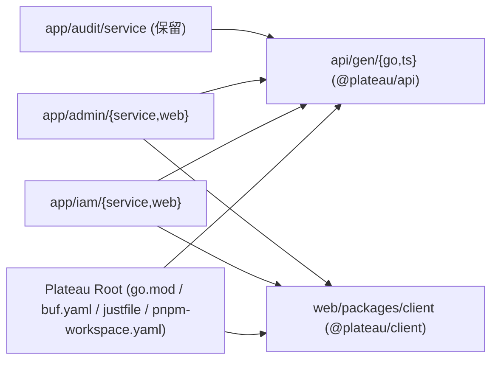

# 技术方案：清理 example 与 test 示例服务

## 1. 架构与保留范围

清理完成后，仓库应用拓扑收敛为 3 个后端与 2 个前端：

- `app/example/{service,web}` 与 `app/test/{service,web}` 整目录删除。
- `.trellis/spec/{example,test}/` 整目录删除；保留 `.trellis/spec/{iam,admin,audit}/` 及全部共享规范目录。

## 2. 关键耦合处理设计

### 2.1 `web/packages/client/test/kratos_stream_fixture.go` 解耦

- **现状**：`runWebSocketFixture`（L161-L173）通过 `examplepb.DeleteUserRequest` 接收前端 WebSocket 发送的 JSON 帧，仅读取 `name`、`etag`、`allowMissing` 三个字段组装回显 map。
- **改动**：移除 `examplepb` 导入，改用同文件已导入的 `structpb.Struct`（`input := new(structpb.Struct)`）。
  - `stream.Recv(input)` 通过 Kratos/protojson 原生反序列化任意 JSON 对象到 `*structpb.Struct`。
  - 从 `input.GetFields()` 显式读取：
    - `"name"` → `GetStringValue()`
    - `"etag"` → `GetStringValue()`
    - `"allowMissing"` → `GetBoolValue()`
  - 保留原有输出结构 `{name, etag, allowMissing}` 与错误/关闭行为完全不变。
- **收益**：共享包 `@plateau/client` 不再依赖任何具体业务服务的生成 Proto。

### 2.2 IAM 配置与测试残留清理

- `app/iam/service/configs/local/oidc.yaml:6-16` 与 `app/iam/service/configs/docker/oidc.yaml:6-16`：删除被注释的 `test-web` 客户端块，保留 `admin` 客户端配置不变。
- `app/iam/service/cmd/server/config_test.go:20`：删除 `t.Setenv("IAM_TEST_WEB_CLIENT_SECRET", ...)`，其余环境变量与断言保持不变。
- `app/iam/service/internal/oidc/provider_test.go:50` 的 `testClientID = "test-web"` 仅是内存测试夹具标识，不改动。

### 2.3 构建、生成与 Just 编排清理

1. **`buf.yaml`**：删除 `app/example/service/api/protos` 与 `app/test/service/api/protos`，保留 `api/protos`、`app/audit/service/api/protos`、`app/iam/service/api/protos`、`app/admin/service/api/protos`。
2. **`just/services.just`**：仅注册 `admin`、`audit`、`iam` 三个服务模块及聚合 recipe（`_gen`、`_build`、`lint`、`clean`、`openapi`、`wire`、`gen-ent`）。
3. **`just/webs.just`**：仅注册 `admin`、`iam` 两个 Web 模块及 `build`/`lint`。
4. **根 `justfile:137`**：`compose-build` 仅保留 `(_compose-build-image "audit")`。
5. **`just/service.just`**：删除 `TYPESCRIPT_TEMPLATE` 变量与 `api-ts` recipe；`api: _root-api-go` 直接触发根 Go API 生成。全仓 TS 生成统一由根 `just api-ts`（`buf.typescript.gen.yaml`）产出至 `api/gen/ts`，与 `.trellis/spec/api/proto/generation.md` 一致。
6. **产物重建**：执行 `just gen-fresh` 先清空 `api/gen/{go,ts,dist}`，再全量重新生成 Go/TS/OpenAPI/Wire/Ent，确保无残留孤儿文件。

### 2.4 依赖与锁文件收敛

- **Go**：`GOWORK=off go mod tidy` 清理可能因移除 `example`/`test` 而失效的依赖条目；验证 `GOWORK=off go test ./...` 与 `GOWORK=off go build ./web/packages/client/test/kratos_stream_fixture.go` 通过。
- **Node/pnpm**：`pnpm-workspace.yaml` 使用 `app/*/web` 通配符无需编辑；在仓库根目录运行 `pnpm install` 重写 `pnpm-lock.yaml`（移除 `@plateau/example-web` 与 `@plateau/test-web` 及其 Vue/Vite/Next.js/React 依赖），再运行 `pnpm install --frozen-lockfile` 验证锁文件自洽。

### 2.5 文档与 Trellis 元数据同步

- `.trellis/config.yaml`：删除 `packages.example` 与 `packages.test`。
- `.trellis/spec/api/proto/generation.md:7`：模块清单更新为 `iam`、`admin`、`audit`。
- `AGENTS.md`：
  - 端口约定移除 `Example`/`Test` 行与 `10080`/`10090` 叙述，保留 `IAM`（`10000–10009`）、`Admin`（`10010–10019`）与“新增服务从 `10020` 起按 10 端口段顺序登记、不重排已有编号”的规则。
  - 目录说明中 `与五个 Go 后端的依赖` 改为 `与各服务 Go 后端的依赖`。
  - 命令列表移除 `just web::example::dev`、`just web::test::dev`；新增服务参考指向 `app/iam`、`app/admin` 与 `app/AGENTS.md`。
- `app/AGENTS.md`：移除 `example`/`test` 条目、移除服务级 `buf.typescript.gen.yaml` 说明、常用命令示例改为 `iam`/`admin`。
- `api/AGENTS.md`：移除第 14 行关于 Example 独立 TS 输出的说明。

## 3. 兼容性、风险与回滚

| 风险项 | 影响 | 缓解 / 回滚措施 |
| --- | --- | --- |
| `structpb.Struct` 解析空字段与原 `DeleteUserRequest` 字段类型差异 | `allowMissing` 若未传默认为 `false`，`name`/`etag` 默认 `""` | `structpb.Value` 的 `GetStringValue()` / `GetBoolValue()` 对 `nil` 安全且返回 Go 零值，行为与 protobuf3 一致；编译并检查 `kratos_stream_fixture.go` |
| `just gen-fresh` 刷新所有保留服务的生成文件 | 若本机插件版本与历史生成物不同，可能产生无关 diff | 执行后检查 `git diff --stat`，确认保留服务生成物无异常变动 |
| 外部文档断链（`../servora/docs/crud.md`） | Servora 文档仍指向 `plateau/app/example` | 本任务不越仓修改 `../servora`；完成后在总结中显式提示后续是否同步更新 `servora` 文档 |
| 本地工作区回滚 | 批量删文件范围较大（144 文件） | 所有变更均在干净 Git 工作树上执行，尚未提交前可通过 `git checkout -- . && git clean -fd` 完整回滚 |
