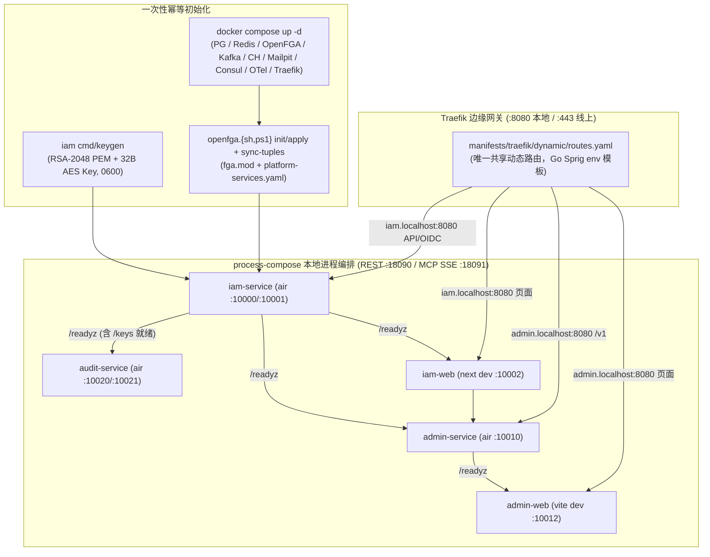

# 技术设计：开发与运维启动链路治理

## 1. 架构概览与模块分工

本次改造围绕「本地开发与线上容器运维同构」的目标，将散落在手工命令行中的初始化与代理步骤收敛为五个正交模块：



## 2. 详细契约与数据流

### 2.1 OpenFGA 三层运维模型与 `sync-tuples`

1. **静态平台服务元组清单** `manifests/openfga/tuples/platform-services.yaml`：
   ```yaml
   - user: service:admin
     relation: manage_users
     object: iam:global
   - user: service:admin
     relation: expunge_users
     object: iam:global
   - user: service:admin
     relation: read_events
     object: audit:global
   ```
   仅存放不含 PII 与动态 UUID 的平台级服务调用契约；人类管理员与业务数据关系继续由 `admin.service` 启动期 `SeedInitializer` 及运行期后台 API 管理。
2. **脚本扩展**（`manifests/scripts/openfga/openfga.sh` 与 `openfga.ps1`）：
   - 新增子命令 `sync-tuples`（Unix 支持 `--tuples-file`，默认 `manifests/openfga/tuples/platform-services.yaml`；PowerShell 支持 `-TuplesFile`）。
   - 解析优先级与现有 `apply` 一致：显式参数 > 环境变量 > `--env-file` 中的 `FGA_STORE_ID` 与 `FGA_MODEL_ID`（缺失 `FGA_STORE_ID` 或 `FGA_MODEL_ID` 时明确报错退出，遵循 OpenFGA 生产固定 `model_id` 规范）。
   - 调用 `fga --api-url "$api_url" tuple write --store-id "$store_id" --model-id "$model_id" --file "$tuples_file" --on-duplicate ignore`。
   - `init` 与 `apply` 保持原语义不变，确保 CI 测试创建临时 Store 时零预设元组。
3. **Just 入口**：
   - `openfga-tuple-sync`：执行 `sync-tuples`（无需重跑 `model test`，便于生产发布在 `openfga-model-apply` 后快速调用）。
   - `openfga-setup: openfga-init openfga-tuple-sync`：供本地开发与 `process-compose` 一键完成 Store、模型与服务元组同步。

### 2.2 IAM OIDC 密钥生成子命令（`app/iam/service/cmd/keygen`）

1. **共享校验与生成函数**：
   - 在 `app/iam/service/internal/oidc/op_key.go` 中导出可供同服务 `cmd/keygen` 复用的校验/生成辅助函数（或 `EnsureKeyMaterial` / `ValidateKeyFiles`），避免在 `cmd/keygen` 复制一套 PEM/32B 解析逻辑，遵守「不定义无必要重复私有实现」原则。
   - 生成规格：RSA 2048-bit 私钥，编码为 PKCS#8 `PRIVATE KEY` PEM；加密密钥使用 `crypto/rand` 生成 32 字节并用 `base64.RawURLEncoding`（43 字符 ASCII，便于 Secret 系统安全存储且完全命中 `loadCryptoKey` 的分支 `base64.RawURLEncoding.DecodeString`）写入。
2. **CLI 参数与幂等状态机**：
   - 支持 `-conf <dir>`（默认 `./configs/local/`，复用 `config.LoadBootstrap` + `bootstrap.Scan` 读取 `oidcpb.OIDC` 的 `signing_key_path` 与 `crypto_key_path`，自动生效 `${IAM_OIDC_SIGNING_KEY_PATH}` 环境变量覆盖）及显式 `-signing-key <path>`、`-crypto-key <path>`（两者均非空时无需加载 `-conf`，方便容器或 CI/CD 一次性初始化 Job 直接调用编译后的 `./bin/keygen`），以及 `-force` 布尔开关。
   - 对每个目标路径独立判定：
     - 若文件存在且 `-force == false`：调用 `loadSigningKey` / `loadCryptoKey` 校验；合法则打印 `skip (valid)`，不改写文件（保护既有登录会话与未过期 JWT）；若文件损坏/格式非法则返回明确错误退出，拒绝静默覆盖。
     - 若文件不存在或 `-force == true`：`os.MkdirAll(filepath.Dir(path), 0o700)`，在同一目录下 `os.CreateTemp` 以 `0o600` 写入完整内容并 `Sync` + `Close`，再校验一次回读结果后 `os.Rename` 原子替换目标路径（Windows 下目标已存在且 `-force` 时先移除目标再重命名，或使用兼容替换）。
3. **Just 集成**：
   - `app/iam/service/justfile` 新增 `keygen *args:` 执行 `go run {{ GOFLAGS }} ./cmd/keygen -conf "{{ CONF }}" {{ args }}`。
   - `just/service.just` 的 `_build` 确保 `./bin/` 目录预先存在后再执行 `go build ... -o ./bin/ ./...`，使 `app/iam/service/bin/` 同时稳定产出 `server` 与 `keygen`（Windows `.exe` 自动适配）。

### 2.3 Just 与 Air 启动链路修正

1. `app/iam/service/.air.toml`：第 5 行 `-X main.Name=audit.service` 修正为 `-X main.Name=iam.service`。
2. `just/service.just`：`run` 与 `dev` 移除 `api openapi` 前置依赖，改为直接启动 `go run` / `air`，彻底消除多服务并发启动时的 `buf generate` 写目录冲突。
3. `app/admin/web` 接入：
   - `app/admin/web/justfile` 新增 Unix/Windows 双平台 `install:`（`pnpm install --frozen-lockfile`）。
   - `app/iam/web/justfile` 补充对齐的 `test`（若无单测脚本则使用 `--if-present`），`just/webs.just` 暴露 `install: admin::install` 与 `test: admin::test iam::test`。
   - 根 `justfile` 的 `init` 在根 workspace `pnpm install --frozen-lockfile` 完成后追加调用 `"{{ JUST }}" --justfile "{{ join(ROOT_DIR, "justfile") }}" web::install`，保证 `link:` 指向的 `@plateau/api` 与 `@plateau/client` 先就绪。

### 2.4 Traefik 跨环境统一网关与 RFC 6761 `*.localhost` 适配

1. **静态配置按环境拆分**：
   - 删除原 `manifests/traefik/traefik.yaml`，拆为：
     - `manifests/traefik/local.yaml`：`api.insecure: true`（映射宿主机 `:8081` Dashboard）、`ping: {}`、`entryPoints.web (:80)`、`entryPoints.metrics (:8082)`、OTel gRPC `otel-collector:4317`、Prometheus metrics、`providers.file: { directory: /etc/traefik/dynamic, watch: true }`。
     - `manifests/traefik/docker.yaml`：`api.insecure: false`、`ping: {}`、`entryPoints.web (:80 -> redirect websecure)`、`entryPoints.websecure (:443, http.tls: {})`、`entryPoints.metrics (:8082)`、OTel gRPC `otel-collector:4317`、Prometheus metrics、`providers.file: { directory: /etc/traefik/dynamic, watch: true }`。
2. **唯一共享动态路由 `manifests/traefik/dynamic/routes.yaml`**：
   - 利用 Traefik File Provider 内置的 Sprig `env` / `default` 函数参数化域名、入口点与上游 URL：
     - `IAM_TRAEFIK_HOST`（默认 `iam.localhost`）、`ADMIN_TRAEFIK_HOST`（默认 `admin.localhost`）、`TRAEFIK_ENTRYPOINT`（本地默认 `web`，线上设 `websecure`）
     - `IAM_API_UPSTREAM`（本地默认 `http://host.docker.internal:10000`，线上设 `http://iam-service:10000`）
     - `IAM_WEB_UPSTREAM`（本地默认 `http://host.docker.internal:10002`，线上设 `http://iam-web:10002`）
     - `ADMIN_API_UPSTREAM`（本地默认 `http://host.docker.internal:10010`，线上设 `http://admin-service:10010`）
     - `ADMIN_WEB_UPSTREAM`（本地默认 `http://host.docker.internal:10012`，线上设 `http://admin-web:10012`）
   - 路由优先级与安全隔离：
     - **IAM API 路由**（高优先级 `priority: 100`）：匹配 `Host("<IAM_TRAEFIK_HOST>") && (PathPrefix("/v1/") || PathPrefix("/cap/") || PathPrefix("/.well-known/") || Path("/keys") || Path("/authorize") || PathPrefix("/authorize/") || PathPrefix("/oauth/") || Path("/userinfo") || Path("/revoke") || Path("/end_session") || Path("/docs") || PathPrefix("/docs/"))` -> `iam-api`（`passHostHeader: true`）。
     - **IAM Web 路由**（默认优先级 `priority: 10`）：匹配 `Host("<IAM_TRAEFIK_HOST>")` -> `iam-web`（自动支持 Next.js WebSocket HMR 升级）。
     - **Admin API 路由**（`priority: 100`）：匹配 `Host("<ADMIN_TRAEFIK_HOST>") && (PathPrefix("/v1/") || Path("/docs") || PathPrefix("/docs/"))` -> `admin-api`。
     - **Admin Web 路由**（`priority: 10`）：匹配 `Host("<ADMIN_TRAEFIK_HOST>")` -> `admin-web`（自动支持 Vite WebSocket HMR 升级）。
     - **不暴露内部端点**：不匹配 `/metrics`、`/healthz`、`/readyz`，且绝不为 `audit.service`（`10020/10021`）声明任何路由。
3. **RFC 6761 `*.localhost` 回环校验与前端开发态放行**：
   - `app/iam/service/internal/oidc/provider.go` 的 `isLoopbackHost` 与 `security/jwt/jwks.go` 的回环判断：按 RFC 6761 §6.3 支持大小写无关的 `localhost`、`127.0.0.1`、`::1` 以及非空标签前缀的 `*.localhost`（如 `iam.localhost`，拒绝 `.localhost` 或含前导点的畸形主机名）。
   - `app/iam/web/next.config.ts`：新增 `allowedDevOrigins: ["iam.localhost", "*.localhost"]`（保留现有 `rewrites()`，使脱离 Docker 单独调试 `:10002` 时仍可工作）。
   - `app/admin/web/apps/web-antd/vite.config.ts`：在 `server` 与 `preview` 中显式配置 `allowedHosts: [".localhost"]`（保留现有 `/v1` `proxy` 作独立运行回退）。
   - 本地默认配置更新：`.env.example`、`app/iam/service/configs/local/{bootstrap,oidc}.yaml`、`app/admin/service/configs/local/{bootstrap,oidc_client}.yaml`、`app/audit/service/configs/local/jwt_authn.yaml` 中的 `IAM_PUBLIC_ORIGIN` 默认值改为 `http://iam.localhost:8080`，`ADMIN_PUBLIC_ORIGIN` 默认值改为 `http://admin.localhost:8080`，`ADMIN_OIDC_REDIRECT_URI` 默认值改为 `http://admin.localhost:8080/v1/admin/auth/callback`（注：`audit.service` 的 `IAM_JWKS_URI` 保持内部高速直连 `http://127.0.0.1:10000/keys`）。

### 2.5 `process-compose` 全链路编排与 MCP Server

1. **端口规划（本地基础设施运维段 `18xxx`）**：
   - `18090`：`process-compose` 自身 HTTP REST API 端口（通过命令行 `-p 18090` 固定，避开 Traefik `:8080`；注意不在根 `justfile` 顶层导出空字符串同名变量以免覆盖子进程配置）。
   - `18091`：`process-compose.yaml` 中 `mcp_server` 监听 `127.0.0.1:18091`（`transport: sse`、`expose_control_tools: true`），仅绑定本地回环接口防止局域网暴露。
2. **DAG 节点与探针设计（`process-compose.yaml`）**：
   - `compose-up`（一次性前置）：执行 `just compose-up` 并等待 `postgres`、`redis`、`openfga`、`kafka`、`clickhouse`、`traefik` 容器就绪（不设 `shutdown.command`，退出 `process-compose` 时保留中间件容器运行）。
   - `iam-keygen`（一次性前置）：无容器依赖，并行执行 `just service::iam::keygen`。
   - `openfga-setup`（一次性前置）：`depends_on: compose-up (process_completed_successfully)`，轮询 OpenFGA `:18080/healthz` 就绪后执行 `just openfga-setup`（写入 `.env` 的 `FGA_STORE_ID` / `FGA_MODEL_ID` 并同步 3 条平台服务元组）。
   - `iam-service`（常驻）：`depends_on: { iam-keygen: process_completed_successfully, openfga-setup: process_completed_successfully }`，执行 `just service::iam::dev`（由 `just` 重新加载 `openfga-setup` 刚更新的 `.env`！这一点至关重要：子进程通过 `just` 启动而非只读父进程初始静态 env，确保首次初始化生成的 `FGA_STORE_ID` / `FGA_MODEL_ID` 被后续微服务读取到！），`readiness_probe` 检查 `http://127.0.0.1:10000/readyz`。
   - `audit-service`（常驻）：`depends_on: { iam-service: process_healthy }`，执行 `just service::audit::dev`，`readiness_probe` 检查 `http://127.0.0.1:10020/readyz`。
   - `iam-web`（常驻）：`depends_on: { iam-service: process_healthy }`，执行 `just web::iam::dev`，`readiness_probe` 检查 `http://127.0.0.1:10002/`。
   - `admin-service`（常驻）：`depends_on: { iam-service: process_healthy, audit-service: process_healthy, iam-web: process_healthy }`（确保 `admin` 启动 `SeedInitializer` 时 IAM gRPC 与 OpenFGA 元组均已就绪），执行 `just service::admin::dev`，`readiness_probe` 检查 `http://127.0.0.1:10010/readyz`。
   - `admin-web`（常驻）：`depends_on: { admin-service: process_healthy }`，执行 `just web::admin::dev`，`readiness_probe` 检查 `http://127.0.0.1:10012/`。
3. **根 `justfile` 与 `.mcp.json`**：
   - `dev *args`: `process-compose -f process-compose.yaml -p 18090 {{ args }}`（默认打开交互式 TUI）。
   - `dev-up`: `process-compose -f process-compose.yaml -p 18090 -D`（后台守护启动，供无 TUI 终端或 AI Agent 自助拉起）。
   - `dev-down`: `process-compose down -p 18090`（有序停止本地应用进程，保留 Docker 容器）。
   - `.mcp.json` 新增 `"process-compose": { "type": "sse", "url": "http://127.0.0.1:18091/sse" }`。

## 3. 兼容性、关键取舍与回滚策略

| 决策点 | 取舍分析 | 降级 / 回滚方案 |
| --- | --- | --- |
| **子服务通过 `just service::<name>::dev` 启动** | 若 `process-compose` 直接调 `air`，首次克隆时父进程启动时尚无 `.env` 中的 `FGA_STORE_ID`；经 `just` 启动可每次动态读取 `openfga-setup` 刚写入的 `.env` | 任何单服务仍可在独立终端单独执行 `just service::<name>::run` |
| **默认入口切为 `*.localhost:8080`** | 浏览器与本机进程遵循 RFC 6761 免改 `/etc/hosts` 直通 Traefik，完全复刻线上同域网关分流；极少数关闭 `nss-myhostname` 的精简 Linux 或开启全局代理未绕过 `*.localhost` 时需配 `NO_PROXY` | 保留 Next.js / Vite 本地代理逻辑，覆盖 `IAM_PUBLIC_ORIGIN=http://localhost:10002` 与 `ADMIN_PUBLIC_ORIGIN=http://localhost:10012` 即可瞬间回退无网关直连 |
| **MCP 选用 `sse` 而非 `stdio`** | 终端 TUI 与多个 Agent 会话共享单一 `127.0.0.1:18091` 实例，避免打开编辑器时后台重复拉起全栈抢占端口 | 未运行 `just dev` / `just dev-up` 时 MCP 处于未连接态，不影响其他 MCP 工具工作 |
| **多副本运维下的 `cmd/keygen`** | 编译产物自带生成能力，消除宿主机 `openssl` 依赖；但多副本容器严禁各自写临时盘 | 文档与规范明确规定多副本环境由一次性 Job 执行 `./bin/keygen` 写入共享 Secret |
