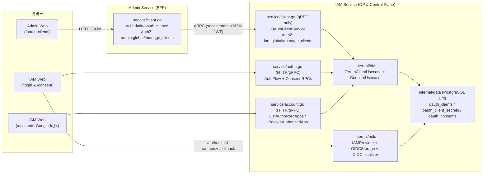
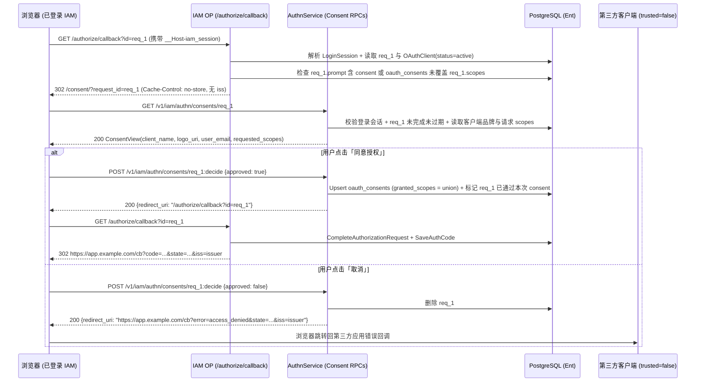

# 动态 OAuth Client 管理技术设计

## 1. 架构总览与职责划分

### 模块职责

| 模块 | 职责 |
| --- | --- |
| `api/protos/plateau/iam/client/v1/client.proto` | 声明 `OAuthClientService`（gRPC 管理接口）、`OAuthClient` 资源、`OAuthClientSecret` 脱敏元数据、枚举与脱敏/审计/授权注解 |
| `api/protos/plateau/admin/client/v1/client.proto` | 声明 Admin BFF 面向控制台的 `/v1/admin/oauth-clients` HTTP + gRPC 编排契约 |
| `api/protos/plateau/iam/authn/v1/authn.proto` | 扩展 `AuthFlowOidcContext`（`client_name`、`logo_uri`），新增 `GetConsentView` 与 `SubmitConsentDecision`（`/v1/iam/authn/consents/{request_id}`） |
| `api/protos/plateau/iam/account/v1/account.proto` | 新增 `ListAuthorizedApps` 与 `RevokeAuthorizedApp`（`/v1/iam/account/applications*`） |
| `api/protos/plateau/iam/oidc/conf/v1/config.proto` | 允许 `oidc.clients` 为空，为静态 `OAuthClient` 增加可选展示与认证方式配置字段 |
| `manifests/openfga/` | `iam.fga` 与 `admin.fga` 新增 `manage_clients` 关系；`platform-services.yaml` 授予 `service:admin` |
| `app/iam/service/internal/data/` | 维护 `OAuthClient`、`OAuthClientSecret`、`OAuthConsent` 三张核心表；实现多密钥查询、客户端级联撤销事务与 `crud/` 列表适配器 |
| `app/iam/service/internal/biz/` | 收敛静态与动态共用的客户端参数校验器、密钥生成与上限检查、Consent 判定/合并逻辑及生命周期用例 |
| `app/iam/service/internal/oidc/` | `OIDCInitializer` 仅对账 `STATIC` 客户端；`OIDCStorage` / `op_client.go` / `provider.go` 适配三种应用类型、三种认证方法、登出跳回白名单与 `/authorize/callback` 第三方 Consent 分流 |
| `app/iam/web/` | `/login/` 展示 OIDC 应用品牌；新增 `/consent/` 授权同意页；`/account/` 升级为参考 `https://myaccount.google.com/` 的导航与卡片布局并新增 `/account/applications/` |
| `app/admin/service/` & `app/admin/web/` | Admin BFF 转发编排与错误翻译；Admin Web 提供 OAuth 客户端列表、分场景新建、一次性密钥复制、多密钥轮换与删除确认视图 |

---

## 2. 数据模型与事务设计

### 2.1 Ent Schema 设计

1. **`OAuthClient`（表 `oauth_clients`）**：
   - `id` (`string`, Immutable)：`^[a-z0-9]([a-z0-9-]{0,61}[a-z0-9])?$`（静态客户端允许既有标识如 `admin`；留空自动生成 `cli_<16字节base32/hex>`）。
   - `source` (`enum`: `static`, `dynamic`, Immutable, Default `dynamic`)。
   - `status` (`enum`: `active`, `disabled`, Default `active`)。
   - `display_name` (`string`, NotEmpty)。
   - `description` (`string`, Optional)。
   - `logo_uri` (`string`, Optional)。
   - `application_type` (`enum`: `web`, `user_agent`, `native`, Default `web`)。
   - `token_endpoint_auth_method` (`enum`: `client_secret_basic`, `client_secret_post`, `none`, Default `client_secret_basic`)。
   - `redirect_uris` (`JSON []string`)。
   - `post_logout_redirect_uris` (`JSON []string`, Default `[]`)。
   - `allowed_grant_types` (`JSON []string`)。
   - `allowed_response_types` (`JSON []string`)。
   - `allowed_scopes` (`JSON []string`)。
   - `audiences` (`JSON []string`, Optional)。
   - `trusted` (`bool`, Default `false`)。
   - `etag` (`string`, NotEmpty)。
   - `create_time` / `update_time` (`time.Time`)。
   - 索引：`index.Fields("source")`、`index.Fields("status")`、`index.Fields("create_time")`。

2. **`OAuthClientSecret`（表 `oauth_client_secrets`）**：
   - `id` (`string`, UUIDv7, Immutable)。
   - `client_id` (`string`, NotEmpty, Immutable)。
   - `name` (`string`, Default `"默认密钥"`)。
   - `secret_prefix` (`string`, NotEmpty)：例如 `pcs_a1b2c3d4`（前 12 字符，供列表识别）。
   - `secret_hash` (`string`, NotEmpty, Sensitive)：`biz.HashOpaqueSecret(rawSecret)`（SHA-256 hex）。
   - `expires_time` (`*time.Time`, Optional, Nillable)。
   - `last_used_time` (`*time.Time`, Optional, Nillable)。
   - `create_time` (`time.Time`, Immutable)。
   - 索引：`index.Fields("client_id", "create_time")`。
   - 明文密钥生成格式：`"pcs_" + base64.RawURLEncoding.EncodeToString(randomBytes(32))`（总长 47 字节，256-bit 熵）。

3. **`OAuthConsent`（表 `oauth_consents`）**：
   - `id` (`string`, UUIDv7, Immutable)。
   - `user_id` (`string`, NotEmpty, Immutable)。
   - `client_id` (`string`, NotEmpty, Immutable)。
   - `granted_scopes` (`JSON []string`)。
   - `create_time` / `update_time` (`time.Time`)。
   - 索引：`index.Fields("user_id", "client_id").Unique()`、`index.Fields("client_id")`。

### 2.2 客户端禁用与删除的级联撤销事务

在 `DisableOAuthClient`、`DeleteOAuthClient` 以及 `OIDCInitializer` 清理已移除的 `STATIC` 客户端时，于单一数据库事务内按固定表顺序执行：

1. 锁定目标 `oauth_clients` 行（`SELECT ... FOR UPDATE`），校验 `source != static`（初始化器清理路径除外）。
2. 查询该 `client_id` 下所有未完成 `oidc_authorization_requests` 的 ID 集合：
   - 若集合非空，将绑定这些 `oidc_request_id` 且处于 `active` 状态的 `auth_flows` 更新为 `status = invalidated, state = invalidated`；
   - 删除该 `client_id` 下未完成的 `oidc_authorization_requests`。
3. 将该 `client_id` 下未消费的 `oauth_authorization_codes` 标记 `consumed_time = now`（或直接清理未消费授权码）。
4. 查询该 `client_id` 下未撤销的 `oauth_token_sessions`，批量置 `revoked_time = now`，同步置关联 `oauth_refresh_tokens.revoked_time = now`。
5. 将该 `client_id` 下未撤销且未过期的 `oauth_access_tokens`（含 `human` 与 `service`）批量置 `revoked_time = now`。
6. 若为 `DeleteOAuthClient`（或静态清理）：删除该 `client_id` 的 `oauth_client_secrets`、`oauth_consents` 与 `oauth_clients` 本体记录。

---

## 3. OIDC 协议适配与第三方 Consent 流程

### 3.1 应用类型、认证方法与回调校验矩阵

| `application_type` | 允许的 `token_endpoint_auth_method` | 允许的 `allowed_grant_types` | `redirect_uris` / `post_logout_redirect_uris` 规则 |
| --- | --- | --- | --- |
| `WEB` | `CLIENT_SECRET_BASIC`、`CLIENT_SECRET_POST`、`NONE` | `authorization_code`、`refresh_token`、`client_credentials`（`NONE` 禁止） | 精确匹配、禁止 `*` 与 `#fragment`；仅允许 `https://` 或 RFC 6761 回环 `http://` |
| `USER_AGENT` | 仅 `NONE` | `authorization_code`、`refresh_token` | 同 `WEB`；当已注册 URI 含合法回环 `http://` 时，`op_client.DevMode()` 返回 `true` 以兼容 `zitadel/oidc` 对 SPA 本地回环 HTTP 的检查（非回环 `http://` 已在写入校验层拦截） |
| `NATIVE` | `NONE`（推荐）、`CLIENT_SECRET_BASIC`、`CLIENT_SECRET_POST` | `authorization_code`、`refresh_token` | 禁止 `*` 与 `#fragment`；允许自定义 Scheme（如 `com.example.app:/callback`，要求含 `:` 且非 `http`/`https`/`javascript`/`data`）、RFC 8252 回环 `http://`（支持动态端口匹配）或 `https://` |

### 3.2 认证方式严格隔离（防降级）

`zitadel/oidc/v3` 在开启 `op.Config{AuthMethodPost: true}` 后，`CodeExchange` 与 `Revoke` 默认会对非 `NONE` 客户端同时接受 HTTP Basic 与表单 POST。为防止客户端认证方式混淆或降级：

- 在 `/oauth/token`、`/oauth/introspect`、`/revoke` 请求进入 `IAMProvider` 时，将当前 HTTP 请求的凭据承载方式（`basic` / `post` / `none`，且拒绝同时携带 Basic 头与表单 `client_secret` 的歧义请求）写入请求 `context`。
- `OIDCStorage.AuthorizeClientIDSecret` 读取客户端记录：
  1. 校验 `entity.Status == active` 且 `entity.TokenEndpointAuthMethod != none`；
  2. 校验上下文中的实际承载方式与客户端注册的 `TokenEndpointAuthMethod` 严格一致；
  3. 查询该 `client_id` 下未过期的 `oauth_client_secrets`（`expires_time IS NULL OR expires_time > now`），使用 `subtle.ConstantTimeCompare` 完整遍历比对（不提前短路泄露时序），命中后异步或轻量更新 `last_used_time`。
- `OIDCStorage.GetClientByClientID` 对 `entity.Status != active` 统一返回 `storageNotFoundError`，使 `/authorize`、刷新令牌与 `NONE` 公共客户端路径对禁用客户端一致拒绝。

### 3.3 第三方 Consent 时序

> **防 `prompt=consent` 死循环细节**：`oidc_authorization_requests` 增加布尔列 `consent_approved`（默认 `false`）及 `prompt`（`JSON []string`）。当 `prompt` 含 `consent` 时，首次进入 `/authorize/callback` 因 `consent_approved == false` 跳 `/consent/`；用户在 `/consent/` 批准后，事务同时写入 `oauth_consents` 并将该条 `oidc_authorization_requests.consent_approved` 置为 `true`，跳回 `/authorize/callback` 后直接放行签发授权码。

---

## 4. Proto 契约概览

### 4.1 `api/protos/plateau/iam/client/v1/client.proto`

- Resource pattern：`iam.plateau.dev/OAuthClient` -> `oauthClients/{oauth_client}`。
- Service：`OAuthClientService`（默认 `AUTHN_MODE_REQUIRED`、`AUTHZ_MODE_REQUIRED` `iam:global#manage_clients`、`AUDIT_CATEGORY_RESOURCE`）：
  - `CreateOAuthClient(CreateOAuthClientRequest) returns (CreateOAuthClientResponse)`（含 `OAuthClient client` 与一次性脱敏字段 `string client_secret`）
  - `GetOAuthClient(GetOAuthClientRequest) returns (OAuthClient)`（`AUDIT_MODE_DISABLED`，内嵌脱敏 `repeated OAuthClientSecret secrets`）
  - `ListOAuthClients(ListOAuthClientsRequest) returns (ListOAuthClientsResponse)`（`AUDIT_MODE_DISABLED`，支持 `page_size`、`page_token`、`filter`、`order_by`、`include_total`）
  - `UpdateOAuthClient(UpdateOAuthClientRequest) returns (OAuthClient)`（支持更新 `display_name`、`description`、`logo_uri`、`redirect_uris`、`post_logout_redirect_uris`、`allowed_grant_types`、`allowed_scopes`、`audiences`、`trusted`、`token_endpoint_auth_method`、`application_type`；若从 `NONE` 切换为机密客户端且尚无密钥须先创建密钥或拒绝无密钥机密状态——设计为：`application_type` 创建后 `IMMUTABLE` 以对齐 Logto，避免把 SPA 半途改成 M2M 造成协议状态错乱！）
  - `DisableOAuthClient` / `EnableOAuthClient` / `DeleteOAuthClient`
  - `CreateOAuthClientSecret(CreateOAuthClientSecretRequest) returns (CreateOAuthClientSecretResponse)`（返回 `OAuthClientSecret secret` + 一次性脱敏 `string secret_value`）
  - `DeleteOAuthClientSecret(DeleteOAuthClientSecretRequest) returns (google.protobuf.Empty)`
- `OAuthClientErrorReason`：
  - `NOT_FOUND` (404)
  - `ALREADY_EXISTS` (409)
  - `STATIC_CLIENT_IMMUTABLE` (403)
  - `INVALID_CLIENT_CONFIG` (400)
  - `SECRET_LIMIT_EXCEEDED` (409)
  - `LAST_ACTIVE_SECRET` (409)
  - `ETAG_MISMATCH` (409)

### 4.2 `api/protos/plateau/admin/client/v1/client.proto`

- 暴露 `/v1/admin/oauth-clients`、`GET /v1/admin/{name=oauthClients/*}`、`PATCH /v1/admin/{client.name=oauthClients/*}`、`POST /v1/admin/{name=oauthClients/*}:disable`、`:enable`、`DELETE /v1/admin/{name=oauthClients/*}`、`POST /v1/admin/{parent=oauthClients/*}/secrets`、`DELETE /v1/admin/{name=oauthClients/*}/secrets/{secret_id}`。
- 复用 `plateau.iam.client.v1.OAuthClient` 与 `OAuthClientSecret` 消息（与 `admin/user/v1` 复用 `iam/user/v1.User` 模式完全一致）。

---

## 5. 前端交互与布局设计

### 5.1 IAM Web 升级（`app/iam/web`）

1. **Google Account 风格个人中心（`AccountShell` + `/account/*`）**：
   - 顶部固定栏：左侧 `Plateau 账户` 标题标识，右侧展示当前用户头像首字母徽章与邮箱、快捷退出按钮。
   - 左侧导航栏（桌面端固定宽 `15rem` 纵向排列，移动端顶部横向胶囊滚动条）：采用 `rounded-full` 胶囊选中态与图标，包含三项：
     - `个人信息`（`/account/`）：将原个人资料表单放入圆角分组卡片（头部说明 + 字段表单）。
     - `安全性与登录`（`/account/security/`）：以分组圆角卡片承载「密码」与「账户操作（退出登录 / 删除账户）」。
     - `第三方应用与服务`（`/account/applications/`）：展示已通过 Consent 授权的第三方应用总数与卡片列表；每行展示应用图标（无图标时显示首字母方块）、`display_name`、已批准权限标签、首次/最近授权时间，展开或点击「移除访问权限」确认后调用 `RevokeAuthorizedApp` 即时移除。
2. **授权同意页（`/consent/?request_id=<id>`）**：
   - 复用认证卡片居中视觉体系：顶部展示应用图标与 `display_name`、当前已登录用户邮箱胶囊（附“切换账号”跳 `/login/?request_id=<id>` 或登出重登能力）、本次请求的权限列表（映射 `openid`/`profile`/`email`/`offline_access` 中文说明），底部主按钮「同意授权」与次按钮「取消」。
3. **登录页品牌上下文（`/login/`）**：
   - 当 `flow.oidc` 存在时，在标题区展示应用图标（若配置了合法 `logo_uri`）与「登录以继续前往 **`<client_name>`**」。

### 5.2 Admin Web 客户端管理（`app/admin/web`）

- 新增菜单与路由「OAuth 客户端」（位于平台身份/安全管理分组，受 `manage_clients` / 管理员权限控制）。
- **列表页**：展示显示名称、`client_id`（一键复制）、来源标签（`系统静态` / `动态创建`）、应用类型标签（`Web` / `SPA` / `原生` / `M2M`）、受信类型（`第一方免审` / `第三方需授权`）、状态（`启用` / `已禁用`）、更新时间与操作列。
- **新建客户端弹窗**：选择接入模板（`传统 Web 应用`、`单页应用 SPA`、`原生 / CLI 应用`、`机器间服务 M2M`）后自动预填推荐的 `application_type`、`token_endpoint_auth_method`、`allowed_grant_types` 与 `trusted`，管理员填写名称、可选 `client_id`、回调地址/受众后提交；若返回一次性 `client_secret`，立即弹出带醒目提示的复制确认模态框。
- **详情与密钥轮换抽屉**：
  - 基础与协议配置表单（`STATIC` 客户端置灰只读并提示「该客户端由 IAM 静态配置文件托管」）。
  - 机密客户端专属「客户端密钥」区块：展示当前密钥列表（名称、前缀掩码 `pcs_xxxx••••`、创建时间、过期时间、最近使用时间），支持「新增密钥」（备注名称 + 可选有效期）与「删除密钥」（剩最后一把有效密钥时禁用删除按钮并悬浮提示先新增密钥）。
  - 危险操作区：启用/禁用切换，以及需手动输入 `client_id` 匹配的物理删除确认框。
