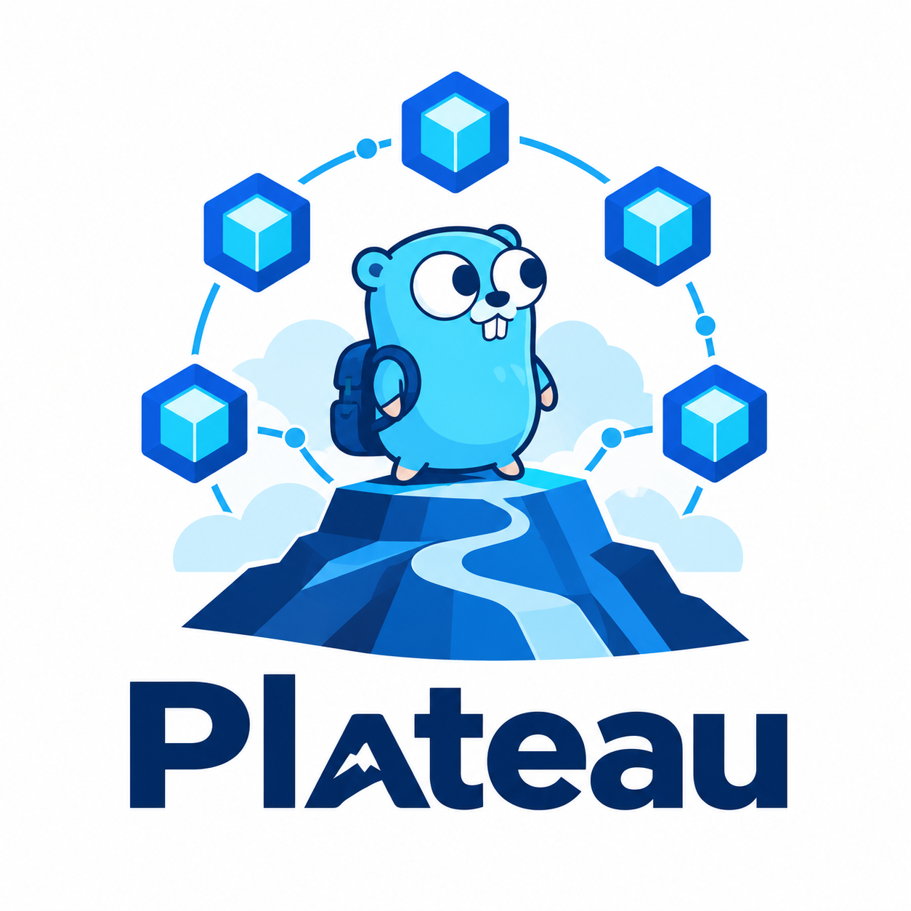
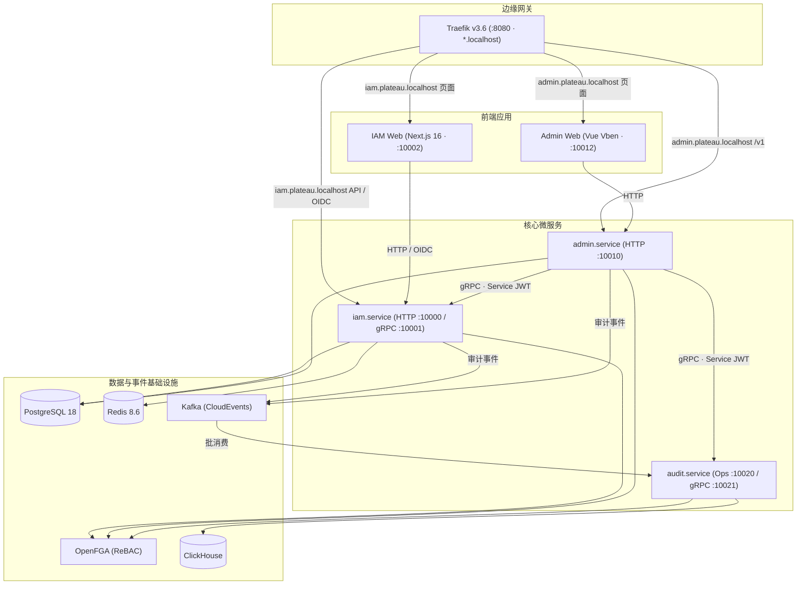

<p align="center">
  
</p>

<h1 align="center">Plateau</h1>

<p align="center">
  构造像高原一样稳固强大的微服务
</p>

<p align="center">
  <a href="https://github.com/Servora-Kit/plateau/actions/workflows/ci.yml"></a>
  <a href="./go.mod"></a>
  <a href="./LICENSE"></a>
  <a href="https://github.com/Servora-Kit/servora"></a>
</p>

> 本项目是 [Servora](https://github.com/Servora-Kit/servora) 框架的最佳实践。

**Plateau** 是一套面向生产场景构建的 Go 微服务平台底座与参考实现，开箱内置身份认证中心（IAM / OIDC）、细粒度关系授权（OpenFGA ReBAC）、全平台异步审计（Kafka + ClickHouse）、管理后台（Vue Vben Admin）以及完整的可观测基础设施。

## 系统架构



### 服务与端口规划

本地端口从 `10000` 起按每个应用固定 10 端口段顺序分配（`+0` HTTP、`+1` gRPC、`+2` Web，`+3～+9` 预留）：

| 应用 | 核心职责 | HTTP | gRPC | Web | 文档 |
| --- | --- | --- | --- | --- | --- |
| **IAM** | 邮箱登录、SCS 会话、邮件验证、CAP PoW、OIDC Provider、全局用户主数据 | `10000` | `10001` | `10002` | [`docs/iam.md`](./docs/iam.md) · [`app/iam/web/README.md`](./app/iam/web/README.md) |
| **Admin** | 平台管理控制面与 BFF，编排全局用户管理与全平台只读审计查询 | `10010` | `10011`（预留） | `10012` | `docs/admin.md`（规划中） |
| **Audit** | 全平台问责审计消费入库（ClickHouse）与只读查询服务 | `10020`（内部运维） | `10021` | `10022`（预留） | `docs/audit.md`（规划中） |

## 核心特性

### 声明式安全与审计契约

Plateau 在 [`cmd/`](./cmd) 下内置四款 `protoc` 插件（`protoc-gen-plateau-authn`、`protoc-gen-plateau-authz`、`protoc-gen-plateau-audit`、`protoc-gen-plateau-crud`），配合 [`security/`](./security) 共享中间件与 [`crud/`](./crud) 运行时，直接通过 `.proto` 注解声明接口级认证、OpenFGA 授权、异步审计策略及 AIP 资源契约：

```proto
service UserService {
  option (plateau.security.authn.v1.service_default) = {mode: AUTHN_MODE_REQUIRED};
  option (plateau.security.authz.v1.service_default) = {
    mode: AUTHZ_MODE_REQUIRED
    action: "manage_users"
    resource_type: "admin"
    resource_id: "global"
  };
  option (plateau.security.audit.v1.service_default) = {
    mode: AUDIT_MODE_ENABLED
    category: AUDIT_CATEGORY_RESOURCE
  };

  rpc ListUsers(ListUsersRequest) returns (ListUsersResponse) {
    option (google.api.http) = {get: "/v1/admin/users"};
    option (plateau.security.audit.v1.rule) = {mode: AUDIT_MODE_DISABLED};
  }
}
```

### 身份中心与 ReBAC 授权（IAM + OpenFGA）

- **双通道认证**：浏览器侧基于 `SCS` Cookie 会话、Argon2id 密码哈希、CAP PoW 验证码与邮箱验证流；内部服务调用基于 OIDC `client_credentials` + JWKS（RS256）校验服务令牌。
- **统一授权模型**：全平台 OpenFGA 关系模型集中维护在 [`manifests/openfga/`](./manifests/openfga)，支持本地声明式单元测试（`just openfga-model-test`）。细节见 [`docs/iam.md`](./docs/iam.md)。

### 全平台异步审计（Kafka + ClickHouse）

- 各业务与平台服务通过共享 `security/audit` 运行时与 Kafka Producer 投递 CloudEvents 审计消息，`audit.service` 通过非泛型批消费传输层落盘 ClickHouse（默认留存 180 天）。
- 自动解析 W3C `traceparent`，支持在 Admin 控制台按来源服务、分类与 `trace_id` 查看同链路完整操作记录。

### 前后端契约一体化

- 通过 [`buf.go.gen.yaml`](./buf.go.gen.yaml) 与 [`buf.typescript.gen.yaml`](./buf.typescript.gen.yaml) 同步生成 Go 代码、TypeScript 客户端包（`@plateau/api`）及公共错误枚举，配合统一前端工具包 `@servora/plateau-utils`，同时驱动 Next.js 16（IAM Web）与 Vue Vben Admin（Admin Web）。

### 开箱即用的本地基础设施与可观测栈

- [`docker-compose.yaml`](./docker-compose.yaml) 一键编排 PostgreSQL 18、Redis 8.6、OpenFGA、Kafka（KRaft）、ClickHouse、Mailpit、Consul、Traefik v3.6 以及 OpenTelemetry（OTel Collector + Jaeger + Loki + Prometheus + Grafana）；[`process-compose.yaml`](./process-compose.yaml) 按依赖拓扑与健康探针统一编排全栈进程，并暴露内置 SSE MCP Server（`127.0.0.1:18091/sse`）供终端与 AI Agent 协同控制。

## 快速开始

### 前置环境

- **Go 1.27.3+**（以 [`go.mod`](./go.mod) 为准）
- **Docker**（含 Compose 插件）
- **[mise](https://mise.jdx.dev/)**（建议启用 [`mise activate`](https://mise.jdx.dev/getting-started.html#activate-mise)；自动安装 [`mise.toml`](./mise.toml) 锁定的 `just`、`process-compose`、`buf`、`fga`、`node`、`pnpm`、`air`、`golangci-lint`、`prek`）

### 1. 初始化工具链与依赖

```bash
git clone https://github.com/Servora-Kit/plateau.git
cd plateau
cp .env.example .env

# 首次克隆先由 mise 拉取 just 等锁定版本工具链（未启用 mise activate 时后续改用 mise x -- just init）
mise install
just init
```

### 2. 一键启动全栈开发环境

```bash
# 打开交互式 TUI：自动拉起 Docker 中间件、生成本地 OIDC 密钥、同步 OpenFGA 模型与服务元组，并按探针顺序启动全部后端（air 热重载）与前端
just dev
```

> 无 TUI 终端或 AI Agent 协同场景可使用后台守护模式：`just dev-up` 启动、`just dev-down` 停止本地应用进程（保留 Docker 中间件容器运行）。首次启动可在 `iam-service` 日志中查看初始管理员 `admin@plateau.local` 的随机密码。

<details>
<summary>分步手动执行（独立调试单个组件时使用）</summary>

```bash
# 1. 启动基础设施容器
just compose-up

# 2. 幂等生成/校验本地 OIDC RSA 签名私钥与 32B 加密密钥（0600 权限，无需宿主机安装 openssl）
just service::iam::keygen

# 3. 初始化 OpenFGA Store / Model 并将 manifests/openfga/tuples/platform-services.yaml 写入 Store
just openfga-setup

# 4. 按需单独运行各服务与前端
just service::iam::run
just service::audit::run
just service::admin::run
just web::iam::dev
just web::admin::dev
```
</details>

### 本地访问入口

默认通过本地 Traefik 网关使用 RFC 6761 `*.plateau.localhost` 回环域名（主流操作系统与浏览器原生解析至 `127.0.0.1`/`::1`，免改 `/etc/hosts`；若开启系统全局代理，请将 `*.localhost` 加入 `NO_PROXY`）：

| 服务 / 工具 | 默认地址 | 说明 |
| --- | --- | --- |
| **IAM 认证中心** | `http://iam.plateau.localhost:8080` | 登录、账户管理与 OIDC Provider 统一同源入口（前端直连端口 `:10002`） |
| **Admin 管理后台** | `http://admin.plateau.localhost:8080` | 平台管理后台：全局用户与全平台审计日志（前端直连端口 `:10012`） |
| **OpenAPI 文档** | `http://iam.plateau.localhost:8080/docs/` · `http://admin.plateau.localhost:8080/docs/` | IAM / Admin Scalar 接口文档（直连 `:10000/docs/` · `:10010/docs/`） |
| **process-compose** | `http://127.0.0.1:18090` · `http://127.0.0.1:18091/sse` | 本地进程编排 REST API 与内置 SSE MCP Server |
| **Mailpit** | `http://localhost:8025` | 查收本地用户验证邮件 |
| **OpenFGA Playground** | `http://localhost:3002` | 授权模型与关系元组调试 |
| **Grafana** | `http://localhost:3001` | Metrics / Logs / Traces 看板（默认 `admin` / `admin`） |
| **Jaeger / Prometheus** | `http://localhost:16686` · `http://localhost:9090` | 链路追踪与指标查询 |
| **Consul / Traefik** | `http://localhost:8500` · `http://localhost:8081` | 服务发现与 Traefik 路由调试面板 |

## 对外发布与下游接入

外部业务微服务无需复制平台基础设施，直接按版本引用以下三项官方产物：

| 产物 | 坐标 | 发布触发 | 核心内容 |
| --- | --- | --- | --- |
| **Go 平台模块** | `github.com/Servora-Kit/plateau` | Git tag `v*`（`release.yml`，`ci-ok` 通过后串行推送 BSR 标签并创建 GitHub Release） | `security`、`crud`、`infra`、`transport/server/kafka` 与 `api/gen/go/**`（生产构建默认 `CGO_ENABLED=0`） |
| **BSR Proto 模块** | `buf.build/servora/plateau` | `main` 推送（`buf-ci.yml`）与 `v*` tag（`release.yml` 于 `ci-ok` 后推送） | `api/protos/plateau/**` 统一命名空间（`plateau.*.*.v1`），涵盖安全/CRUD/基础设施及 `iam`、`admin`、`audit` 服务与配置契约 |
| **前端工具包** | `@servora/plateau-utils` | Git tag `plateau-utils/v*`（OIDC Provenance） | HTTP/SSE/WebSocket 传输客户端、AIP CRUD 查询构建与平台错误码枚举 |

## 仓库结构

```text
plateau/
├── api/                     # 单一 BSR 模块源 Proto（api/protos/plateau/**，buf.build/servora/plateau）与 Go / TS 生成产物
├── app/
│   ├── iam/                 # 身份与认证中心（Go service + Next.js web）
│   ├── admin/               # 平台管理控制面（Go service + Vue Vben web）
│   └── audit/               # 平台问责审计服务（Go service）
├── cmd/                     # 自研 protoc 插件（authn / authz / audit / crud）
├── crud/                    # AIP 标准 CRUD 运行时、ResourceMapper 读投影与跨语言测试向量
├── internal/codegen/        # 代码生成共享实现
├── security/                # 共享安全能力（actor、authn、authz、audit、oidc、session、cap、jwt、password）
├── infra/                   # 共享基础设施封装（openfga、clickhouse、kafka、redis、cache、entgo、gorm）
├── transport/               # 平台传输扩展（非泛型 Kafka 批消费 Server）
├── web/packages/plateau-utils/ # 统一前端工具包（@servora/plateau-utils：client / crud / error-reasons）
├── manifests/               # OpenFGA 模型、初始化脚本与网关/可观测配置
├── just/                    # 共享 Just 任务与服务注册表
├── process-compose.yaml     # 本地全栈进程编排与内置 SSE MCP Server 配置
└── docs/                    # 按服务拆分的专题文档
```

## 常用命令

| 命令 | 说明 |
| --- | --- |
| `just init` | 安装 mise 工具、Git hooks 以及根 workspace 与 Admin Web 依赖 |
| `just dev` / `just dev-up` / `just dev-down` | 启动交互式全栈开发 TUI / 后台守护启动 / 停止本地应用进程 |
| `just service::iam::keygen` | 幂等校验或生成 IAM OIDC 签名私钥与加密密钥（`-force` 强制轮换） |
| `just --list --list-submodules` | 查看根级及各服务/前端子模块全部任务 |
| `just gen` / `just gen-check` | 生成 Proto / Ent / Wire / OpenAPI 产物并校验无漂移 |
| `just test` | 运行全仓 Go 测试（`-race -count=1`） |
| `just lint` | 执行 TS 类型检查、Proto lint 与 Go lint |
| `just fmt-proto-check` / `just breaking` | 校验 Proto 格式与手动检查向后兼容性（`0.x` 阶段关闭自动 breaking 拦截，`v1.0.0` 恢复） |
| `just openfga-setup` / `just openfga-tuple-sync` | 初始化 OpenFGA Store+Model 并幂等同步平台静态服务元组 |
| `just openfga-model-test` / `just openfga-model-apply` | 测试并推送 OpenFGA 授权模型（不自动写元组，保持测试隔离） |
| `just web::build` / `just web::lint` / `just web::test` | 构建、检查与测试 IAM / Admin 前端应用 |
| `just compose-down` / `just compose-reset` | 停止基础设施 / 停止并清理持久化卷 |

## 文档导航

服务专题文档按“一服务一文档”组织：

- IAM 认证、授权与服务调用：[`docs/iam.md`](./docs/iam.md)
- IAM Web 本地开发与同源代理：[`app/iam/web/README.md`](./app/iam/web/README.md)
- Admin / Audit 服务文档将按同规范补充至 `docs/admin.md`、`docs/audit.md`

## 鸣谢

- 感谢 [Servora](https://github.com/Servora-Kit/servora) 与 [go-kratos](https://github.com/go-kratos/kratos) 提供核心框架与传输能力支撑。
- 感谢 [OpenFGA](https://openfga.dev/)、[Vue Vben Admin](https://github.com/vbenjs/vue-vben-admin)、[Next.js](https://nextjs.org/)、[ClickHouse](https://clickhouse.com/) 与开源社区的支持。

## 许可证

Apache License 2.0，详见 [`LICENSE`](./LICENSE)。
